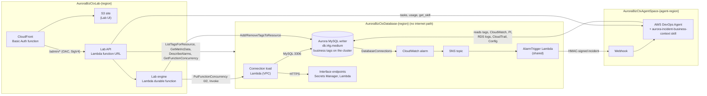

# Architecture

## Overview

## Stacks

| Stack | Deployed | Holds |
|---|---|---|
| `AuroraBizCtxAgentSpace-{agent-region}` | first | Shared `DevOpsAgentSpace`: monitoring and operator roles, Agent Space, operator app, AWS monitor association, eventChannel webhook (secret straight to Secrets Manager). The monitoring role also gets `config:GetResourceConfigHistory` for the skill's Recent changes line, `lambda:GetFunction` and `lambda:GetFunctionConcurrency` on the load function, and `rds:DownloadDBLogFilePortion` on the writer. `lambda:GetDurableExecution` is not granted, on purpose: the Lab engine's durable executions stay unreadable to the agent, keeping it out of the Lab's control plane |
| `AuroraBizCtxDatabase-{region}` | second, main stack (tracking tag) | VPC with two isolated subnets and no NAT; Aurora MySQL 3 cluster (`aurora-bizctx-cluster`) with one writer (`aurora-bizctx-writer`), Performance Insights on, storage encrypted, master secret generated; the five business tags on the cluster only; the connection load function in the VPC; Secrets Manager and Lambda interface endpoints in one AZ; the `DatabaseConnections` alarm; the alarm topic and the shared `AlarmTrigger` |
| `AuroraBizCtxLab-{region}` | third | Shared `LabEngine` (engine durable function + `live` alias, API function, one role) with this demo's `lab/`; the API's function URL (IAM auth, CloudFront only); the S3 site and the CloudFront distribution with the Basic Auth function |

## Data flows

### Inject a connection storm

1. The presenter chooses **Inject**; the Lab API starts one engine execution named
   `<scenario-id>-<epoch>` (HTTP 409 if another is running).
2. The engine's `inject` step sets the load function's reserved concurrency to 2 and invokes it
   asynchronously with the storm's start time. For the GDPR scenario it first tags the cluster
   `Compliance=GDPR`, `DataClassification=PersonalData`.
3. The load function reads the master secret through the Secrets Manager endpoint and opens TLS
   connections to the writer until it reaches 85 or the writer answers error 1040 (Too many
   connections). Every 5 seconds it reads its own reserved concurrency through the Lambda
   endpoint; at 0 it closes everything. A minute before its 15-minute limit it invokes itself
   again and closes its connections; the next invocation takes the freed slots.
4. `DatabaseConnections` (one-minute Maximum) stays above 60 for two datapoints, the alarm goes
   to ALARM, SNS notifies the shared trigger Lambda, which signs the incident with the webhook
   secret and posts it. AWS DevOps Agent opens an investigation with the skill loaded.
5. The engine waits on a callback for up to `autoRevertSeconds` (1800 s).

### Revert

- **Rollback**: the API resolves the execution's callback; the `revert` step runs at once.
- **Auto-revert**: the callback times out and the same `revert` step runs, with the page closed.
- `revert` sets reserved concurrency to 0 (the load closes its connections within seconds and
  any queued hand-over event is dropped: retry attempts 0, event age 2 minutes), then polls
  `DatabaseConnections` until the latest datapoint is under the threshold (up to 4 minutes; the
  engine's timeout is 6 minutes). For the GDPR scenario it removes `Compliance` and puts
  `DataClassification` back to `Confidential`.
- For the tags scenario, `revert` re-adds the five tags from `BASELINE_TAGS`, the same
  `cdk/lib/constants.ts` definition CDK used to tag the cluster.

### Is it injected?

Read from the live environment on every status poll, never stored:

| Scenario | Injected when |
|---|---|
| Connection storm on a business-critical cluster | load reserved concurrency > 0 and no `Compliance=GDPR` tag |
| Connection storm on a cluster tagged GDPR | the cluster is tagged `Compliance=GDPR` |
| Business tags missing | any of the five business tag keys is absent |

The conditions are disjoint, so one change shows on one card. When the condition is present
with no engine run owning it, the card reads "Injected outside the Lab" and Rollback reverts it
directly from the Lab API. That road uses each handler's `quick_revert`: switch the load off,
restore the tags, return. It does not wait for `DatabaseConnections` to settle, because the API
function runs behind CloudFront's 30-second origin timeout; the card's Connections fact shows
the metric catching up. The engine road keeps the waiting `revert`.

A failed inject leaves nothing behind: if starting the load fails, the switch is set back to 0,
and the GDPR scenario restores its tags before the error is reported. The storm card reads
"On, connections not held yet" when the switch is on but the writer is under the threshold
(the metric's one-minute lag right after Inject, or a load function that could not connect).

## Security model

- **No internet path for the database or the load function.** Isolated subnets, no NAT, no
  internet gateway. The writer is not publicly accessible; its security group admits 3306 from
  the load function's security group only. The endpoints admit 443 from the same group.
- **Least privilege.** The load function reads one secret and reads/invokes only itself. The Lab
  role tags only the cluster ARN, switches only the load function, and reads metrics and alarms.
- **Demo shortcuts, stated.** The load function connects as the master user (a dedicated user
  would need a SQL bootstrap step). Lab credentials are
  embedded in the CloudFront Function; anyone who can read the template can read them.
- **TLS to the writer.** The load function verifies the writer's certificate and hostname against
  the RDS global CA bundle, which the CDK bundling step downloads into the function asset (the
  function itself has no internet path).
- **Webhook secret.** Written by the shared provisioner straight into Secrets Manager; the deploy
  script passes only its ARN.

## Teardown

`destroy-all` switches the load off, destroys the Lab and database stacks (the cluster and its
secret have a Delete policy, no final snapshot), deletes the Lambda log groups created at run
time (Lab engine, Lab API, trigger, custom resource providers), then destroys the Agent Space
stack. The load function's and the webhook provisioner's log groups are stack resources.
