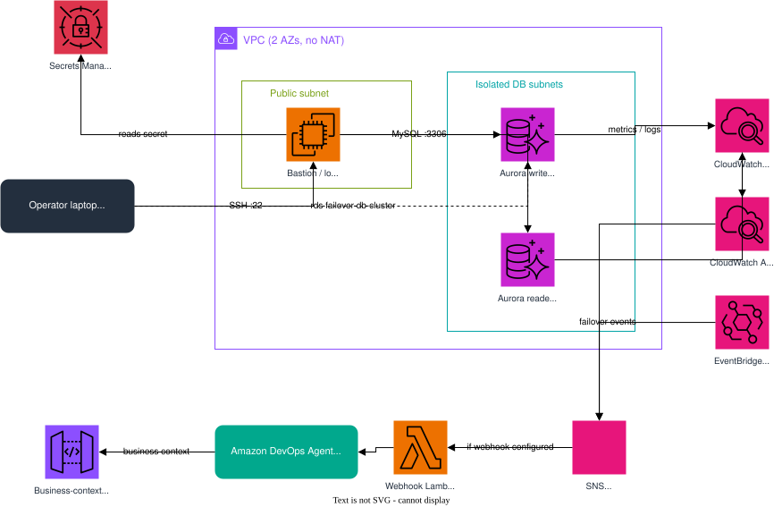

# Intelligent Aurora MySQL Incident Investigation with AWS DevOps Agent
*Your database degrades at 2 AM — instead of an on-call engineer digging through Performance Insights and error logs for 45 minutes, AWS DevOps Agent investigates automatically, finds root cause, and quantifies the business impact.*

## Overview

Automated root-cause analysis for Amazon Aurora MySQL incidents. When a CloudWatch alarm fires (or a failover event occurs), an SNS → Lambda webhook notifies **AWS DevOps Agent**, which reads CloudWatch metrics, Performance Insights, and the Aurora error/slow-query logs, correlates the signals, and enriches the finding with business context (dependent services, revenue-per-minute, SLA and compliance exposure, recent changes) using the [aurora-incident-business-context skill](https://github.com/aws/tools-for-devops-agent/tree/main/skills/aurora-incident-business-context) from the AWS DevOps Agent tools catalog. The result is an actionable incident report — not a wall of raw logs.

This is the database sibling to the EKS and Site-to-Site VPN DevOps Agent investigation demos.

## DevOps Agent Features Demonstrated

| Feature | How it's shown |
|---------|----------------|
| **Automated incident investigation** | Inject a failure → a CloudWatch alarm fires → the agent opens and runs an investigation on its own, no prompting |
| **On-demand chat** | Ask the agent about the cluster in the Operator App → it queries CloudWatch + RDS and returns a structured root-cause report |
| **Business-context enrichment (skill)** | The published `aurora-incident-business-context` skill has the agent read the cluster's business tags, AWS Config history, and CloudTrail for dependent services, cost of downtime, SLA and compliance exposure, and recent changes — context it can't get from metrics alone |
| **Multiple incident types** | Four reliable scenarios — connection storm, CPU spike, deadlock, failover — each mapped to its own alarm/event |

## At a Glance
- **Duration**: \~25 minutes (Agent Space setup + infra deployment; Aurora cluster creation is \~10-15 min of that)
- **Difficulty**: Intermediate
- **Target Audience**: DBREs, SREs, Cloud Operations, TAMs running database-focused customer conversations
- **Key Technologies**: Amazon Aurora MySQL, CloudWatch, CloudWatch Database Insights (formerly Performance Insights), SNS, Lambda, EventBridge, CDK (Python), AWS DevOps Agent, DevOps Agent skills
- **Estimated Cost**: \~$0.17/hr for the infrastructure while it runs, plus AWS DevOps Agent usage (\~$4 per 8-minute investigation). A 2-hour demo with three investigations costs \~$12. This demo is meant to be deployed, tested, and torn down. See [Cost Estimate](#cost-estimate).

## Interactive Demo

## Business Value

Database incidents are high-stakes and time-sensitive: a stalled writer blocks checkout, a connection storm takes down every dependent service, and a replica-lag spike quietly serves stale data. Mean-time-to-resolution is dominated by *triage* — figuring out *what* broke and *who* it affects. This demo shows how DevOps Agent collapses that triage from tens of minutes of manual log-reading into an automated, business-aware investigation, so engineers act on conclusions instead of assembling them.

## What You'll See

1. A healthy Aurora MySQL cluster (writer + reader) with CloudWatch alarms in OK state.
2. Inject a realistic failure with one command (e.g. a connection storm).
3. A CloudWatch alarm transitions to ALARM → SNS → Lambda webhook → DevOps Agent.
4. DevOps Agent opens an investigation on its own, reads metrics + logs, and identifies root cause.
5. The `aurora-incident-business-context` skill adds business context from the cluster's tags, AWS Config, and CloudTrail: dependent services, $/minute impact, SLA status, compliance exposure, and recent changes.
6. A complete incident report, plus on-demand follow-up chat ("what are the remediation steps?").

## How Incident Detection Works

```
Inject a failure (e.g. connection storm)
        │
        ▼
Aurora metric breaches → CloudWatch Alarm fires (ALARM)
        │   (RDS failover uses an EventBridge rule instead of a metric alarm)
        ▼
SNS topic (aurora-demo-alarm) notifies the webhook Lambda
        │
        ▼
Lambda signs the payload (HMAC-SHA256) → calls the DevOps Agent webhook
        │
        ▼
DevOps Agent investigates: CloudWatch metrics, Performance Insights, Aurora logs
        │
        ▼
Root cause + business context (via the skill) delivered — no human in the loop
```

## Prerequisites
- AWS CLI v2.31+ configured with credentials
- Node.js 20+ and Python 3.9+ (for CDK)
- An EC2 key pair in the target region
- OpenSSH client (`ssh`/`scp`) — preinstalled on macOS/Linux and Windows 10+
- AWS DevOps Agent access in your account/region
- **CDK bootstrap** — handled for you: `deploy-all` runs the repo's shared deploy script, which bootstraps the account and region if needed
- **DevOps Agent region** — the Agent Space is created in your deploy region. `AWS::DevOpsAgent` isn't available everywhere, so use a supported region (e.g. `us-west-2`, `us-east-1`)

## Deployment (Quick Start)

Two commands. Step 1 configures AWS DevOps Agent; step 2 deploys the Aurora
environment and automatically picks up the webhook from step 1.

### 1. Set up the DevOps Agent (hands-free)
```bash
bash scripts/setup-devops-agent.sh <region>           # macOS/Linux
# ./scripts/setup-devops-agent.ps1 -Region <region>    # Windows
```
This **creates (or reuses) everything automatically** via the AWS SDK — no console
clicking:
- an Agent Space named `aurora-demo`
- the two required IAM roles (monitoring + operator)
- the Operator App (web console access)
- your AWS account connected as a monitored cloud source
- a generic HMAC **webhook**, whose URL + secret are saved to `.devops-agent.env`
- the [aurora-incident-business-context skill](https://github.com/aws/tools-for-devops-agent/tree/main/skills/aurora-incident-business-context), downloaded from `aws/tools-for-devops-agent` at a pinned, reviewed commit, plus the one extra permission it needs (`config:GetResourceConfigHistory`) on the Agent Space role

The script installs the skill in the Agent Space automatically (or updates it if
it's already there). If your boto3 is too old to include the skill API, it saves
`aurora-incident-business-context.zip` in the demo folder instead: in the DevOps
Agent web app, open the `aurora-demo` Agent Space, go to **Skills**, choose
**Upload**, and select the zip. Upgrading boto3 (`pip install -U boto3`) and
re-running the script also works.

> If your AWS SDK build predates the DevOps Agent API, the script detects that and
> prints the one-time console steps instead — the rest of the demo is unchanged.

### 2. Deploy the Aurora demo
```bash
# macOS / Linux — auto-loads the webhook from .devops-agent.env
bash deploy-all.sh --key-file ~/.ssh/your-key.pem
```
```powershell
# Windows
./deploy-all.ps1 -KeyFile "$HOME\.ssh\your-key.pem"
```
You don't need to copy/paste the webhook — `deploy-all` reads `.devops-agent.env`
automatically. (You can still pass `--webhook-url` / `--webhook-secret` explicitly,
or omit step 1 entirely to run the environment without agent notifications and just
watch alarms + Performance Insights.)

## Running Scenarios
```bash
# Inject
bash scripts/inject-failure.sh connection-storm --key-file ~/.ssh/your-key.pem

# Roll back
bash scripts/inject-failure.sh connection-storm --key-file ~/.ssh/your-key.pem --rollback

# Status (injections + alarm states)
bash scripts/inject-failure.sh status --key-file ~/.ssh/your-key.pem
```

## Watching the Investigation

Open your Agent Space in the AWS DevOps Agent console (same region you deployed in):
```
https://<region>.console.aws.amazon.com/aidevops/home?region=<region>
```
Select the `aurora-demo` space. After you inject a scenario, the alarm → webhook path
opens a new investigation **automatically** within 1–3 minutes (titled
`ALARM: "aurora-demo-…" in <Region>`) — click into it to watch the agent read the
metrics, correlate signals, and produce a root-cause report with no prompting.

The business impact from the skill appears in the investigation **summary**:
the recent change shows up as a finding, and the rest is usually listed under
**Other Gaps** as "Impact on dependent services unverified", "Business cost
unconfirmed", and "Reporting obligation undetermined", each with the tag values
and evidence it used.

You can also start an investigation **on demand** from the Agent chat, e.g.:

> Investigate the Amazon Aurora MySQL cluster `aurora-demo-cluster` in `<region>`. The
> `aurora-demo-connections-high` alarm is firing on the writer `aurora-demo-writer`.
> Find the root cause and recommend remediation.

Tip: CloudWatch metrics lag \~2–3 minutes, so give an active incident a moment before
asking the agent to investigate (or ask it to "re-check" to pick up the peak).

## Run the Demo

A suggested walkthrough:

1. **Show a healthy cluster** — open the DevOps Agent console + CloudWatch Alarms; all `aurora-demo-*` alarms are OK.
2. **Inject an incident** — e.g. `bash scripts/inject-failure.sh connection-storm --key-file ~/.ssh/your-key.pem` (see [Running Scenarios](#running-scenarios)).
3. **Watch the alarm fire** — the matching alarm flips to ALARM in \~1–3 min.
4. **Watch the agent investigate** — a new investigation appears in the Agent Space on its own (see [Watching the Investigation](#watching-the-investigation)); open it to see the root-cause reasoning and the business impact from the skill.
5. **Roll back** — re-run the inject with `--rollback`; the alarm returns to OK.

Recommended scenarios for a live demo: **connection-storm, cpu-spike, deadlock, failover** — the four most reliable.

## Failure Scenarios

| Scenario | What it does | Signal / Alarm |
|----------|--------------|----------------|
| `connection-storm` | Opens \~200 held connections on the writer | `DatabaseConnections` high → `aurora-demo-connections-high` |
| `cpu-spike` | Runs CPU-burn query workers | `CPUUtilization` high → `aurora-demo-cpu-high` |
| `deadlock` | Two transactions lock rows in opposite order | InnoDB `Deadlocks` → `aurora-demo-deadlocks` |
| `failover` | `aws rds failover-db-cluster` — swaps writer/reader | RDS failover event via EventBridge → SNS |
| `memory-pressure` | Large sorts / temp tables (best-effort) | `FreeableMemory` low → `aurora-demo-memory-pressure` *(dedicated)* |
| `replica-lag` | Heavy write churn (best-effort) | `AuroraReplicaLag` high → `aurora-demo-replica-lag` *(dedicated)* |

Dedicated alarms start with their actions disabled; the inject script enables them before injecting and disables them on rollback (so they only fire for their scenario). `memory-pressure` and `replica-lag` are best-effort (harder to force on a larger instance) — the four core scenarios are the most demo-reliable.

## Business Context Skill

The demo uses the published [`aurora-incident-business-context`](https://github.com/aws/tools-for-devops-agent/tree/main/skills/aurora-incident-business-context) skill. The demo doesn't keep its own copy: `setup-devops-agent` downloads the skill from `aws/tools-for-devops-agent` at a pinned commit, so the catalog is the single source of truth.

The skill reads these tags, which the CDK stack sets on the Aurora cluster:

| Tag | Demo value | Used for |
|---|---|---|
| `DependentServices` | `checkout-service:CRITICAL - order-history-api:HIGH - analytics-etl:MEDIUM` | Affected services and criticality |
| `OnCallTeam` | `Data Platform / DBRE` | Who to notify |
| `RevenuePerMinute` | `5100` | Estimated cost of downtime |
| `SLAThresholdMinutes` | `20` | SLA breached, or minutes remaining |
| `DataClassification` | `Confidential` | Compliance exposure (for the compliance owner to decide) |

The values are illustrative. No `checkout-service` compute exists in the demo, so the skill should flag the `DependentServices` tag as unverified, which shows it cross-checks tags against real connection evidence instead of repeating them. For recent changes, it checks AWS Config history and CloudTrail for parameter group, cluster, instance, and failover changes.

## Architecture



The editable source is [`architecture.drawio`](architecture.drawio).

- **Network**: an Aurora MySQL cluster (writer + reader) sits in isolated subnets; a public bastion/load-generator injects scenarios over the MySQL protocol. No NAT gateway (cost).
- **Detection**: CloudWatch alarms (connections, CPU, deadlocks, memory, replica-lag) plus an EventBridge failover rule fan into a single SNS topic.
- **Investigation**: a conditional webhook Lambda notifies AWS DevOps Agent, which reads CloudWatch metrics, Performance Insights, and Aurora logs, then uses the `aurora-incident-business-context` skill to add business context from the cluster's tags, AWS Config, and CloudTrail (dependencies, cost impact, SLA, compliance, recent changes).

See [ARCHITECTURE.md](ARCHITECTURE.md) for the full component breakdown and Well-Architected design notes.

## Project Structure

```
aurora-mysql-incident-investigation-devops-agent/
├── deploy-all.sh / deploy-all.ps1      # Deploy the Aurora environment (shared CDK deploy script)
├── scripts/
│   ├── setup-devops-agent.sh / .ps1    # Agent Space, IAM roles, webhook, business-context skill
│   ├── devops_agent_setup.py           # The AWS SDK calls behind setup-devops-agent
│   ├── inject-failure.sh / .ps1        # Inject, roll back, or check a failure scenario
│   └── cleanup.sh / .ps1               # Tear everything down
├── bastion-scripts/                    # Scenario scripts copied to the bastion
├── infrastructure/cdk/                 # CDK app (Python): VPC, Aurora, bastion, alarms, webhook Lambda
├── architecture.svg / .drawio          # Architecture diagram
├── ARCHITECTURE.md                     # Component breakdown and design notes
└── storylane-script.md                 # Script for the interactive walkthrough
```

## Cost Estimate

On-demand prices in us-west-2 (checked with the AWS Pricing API). Other regions differ slightly.

| Component | Price | While running |
|---|---|---|
| Aurora MySQL writer + reader (`db.t4g.medium` × 2) | $0.073/hr each | $0.146/hr |
| Bastion (`t3.micro`) | $0.0104/hr | $0.010/hr |
| Public IPv4 address (bastion) | $0.005/hr | $0.005/hr |
| Aurora storage and I/O | $0.10 per GB-month, $0.20 per million I/Os | <$0.01/hr for the demo data |
| CloudWatch alarms (6), Secrets Manager (1 secret) | $0.10 per alarm-month, $0.40 per secret-month | \~$1/month |
| Lambda, SNS, EventBridge, CloudWatch Logs | Per request or GB | <$0.05 per demo |
| CloudWatch Database Insights (Standard) | Included | $0 |
| **Infrastructure total** | | **\~$0.17/hr (\~$125/month if left running)** |
| AWS DevOps Agent | [$0.0083 per agent-second](https://aws.amazon.com/devops-agent/pricing/) | \~$4 per 8-minute investigation |

**Demo run:** \~2 hours of infrastructure plus three investigations is \~$12. Most of that is DevOps Agent usage, so the cost depends mainly on how many investigations you run.

**Keep costs down:** run `cleanup` as soon as you're done, inject only the scenarios you plan to show, and roll each one back so the alarm doesn't open repeat investigations.

## Cleanup

Tear everything down when finished:
```bash
bash scripts/cleanup.sh <region>      # macOS/Linux
# ./scripts/cleanup.ps1 -Region <region>                # Windows
```
Cleanup destroys the CDK stack **and** removes the Agent Space + IAM roles that
`setup-devops-agent` created, including the skill installed in that Agent Space.

## Troubleshooting

| Issue | Cause | Fix |
|---|---|---|
| Alarm doesn't flip to ALARM after inject | CloudWatch metrics lag \~2–3 minutes behind real time | Wait 2–3 min after injecting before checking. Run `bash scripts/inject-failure.sh status --key-file <path>` to confirm the injector is actually running on the bastion. |
| The investigation shows no business impact | The skill isn't installed in the Agent Space, or the cluster has no business tags | Re-run `setup-devops-agent` and check that it prints "Skill 'aurora-incident-business-context' installed" or "updated". In the DevOps Agent console, check the Agent Space's **Skills** list. Check the cluster's tags in the RDS console (**Tags** tab). |
| `--rollback` takes a long time, or `status` still says "running" afterwards | The rollback stops the load on the bastion but can be slow to return, and the status record can lag behind | If it hangs, press Ctrl+C. Check that the alarm is back to OK and that `status` shows `threads_connected` near its normal level (around 10). |
| `deploy-all` hangs on "Waiting for SSH..." | Bastion still booting, or `--ssh-cidr` doesn't match your current IP | Wait — it retries for \~5 minutes. If it still fails, confirm your current public IP matches the security group rule, or rerun with `--ssh-open` for the demo (never leave this on outside a live session). |

## Security Notes (demo-grade)

- The bastion is internet-facing on port 22; `deploy-all` restricts SSH to your current IP by default (`--ssh-open` widens it — avoid outside a demo).
- The Aurora cluster is **not** publicly accessible, is encrypted at rest, and only accepts MySQL from the bastion security group.
- Master credentials are generated into AWS Secrets Manager; the bastion reads them via an instance role. No passwords are stored in code or on disk.

## Contributing

We welcome community contributions! Please see [CONTRIBUTING.md](../../CONTRIBUTING.md) for guidelines.

## Security

See [CONTRIBUTING](../../CONTRIBUTING.md#security-issue-notifications) for more information.

## License

This library is licensed under the MIT-0 License. See the [LICENSE](../../LICENSE) file.
