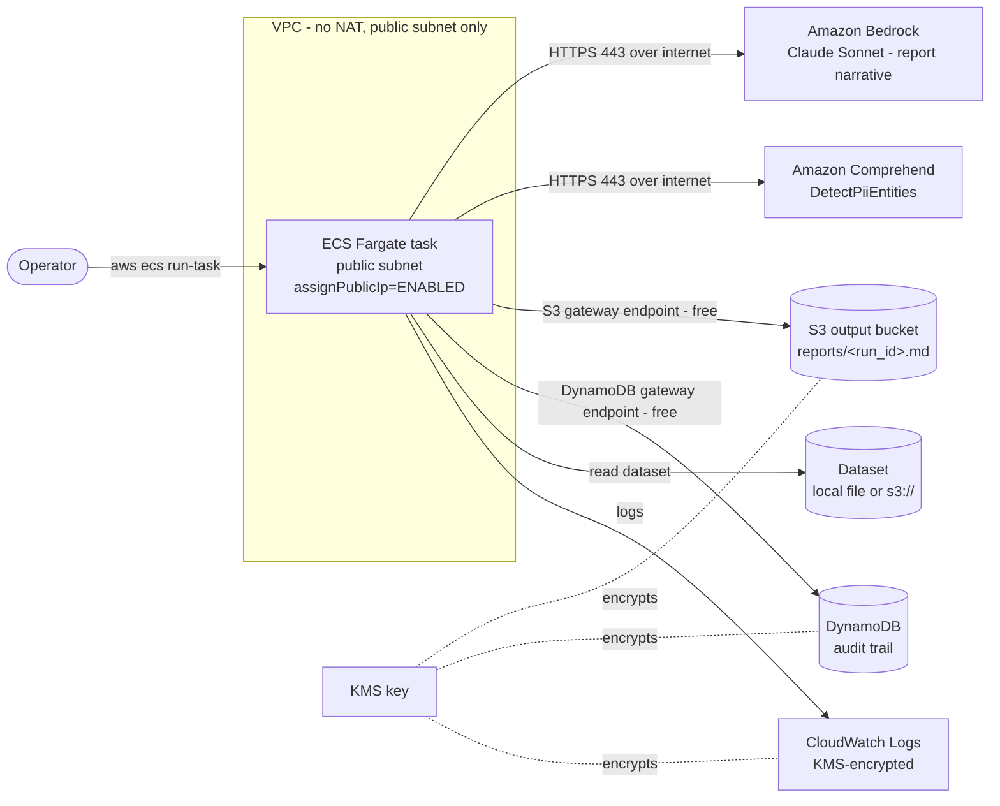

# Architecture — AI Dataset Training Audit (DART)

DART is a pre-flight validator for LLM fine-tuning datasets. An operator runs a
short-lived ECS Fargate task that scans a dataset (JSONL/CSV/Parquet, local or
`s3://`), runs seven analysis checks, and returns a **GO / GO WITH FIXES /
NO-GO** verdict with a **0–100 quality score** and a Markdown report — before
any GPU compute is spent on training.

## Architecture diagram



The task runs in a **public subnet** with a public IP and an explicit security
group (no ingress; egress TCP 443 only). Bedrock and Comprehend are reached over
the public internet — they are not gateway-endpoint services — while S3 and
DynamoDB are reached through **free gateway VPC endpoints**. This is the no-NAT
networking tradeoff described below.

## Networking tradeoff (no NAT gateway)

The VPC is created with `natGateways: 0` and a **public subnet only**. The
alternative — private subnets with a NAT gateway for internet egress to Bedrock
and Comprehend — carries a standing hourly cost plus per-GB data processing
charges for every hour the VPC exists, whether or not a task is running.

- **Chosen (Option B): public subnet, no NAT.** Zero standing network cost. The
  task gets a public IP and reaches Bedrock/Comprehend directly over 443. Egress
  is constrained by the task security group (443 only, no ingress), and S3 and
  DynamoDB stay on free gateway endpoints and never traverse the internet.
- **Production alternative: private subnets + NAT (or interface endpoints).** A
  production deployment would typically place the task in private subnets with a
  NAT gateway, or add interface (PrivateLink) endpoints for Bedrock and
  Comprehend, trading cost for the task never holding a public IP.

For a short-lived, on-demand batch task this demo favors zero standing cost. The
tradeoff is documented here and in the README so the production-hardening path is
explicit.

## Reproducible scoring formula

The quality score is deterministic and reproducible from the seven tools'
outputs. It is computed in
`agent/tools/generate_preflight_report.py` (`_compute_quality_score`).

### Category weights (sum = 100)

| Category | Weight | Sub-score source |
|---|---:|---|
| Schema validity | 20 | `1.0` if `viability.schema_check.schema_valid` else `0.4` |
| Completeness | 15 | `1 - min(1, empty_record_count / total_records)` |
| Uniqueness | 20 | `1 - min(1.0, duplicate_rate)` |
| PII safety | 20 | `1.0` if `scan_complete and not pii_found`; `0.0` if `pii_found` **or** `scan_complete is False` |
| Training viability | 15 | `0.0` if `records_exceeding_context > 0` **or** `leakage_detected`; else `1.0` if `size_check.meets_minimum` else `0.5` |
| Cost efficiency | 10 | `1 - min(1.0, max(0.0, savings_percent) / 100)`; **`1.0`** when `savings_percent` is absent/`None` |

Each category yields a sub-score in `[0.0, 1.0]`. The base quality score is:

```
quality_score = round(100 * Σ(weight_i * subscore_i) / 100), clamped to [0, 100]
```

### Critical-finding cap

Independently of the weighted sum, **if any finding has severity `critical`**,
the final score is set to `min(score, 49)`:

- `PII-001` — PII found
- `PII-000` — PII scan did not complete (treated identically to PII found, never
  "clean")
- `LEAK-001` — train/validation leakage detected
- `TOKEN-001` — records exceed the model context window

The 49-cap is the **single mechanism** that enforces the original's
"any critical → NO-GO" rule: it pushes the verdict into the NO-GO band
regardless of category weights. The per-category zeroing of PII safety and
Training viability is retained only for score monotonicity on non-critical
boundaries; it is not what decides the verdict.

### Verdict bands

| Score | Verdict |
|---|---|
| 80–100 | GO |
| 50–79 | GO WITH FIXES |
| 0–49 | NO-GO |

`_determine_recommendation(score)` returns the band directly, so **score and
verdict are mutually consistent by construction** — they can never disagree.

### Behavioral notes (read before interpreting a score)

- **Only critical findings change the band.** Under this weighted model,
  `high`/`medium`/`low` findings (including `DEDUP-001` and `EMPTY-001`, both
  `high`) influence the score **proportionally through their category sub-score**
  and do **not** by themselves force a lower band. Only a `critical` finding
  changes the band, via the 49-cap. Consequently a dataset with substantial
  duplicates/empties but no critical finding can still land in the GO band. This
  is an intentional difference from the original's severity-derived verdict and
  is documented here so it is not surprising.
- **Cost-efficiency direction is intentional.** A **high** `savings_percent`
  means the dataset is *currently wasteful* (large fixable duplicate/empty cost),
  so it scores **lower** on cost efficiency; a clean dataset with
  `savings_percent = 0` scores `1.0`. This reads opposite to a naive "high
  savings = good" interpretation. When `savings_percent` is absent or `None`
  (e.g. a partial cost estimate), the sub-score defaults to **`1.0`** (neutral —
  no penalty for an absent signal), and the raw value is clamped to `[0, 100]`
  before the formula.

### Findings catalog

| ID | Severity | Category |
|---|---|---|
| `PII-001` | critical | PII safety |
| `PII-000` | critical | PII safety |
| `LEAK-001` | critical | Training viability |
| `TOKEN-001` | critical | Training viability |
| `DEDUP-001` | high | Uniqueness |
| `EMPTY-001` | high | Completeness |
| `SCHEMA-001` | medium | Schema validity |
| `SIZE-001` | medium | Training viability |
| `ENC-001` | low | Schema/encoding |

Findings are sorted by `severity_order = {critical:0, high:1, medium:2, low:3}`.

## Data-handling invariants

These invariants hold regardless of configuration:

- **Never send raw dataset records to Bedrock.** The only Bedrock call is the
  report narrative in `generate_preflight_report`, which builds a payload of up
  to eight **finding summaries** (`severity/title/detail/action/auto_fixable`)
  plus dataset **metadata** (path, model, score, costs) — never record text. The
  six analysis tools perform no Bedrock inference; PII detection is Amazon
  Comprehend, everything else is local compute.
- **The original input is never modified or deleted.** `apply_safe_fixes` and
  `scan_pii` always write to a **new** output path (auto-generated when not
  supplied) and never open the input for writing.
- **Path safety.** Every tool routes caller-supplied paths through
  `tools/_validation.py`: S3 URIs must match a strict `s3://bucket/key` shape,
  keys may not start with `/` or contain `..`, and inputs are checked against the
  `ALLOWED_S3_BUCKETS` / `ALLOWED_S3_PREFIXES` / `ALLOWED_LOCAL_BASE_DIR`
  allowlists when those are set. Temporary S3 downloads are always removed in a
  `finally` block.

## MODEL_ID / CRIS note

The CDK stack and Terraform `locals` compute the cross-region inference (CRIS)
prefix inline from the deploy region (`us`/`eu`/`apac`, else `global`) and inject
the prefixed id as the container `MODEL_ID` env var. The container-local
`agent/aws_utils.py` is a copy of `shared/utils/aws_utils.py` (the sanctioned
container-local copy, since the shared module is outside the Docker build
context). **When the shared util's default model or prefix mapping changes, the
inline mapping in `cdk/lib/dataset-training-audit-stack.ts`, the Terraform
`locals` in `terraform/main.tf`, and `agent/aws_utils.py` must all be updated
together.**
