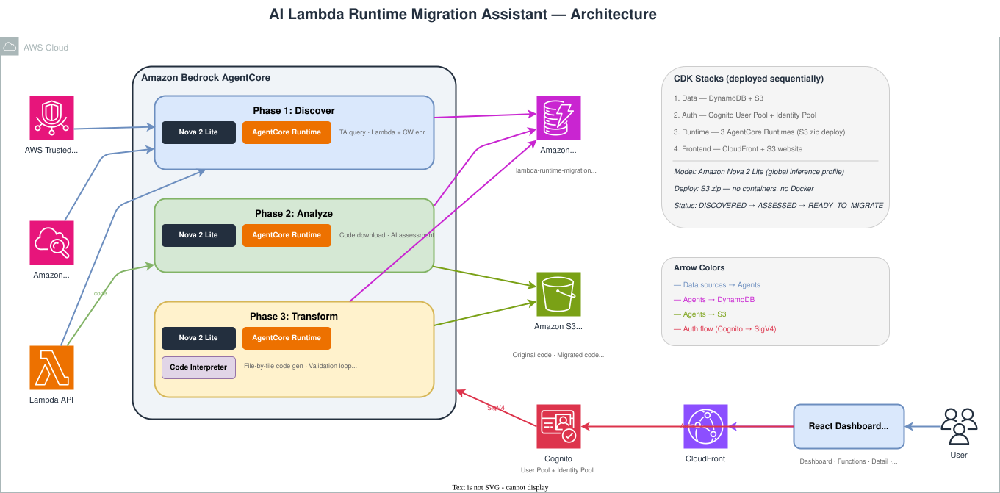

# AI Lambda Runtime Migration Assistant
*Discover and assess AWS Lambda functions running deprecated runtimes with a Lambda durable function and Amazon Nova, then plan each migration from a scoped inventory*

## Overview

AWS Lambda periodically deprecates older runtimes, leaving teams with dozens or hundreds of functions to evaluate and migrate. This demo showcases an automated triage pipeline: a single **Refresh** runs **Discover + Assess** as one checkpointed [Lambda durable function](https://docs.aws.amazon.com/lambda/latest/dg/durable-functions.html) — it determines which accounts to scan across your AWS Organization, checks each account's Support tier, finds deprecated-runtime functions via Trusted Advisor, enriches each with Lambda API and CloudWatch data, and runs an AI-powered code assessment with Amazon Nova. The results land in a DynamoDB inventory the dashboard presents as a scoped, filterable table ranked by urgency.

From that inventory you select functions and click **Migrate**. For each one, a durable orchestrator resolves the source repository from the function's tags, runs an AWS Transform managed runtime-upgrade transformation inside AWS CodeBuild, and pushes the result as a new branch (`lambda-migration/<target>-<job>`) in that repository. `main` is never touched and no Lambda function is modified: the row ends as **Branch ready** with a link to the branch; opening the pull request, reviewing and merging happen in your repository host.

A React dashboard built with the Cloudscape Design System provides the inventory table, the durable **Refresh** and **Migration** step views, an Activity log and a **How it works** reference page.

## At a Glance

- **Duration**: ~5 minutes deployment (direct code deploy — no container build)
- **Difficulty**: Intermediate
- **Target Audience**: DevOps Engineers, Platform Engineers, SREs
- **Key Technologies**: AWS Lambda durable functions, Amazon Nova, Amazon API Gateway (HTTP API), Amazon Cognito, Amazon CloudFront, Cloudscape Design System
- **Estimated Cost**: ~$5 for 1,000 functions (see [Cost Estimate](#cost-estimate))

## Architecture

An editable draw.io diagram is available at [img/architecture.drawio](img/architecture.drawio).



The browser holds no AWS credentials. The React SPA calls an HTTP API protected by a Cognito JWT authorizer; the API Lambda starts (or adopts) the durable **Refresh** execution and reads the inventory. The durable pipeline Lambda performs the 5-step org-wide discovery and assessment, with each step checkpointed so a mid-run failure resumes rather than restarts. See [ARCHITECTURE.md](ARCHITECTURE.md) for the full design.

## Prerequisites

- AWS CLI v2.31.13+ ([Installation Guide](https://docs.aws.amazon.com/cli/latest/userguide/getting-started-install.html))
- Node.js 20+
- Python 3.13+
- AWS CDK 2.1030.0+
- AWS Business or Enterprise Support plan in **each account you scan** (required for Trusted Advisor API access). Accounts on Basic/Developer Support are skipped and reported as "not checked" — see [The Refresh Pipeline](#the-refresh-pipeline-durable-5-step-discover--assess)
- AWS credentials configured with permissions for CloudFormation, Lambda, S3, DynamoDB, Cognito, API Gateway, Bedrock, and IAM
- Amazon Bedrock access to Amazon Nova enabled in your target region ([Model access](https://docs.aws.amazon.com/bedrock/latest/userguide/model-access.html))

The deploy script verifies your credentials with `aws sts get-caller-identity`; admin access is required to deploy the demo.

## Quick Start

### Deploy

**Windows (PowerShell):**
```powershell
.\deploy-all.ps1
```

**macOS/Linux:**
```bash
chmod +x deploy-all.sh scripts/build-frontend.sh
./deploy-all.sh
```

The script deploys five CDK stacks (Data → Auth → Pipeline → Api → Frontend) through the shared deployment scripts, builds the React frontend with the API URL and Cognito config, and prints the CloudFront dashboard URL.

Single-account is the default, but multi-account is decided at **runtime**, not by a deploy flag: a plain `deploy-all` already leaves a pipeline that fans out to whatever AWS Organization it can read. When the hub account is the organization's management account (or a delegated administrator), every Refresh enumerates the active member accounts and scans them; a standalone account degrades cleanly to the hub alone. To additionally roll the read-only spoke role out to member accounts (so the hub can assume into them), pass `-MultiAccount` (PowerShell) / `--multi-account` (Bash); a read-only preflight runs first, then the optional Org/Spoke StackSet. See [Multi-account scanning](#multi-account-scanning).

### Create a Dashboard User

The deployment output includes the commands to create a Cognito user. Replace the email and password:

```bash
aws cognito-idp admin-create-user \
  --user-pool-id <USER_POOL_ID> \
  --username admin \
  --user-attributes Name=email,Value=admin@example.com Name=email_verified,Value=true \
  --message-action SUPPRESS --no-cli-pager

aws cognito-idp admin-set-user-password \
  --user-pool-id <USER_POOL_ID> \
  --username admin \
  --password "YourSecurePassword123!" \
  --permanent --no-cli-pager
```

### Use the Dashboard

1. Open the CloudFront URL from the deployment output
2. Sign in with the credentials you just created
3. Click **Scan functions** to run the 5-step durable pipeline; watch the per-step progress as the durable execution advances
4. Filter the inventory by account, region, or tag and sort by urgency
5. Select functions and click **Migrate** (requires the optional Transform build plane, see below); each function ends as *Branch ready* with a link to the pushed upgrade branch, *No changes*, *Rejected* or *Failed*. The **How it works** page explains every step, status and code.

## The Refresh Pipeline (durable 5-step Discover + Assess)

A single **Refresh** runs as one Lambda durable execution with five checkpointed steps. The dashboard renders these exact step labels as it polls the execution history:

1. **Determine the accounts to scan** — resolve the scope into concrete accounts. Any explicit accounts in the refresh scope win; otherwise AWS Organizations is queried for the active member accounts. The hub account is always included and scanned with its own credentials; member accounts are reached through the read-only spoke role. A standalone account (or one that cannot read Organizations) degrades cleanly to the hub alone.
2. **Check each account's AWS Support tier** — one unit per account. Trusted Advisor requires a Business or Enterprise Support plan, so each account's tier is inferred first (as the ceiling of the severities it can open). Accounts on Basic/Developer/unknown tiers are **not dropped**: they skip discovery and are reported as "not checked" (surfaced as a counter on the My Functions hero, never a list).
3. **Discover deprecated-runtime functions via Trusted Advisor** — for each TA-eligible account × region, query check `L4dfs2Q4C5` for deprecated-runtime Lambda functions, enrich each with Lambda API configuration and CloudWatch metrics, compute a rule-based priority score and let Nova (constrained decoding / tool use) adjust it by at most ±15.
4. **Assess migration complexity and risks** — one unit per function. Download the deployment package (source plus manifests), send it to Nova for an AI-powered assessment, and store the result in the inventory.
5. **Summarize findings and update the inventory** — assemble the bounded run summary (counts, per-account tiers, the accounts-not-checked list) and finalize the inventory.

Each account and each function is processed as its own checkpointed unit, so a failure on one account or function fails only that unit — the run reports it and continues. One unreachable account never fails the whole run.

**Discover details**
- **Priority scores**: 0–100 with reasoning — CRITICAL (80+), HIGH (60–79), MEDIUM (40–59), LOW (20–39), INACTIVE (0–19) — a rule-based base score adjusted by Nova by at most ±15 from tags and names
- **Container image functions**: skipped (cannot migrate via code)

**Assess details**
- **AI assessment**: classifies complexity (LOW/MEDIUM/HIGH), identifies deprecated APIs, breaking changes, and dependency issues
- **Target runtime**: fixed per language family by the managed transformation (nodejs24.x, dotnet10, python3.13); the assessment does not suggest one

## Multi-account scanning

Multi-account is decided at runtime, so there is nothing to turn on for the scan itself — the hub account always scans whatever AWS Organization it can read:

- **Single-account (default)** — a standalone account, or an account that is not the organization's management/delegated administrator, degrades to scanning the hub alone. No error is surfaced; this is a normal outcome.
- **Organization-wide** — when the hub is the management account (or a delegated administrator), every Refresh enumerates the active member accounts via `organizations:ListAccounts`, scans the hub with its own credentials, and assumes a fixed read-only role (`LambdaRuntimeMigrationScanRole`) in each member account. The hub-side grants are always attached and are harmless in single-account (no org to list, no spoke roles to assume).
- **Rolling out the spoke role** — `-MultiAccount` / `--multi-account` does not change the scan. It runs a read-only preflight, then deploys the optional Org/Spoke StackSet (`LambdaRuntimeMigrationOrg-<region>`) that installs the read-only spoke role across the org (hub excluded) so the hub can assume into member accounts. The set of read/scan actions is single-sourced in `cdk/lib/scan-permissions.ts`, so the hub role and the spoke role cannot drift.

Per-account Support tier is always reported. An account without Business/Enterprise Support is counted as "not checked (Basic/Developer tier)" on the hero rather than silently omitted, so an empty result reads as "not checked" and never as "nothing found".

## Migrating a function (AWS Transform)

The optional **Transform** build plane (`scripts/deploy-transform.ps1` / `.sh`, opt-in via `--context transform=true`) runs an [AWS Transform](https://docs.aws.amazon.com/transform/latest/userguide/) managed runtime-upgrade transformation against a function's source repository inside AWS CodeBuild. A migration is one durable execution with three steps per batch, shown live in a collapsible **Migration steps** card on My functions:

1. **Prepare the migration batch** — mint the batch id, apply the 50-function per-run cap (extra selections are reported, never silently dropped).
2. **Resolve source repositories** — read each function's repository (and optional branch) tag configured in Settings, verify the repository and branch exist, use the family's target runtime. A function that cannot be resolved is **Rejected** with a code (no repository tag, repository or branch not found, unsupported runtime, access denied, already in progress).
3. **Transform with AWS Transform** — start a CodeBuild job that runs the `atx` CLI on a fresh clone. The build pushes the upgrade branch `lambda-migration/<target>-<job>` to the repository when the transformation produced a diff and reports back through a durable callback: **Branch ready**, **No changes**, or **Failed** (transformation failed, push failed, timed out).

The flow ends with the pushed branch. `main` is never touched and no live function is modified; open the pull request, review and merge in your repository host. After you deploy the merged code, Trusted Advisor stops reporting the function and the next scan marks it **Migrated**. The card persists across navigation and reloads (it re-attaches to the most recent batch) and the inventory refreshes every 30 seconds while a batch runs. The **How it works** page lists every step, status and rejection/failure code.

### Transform region selection (automatic)

AWS Transform custom is available in only [a subset of Regions](https://docs.aws.amazon.com/transform/latest/userguide/regions.html) (N. Virginia, Frankfurt, London, Mumbai, Sydney, Tokyo, Seoul, Canada Central). Your deploy region may not be one of them (e.g. `eu-west-3`), and there is **no way to test Transform availability ahead of time** — the AWS CLI has no `transform` service, Transform is not published in SSM global-infrastructure, and the only component that knows is the `atx` CLI itself, which we deliberately do **not** require as a setup prerequisite (it is installed inside CodeBuild at migration time, not on your machine).

So the demo does **not** probe — it picks a Transform region automatically from your deploy region's geography, the same way Bedrock cross-region inference profiles are chosen:

- If your deploy region **is** a Transform region, it is used directly.
- Otherwise the nearest in-geo Transform region is used (`eu-*` → Frankfurt, `us-*`/`ca-*` → N. Virginia, `ap-south-*` → Mumbai, `ap-southeast-*` → Sydney, other `ap-*` → Tokyo, everything else → N. Virginia). Frankfurt routes Bedrock inference back across the EU (including `eu-west-3`), so EU data residency is preserved.

The migration build always **tries your deploy region first** and only falls back to the computed region if `atx` reports the deploy region is unsupported — so when AWS adds Transform to your region, it is used automatically with no change here. The mapping lives in the shared `get_transform_region` helper (`shared/utils/aws_utils.py`).

### Forcing a specific Transform region

To override the automatic choice, set the **`TRANSFORM_FALLBACK_REGION`** environment variable on the CodeBuild project (or pass it as a `start-build` environment-variable override). Any value you set replaces the geo-derived fallback; the build still tries your deploy region first, then uses your value if that region is unsupported. Use this to pin migrations to a specific supported Region for data-residency or latency reasons.

## CDK Stacks

All stack IDs include the region suffix for multi-region deployment support.

| Stack | Purpose | Key Resources | Dependencies |
|-------|---------|---------------|--------------|
| `LambdaRuntimeMigrationData-{region}` | State storage | DynamoDB inventory table, S3 bucket | None |
| `LambdaRuntimeMigrationAuth-{region}` | Authentication | Cognito User Pool + app client | None |
| `LambdaRuntimeMigrationPipeline-{region}` | 5-step Discover + Assess | Lambda durable function, API Lambda, hub pipeline IAM role (always carries the org-read + spoke-assume grants) | Data |
| `LambdaRuntimeMigrationApi-{region}` | HTTP API | API Gateway HTTP API, Cognito JWT authorizer | Auth, Pipeline |
| `LambdaRuntimeMigrationFrontend-{region}` | Dashboard | CloudFront distribution, S3 website bucket | Auth, Api |

> **Redeploy resets the inventory.** The inventory table's partition key is `item_key` (`fn#<account_id>#<region>#<function_arn>`). This is a breaking schema change from earlier versions, so the Data stack recreates the table on deploy — any previous inventory is cleared. This is demo-quality behavior; there is no data migration.

## Frontend

The React dashboard calls the HTTP API with the Cognito **ID token** — the browser holds no AWS credentials (no Identity Pool, no SigV4 signing).

**Authentication flow**: Cognito User Pool → ID token → HTTP API (Cognito JWT authorizer) → API Lambda.

| Surface | Description |
|---------|-------------|
| **Scope banner** | Sticky banner showing the active account/region/tag scope |
| **My Functions** | Labelled summary strip (including an "N accounts not checked" counter when any account was skipped for Support tier) plus a sortable, property-filtered inventory table ranked by urgency |
| **Refresh steps** | Per-step view of the 5-step durable pipeline (determine accounts → check Support tier → discover → assess → summarize) driven by the execution history |
| **Migration steps** | Collapsible card for the latest migration batch (prepare → resolve → transform); expands on Migrate, collapses once the builds are running, persists across navigation and reloads (`GET /migrate-runs`), refreshes every 30 s |
| **Activity log** | Scans and migration batches interleaved newest-first, one line per batch ("Migration · 2 selected, 1 rejected, 1 branch ready") |
| **How it works** | Reference page: scan steps, migration steps, function statuses, rejection/failure codes, where the data comes from |

Each data point is labeled with its source (Trusted Advisor, Lambda API, CloudWatch, or Amazon Bedrock) and AI-generated content uses the Cloudscape GenAI label pattern.

## Project Structure

```
ai-lambda-runtime-migration/
├── backend/                            # Python Lambda bundle (one bundle, two handlers)
│   ├── pipeline.py                     # Durable discover + assess handler
│   ├── migrate.py                      # Durable migration orchestrator (resolve, AWS Transform callback)
│   ├── build_complete.py               # CodeBuild completion handler (writes Branch ready / No changes / Failed)
│   ├── api.py                          # Plain API handler (UI actions, refresh + migration control)
│   ├── discover.py                     # Discovery + enrichment + prioritization
│   ├── assess.py                       # Code download + AI assessment
│   ├── requirements.txt
│   └── tests/                          # pytest suite (durable test runners)
├── cdk/                                # CDK TypeScript infrastructure (5 stacks)
│   ├── bin/app.ts                      # Entry point with solution adoption tracking
│   ├── lib/
│   │   ├── data-stack.ts               # DynamoDB inventory table + S3
│   │   ├── auth-stack.ts               # Cognito User Pool + app client
│   │   ├── pipeline-stack.ts           # Lambda durable function + API Lambda
│   │   ├── api-stack.ts                # HTTP API + Cognito JWT authorizer
│   │   ├── scan-permissions.ts         # Shared scan/read IAM statements
│   │   └── frontend-stack.ts           # CloudFront + S3 website
│   ├── cdk.json
│   ├── package.json
│   └── tsconfig.json
├── frontend/                           # React + Cloudscape dashboard (Vite)
│   ├── src/
│   │   ├── main.tsx
│   │   ├── App.tsx
│   │   ├── api.ts                       # HTTP API client (Cognito ID token)
│   │   ├── auth.ts                      # Cognito authentication
│   │   ├── tag-filter.ts
│   │   ├── constants.ts                 # Status labels / indicators + rejection & failure code help (single source)
│   │   ├── console-links.ts             # Partition-aware console deep links (Lambda, CodeCommit branch)
│   │   ├── components/                  # TagFilterModal, TagFilterProvider, RefreshSteps, MigrationSteps, ScanLog
│   │   └── pages/                       # MyFunctions, ScanLogPage, StatisticsPage, HowItWorksPage, SettingsPage
│   ├── index.html
│   ├── package.json
│   └── vite.config.ts
├── img/                                # Architecture diagrams
├── scripts/
│   └── build-frontend.ps1 / .sh         # Build frontend with Vite env injection
├── deploy-all.ps1                      # Deployment script (PowerShell)
├── deploy-all.sh                       # Deployment script (Bash)
├── validation.yaml                     # Demo validation contract
└── README.md
```

## Cost Estimate

Pricing based on Amazon Nova on-demand rates and Lambda/API Gateway consumption-based pricing. Actual costs vary with function code size and complexity.

### Scenario: 1,000 Lambda Functions — Discover + Assess (One-Time)

Assumes an average function has 3 source files, ~500 lines of code.

| Phase | What happens | Nova | Lambda | Total |
|-------|-------------|------|--------|-------|
| Discover | TA query + Lambda/CW enrichment + AI prioritization | ~$1 | ~$1 | ~$2 |
| Assess | Code download + AI assessment (×1,000) | ~$2 | ~$1 | ~$3 |
| **Total** | | **~$3** | **~$2** | **~$5** |

Infrastructure costs (CloudFront, Cognito, DynamoDB, S3, HTTP API) are negligible — all services are either free-tier eligible or on-demand with near-zero cost when idle.

## Cleanup

Destroy the stacks in reverse dependency order:

**Bash:**
```bash
cd cdk
region=$(aws configure get region)
npx cdk destroy "LambdaRuntimeMigrationFrontend-$region" --no-cli-pager
npx cdk destroy "LambdaRuntimeMigrationApi-$region" --no-cli-pager
npx cdk destroy "LambdaRuntimeMigrationPipeline-$region" --no-cli-pager
npx cdk destroy "LambdaRuntimeMigrationAuth-$region" --no-cli-pager
npx cdk destroy "LambdaRuntimeMigrationData-$region" --no-cli-pager
```

**PowerShell:**
```powershell
cd cdk
$region = aws configure get region
npx cdk destroy "LambdaRuntimeMigrationFrontend-$region" --no-cli-pager
npx cdk destroy "LambdaRuntimeMigrationApi-$region" --no-cli-pager
npx cdk destroy "LambdaRuntimeMigrationPipeline-$region" --no-cli-pager
npx cdk destroy "LambdaRuntimeMigrationAuth-$region" --no-cli-pager
npx cdk destroy "LambdaRuntimeMigrationData-$region" --no-cli-pager
```

## Design Decisions

### Discover + Assess, then AWS Transform to a pushed branch

The scan delivers the scoped inventory: a durable Refresh that discovers and assesses deprecated-runtime functions with Nova, so a team can see what is deprecated, how risky it is, and what to migrate first. **Migrate** is a direct action on the selected rows: each function ends as *Branch ready* (an upgrade branch pushed to its repository), *No changes*, *Rejected* or *Failed*. `main` is never written and no pull request is opened by the demo.

The migration engine is [AWS Transform](https://aws.amazon.com/transform/), which provides managed, validated code transformation. AWS Transform's `additionalPlanContext` parameter is written as directives: upgrade this one function (named with its handler and runtime) to the target and leave the rest of the repository untouched, then the non-empty findings from Discover + Assess (deprecated APIs, breaking changes, dependency issues, migration risks) as advisory. The target is the assessed one when it is valid for the family and newer than the source runtime, otherwise the family default. The runtime family picks one of three AWS Transform [managed transformations](https://docs.aws.amazon.com/transform/latest/userguide/transform-aws-customs.html) (the map lives in `backend/transform_runtimes.py`; any other runtime is rejected with `RUNTIME_UNSUPPORTED`):

- `AWS/lambda-nodejs-runtime-upgrade` — Lambda-specific Node.js runtime upgrade (default target nodejs24.x)
- `AWS/dotnet-lambda-upgrade` — Lambda-specific .NET upgrade (.NET Core 3.1 / 6 / 8 → .NET 10; default target dotnet10)
- `AWS/python-version-upgrade` — generic Python version upgrade (3.8 / 3.9 / 3.10 → 3.11 / 3.12 / 3.13; default target python3.13). The only family whose plan context carries Lambda conventions (handler signature, runtime line in the SAM/CDK/Serverless template, no handler rename), because this transformation is not Lambda-specific

## Contributing

We welcome community contributions! Please see [CONTRIBUTING.md](../../CONTRIBUTING.md) for guidelines.

## Security

See [CONTRIBUTING](../../CONTRIBUTING.md#security-issue-notifications) for more information.

## License

This library is licensed under the MIT-0 License. See the [LICENSE](../../LICENSE) file.
