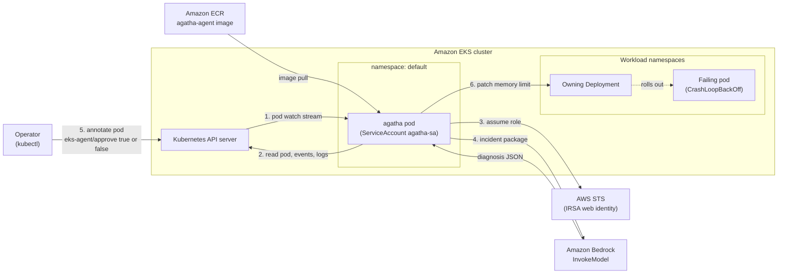
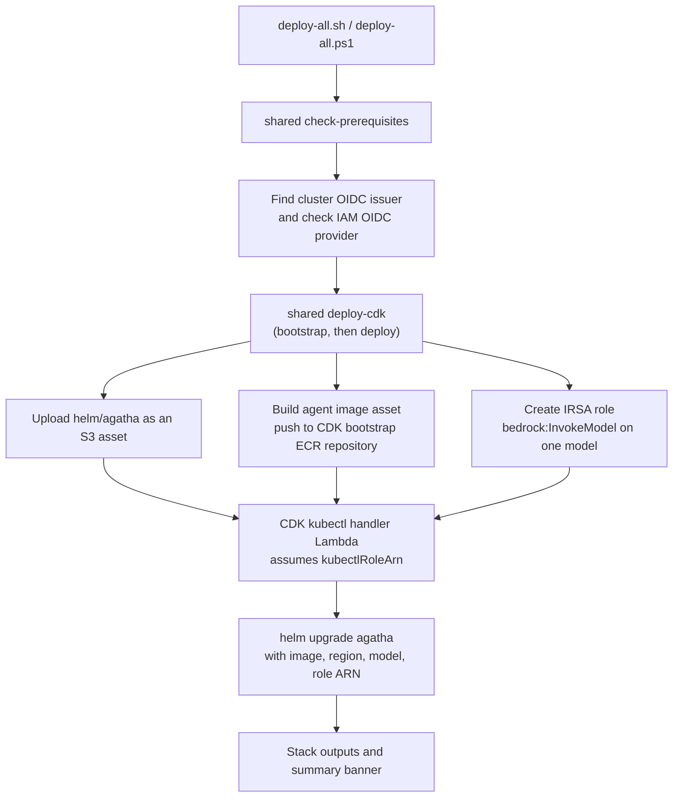

# Architecture: EKS Self-Healing Agent (Agatha)

This document describes the architecture as it is implemented today: one Python agent running as a pod inside an existing Amazon EKS cluster, installed with a Helm chart.

## Components

| Component | Where it lives | What it does |
|---|---|---|
| Agent container | `agent/agent.py`, `agent/Dockerfile` (python:3.12-slim) | Watches pods, collects signals, calls Amazon Bedrock, waits for approval, patches the Deployment |
| Helm chart | `helm/agatha/` | Installs the Deployment, ServiceAccount, ClusterRole and ClusterRoleBinding |
| Deployment `agatha` | Namespace `default`, 1 replica | Runs the agent container (requests 128Mi / 100m, limits 256Mi / 200m) |
| ServiceAccount `agatha-sa` | Namespace `default` | Carries the IRSA annotation `eks.amazonaws.com/role-arn` |
| ClusterRole `agatha-role` | Cluster scope | Kubernetes permissions the agent needs (see RBAC below) |
| IAM role `AgathaAgentRole` | Your AWS account, created by CDK | IRSA role that lets the pod call `bedrock:InvokeModel` on one model |
| Agent image | CDK bootstrap asset repository in Amazon ECR | CDK builds the image from `agent/` and pushes it |
| CDK stack `EksSelfHealingAgent-<region>` | `infrastructure/cdk/` | Creates the image, the role and the Helm release |
| Amazon Bedrock | Region set in `config.awsRegion` | Root cause analysis with the model in `config.bedrockModel` |

## Diagram

## Request flow

1. Watch. The agent loads the in-cluster config and opens a watch on pods in all namespaces (`list_pod_for_all_namespaces`, 60 second timeout, then it reconnects). On a watch error it logs the error, waits 10 seconds and reconnects. Namespaces listed in `SKIP_NAMESPACES` (default `kube-system,kube-public`) are ignored.
2. Trigger. A container triggers analysis when its waiting reason is `CrashLoopBackOff` and its restart count is at or above `RESTART_THRESHOLD` (default 3). Each pod is analyzed once. The record of analyzed pods is held in memory, so it resets when the agent restarts.
3. Collect signals. For the pod, the agent reads container images and resource requests and limits, the last 8 events, the node name and the owner references. The exit code and the `OOMKilled` reason come from the container's last terminated state.
4. Route by exit code.
   - `137` or `OOMKilled`: adds the current memory limit to the package.
   - `1`: adds the last 80 lines of the previous container's logs.
   - Any other code: no extra signal, the package is still sent for diagnosis.
5. Analyze. The agent builds a text incident package and calls `bedrock-runtime` `InvokeModel` with the Anthropic Messages request format (`max_tokens` 600). The prompt asks for JSON with `root_cause`, `evidence`, `proposed_fix`, `new_memory_limit`, `confidence` and `priority`. If the reply is not valid JSON, the raw text is reported as the root cause with low confidence. The full prompt and reply are written to the agent log.
6. Propose (OOM path only). The new limit is the model's `new_memory_limit`, or double the current limit as a fallback (512Mi when no limit is set). The agent walks Pod to ReplicaSet to Deployment through owner references. If no Deployment owns the pod, it stops and asks for a manual fix.
7. Approve. The agent runs in ASSIST mode. It prints the `kubectl annotate` commands and watches the pod's namespace for up to 10 minutes for the annotation `eks-agent/approve` on that pod. `true` approves, `false` rejects, and a timeout means no action.
8. Fix. On approval the agent reads the Deployment, sets `resources.limits.memory` on the matching container and patches the Deployment. Kubernetes then rolls out a new pod. Memory requests are not changed.

For exit code `1` and other codes the agent reports the diagnosis only and takes no action.

## Design notes and current limits

- Single-threaded. The approval wait runs inside the main loop, so the cluster-wide watch is paused while a decision is pending (up to 10 minutes).
- The only automated fix is a memory limit increase on a Deployment. Pods owned by StatefulSets, DaemonSets, Jobs or bare pods get a diagnosis only.
- OBSERVE and AUTO modes are described in the README as planned modes. Only ASSIST is implemented.
- Pod logs and event text are sent to Amazon Bedrock and also written to the agent log. Treat the agent log as containing workload data.

## Security

### Kubernetes RBAC (`helm/agatha/templates/clusterrole.yaml`)

| API group | Resources | Verbs | Used for |
|---|---|---|---|
| core | pods, pods/log, events, replicationcontrollers | get, list, watch | Watch stream, signal collection, approval watch |
| core | pods | patch | Granted for approval tracking |
| apps | replicasets | get, list | Find the owning Deployment |
| apps | deployments | get, list, patch | Apply the memory limit fix |

The ClusterRoleBinding `agatha-binding` binds this role to `agatha-sa` in `default`. The role is cluster scoped because the agent watches all namespaces.

### AWS IAM (IRSA)

The ServiceAccount is annotated with the IAM role ARN from `serviceAccount.irsaRoleArn`, which CDK sets. The pod gets temporary credentials through the EKS OIDC provider and AWS STS. No static AWS keys are stored in the cluster.

CDK creates the role with a trust policy for the cluster OIDC provider, limited to `sub = system:serviceaccount:default:agatha-sa` and `aud = sts.amazonaws.com`. Its only permission is `bedrock:InvokeModel` on two resources: the foundation model ARN for the chosen base model (any region, to cover cross-region inference) and the account-scoped inference profile ARN for the region-prefixed model ID.

### Deployment credentials

The CDK kubectl handler Lambda assumes the IAM role you pass as `kubectlRoleArn`. That role needs cluster admin rights on the cluster. It is used only while the stack is created, updated or deleted.

### Human in the loop

No change is made to a workload without an explicit `eks-agent/approve=true` annotation from an operator who has `patch` rights on pods in that namespace.

## Configuration

| Helm value | Env var | Default in chart | Purpose |
|---|---|---|---|
| `image.repository` | n/a | `<ECR_REPOSITORY_URI>` (set by CDK) | Agent image location |
| `image.tag` | n/a | `<IMAGE_TAG>` (set by CDK to the image asset hash) | Agent image tag |
| `config.awsRegion` | `AWS_REGION` | `<AWS_REGION>` (set by CDK) | Region for the Bedrock client |
| `config.bedrockModel` | `BEDROCK_MODEL` | `<BEDROCK_MODEL_ID>` (set by CDK) | Model or inference profile ID with the region prefix |
| `config.skipNamespaces` | `SKIP_NAMESPACES` | `kube-system,kube-public` | Namespaces to ignore |
| `config.restartThreshold` | `RESTART_THRESHOLD` | `3` | Restarts before analysis |
| `serviceAccount.name` | n/a | `agatha-sa` | ServiceAccount name |
| `serviceAccount.irsaRoleArn` | n/a | `<AGATHA_IRSA_ROLE_ARN>` (set by CDK) | IAM role for IRSA |

## Deployment

The demo deploys one CDK stack, `EksSelfHealingAgent-<region>`, onto an existing cluster. The stack description carries the adoption tracking tag `(uksb-do9bhieqqh)(tag:eks-self-healing-agent,resilience)`. It does not create a cluster.

Inputs reach the stack as CDK context: `clusterName`, `kubectlRoleArn` and `oidcIssuer` (required), and `nodeArchitecture`, `bedrockBaseModelId` and `imageTag` (optional). Nothing is stored in `cdk.json`.

Deployment flow:

1. `deploy-all` runs the shared prerequisites check (with Docker for deploy, without it for teardown).
2. It reads the OIDC issuer from the cluster when it is not passed, and checks that the matching IAM OIDC provider exists.
3. It calls the shared `deploy-cdk` script, which bootstraps the account and region if needed and deploys the stack.
4. CDK builds the image and pushes it to the bootstrap asset repository, creates the IRSA role, and uploads the chart directory as an asset.
5. The kubectl handler Lambda assumes `kubectlRoleArn` and installs the chart with `helm upgrade`, using values that CDK injects: image repository and tag, region, region-prefixed model ID and role ARN.
6. The stack outputs `ClusterName`, `KubectlRoleArn`, `OidcIssuer`, `AgentRoleArn`, `ImageUri`, `BedrockModelId`, `HelmRelease` and `Region`.

Teardown (`deploy-all --destroy`) reads the cluster inputs back from the stack outputs and destroys the stack with `imageTag=destroy`, so no Docker engine is needed. The Helm release is uninstalled and the IAM role is deleted. The image stays in the shared CDK bootstrap asset repository.

The region prefix of the model ID follows `shared/utils/aws_utils.py`: `us`, `eu`, `apac` (for `ap`), otherwise `global`. The CDK code in `infrastructure/cdk/lib/bedrock-model.ts` mirrors it, because `shared/utils/aws-utils.ts` has no model helper.
