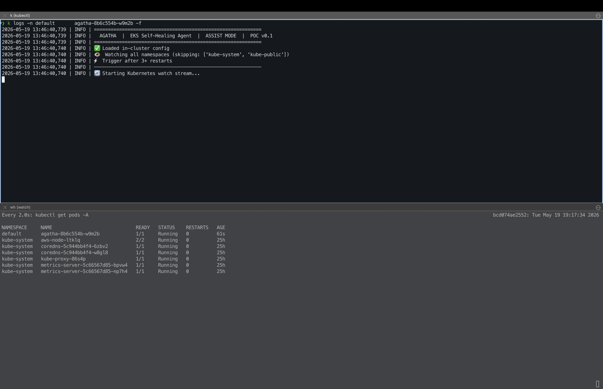
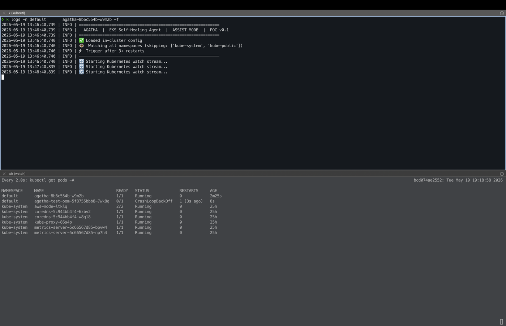
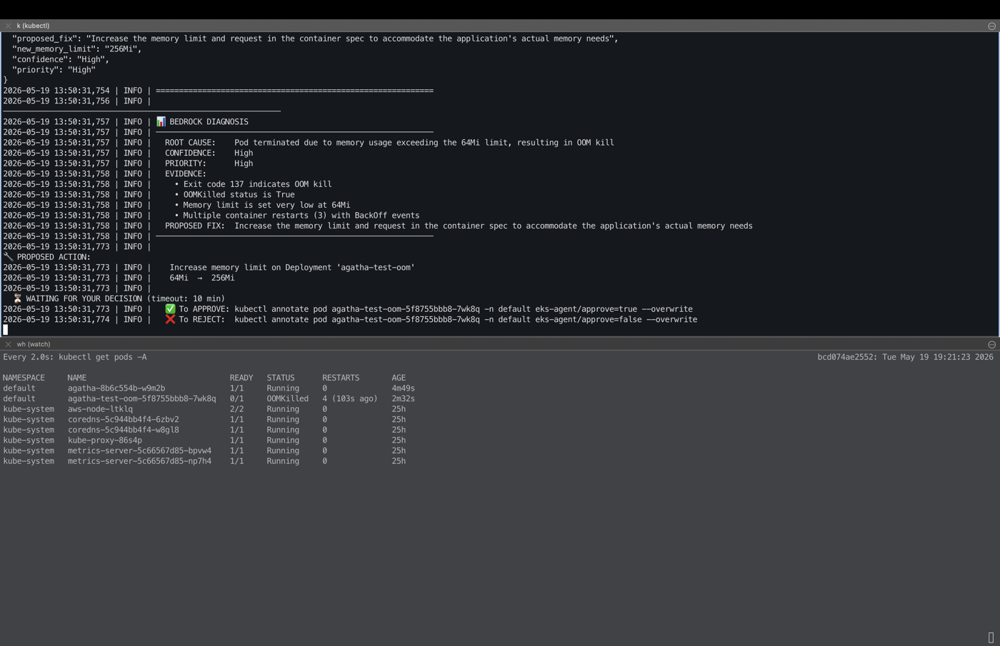
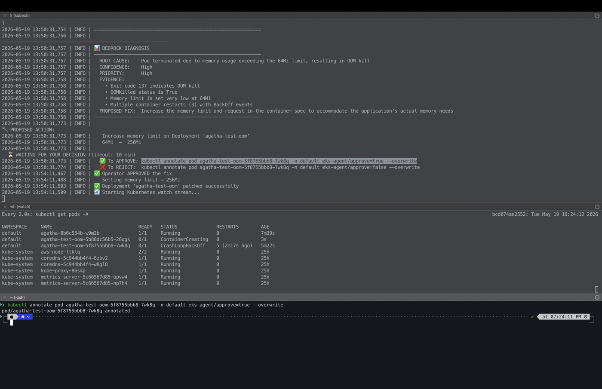
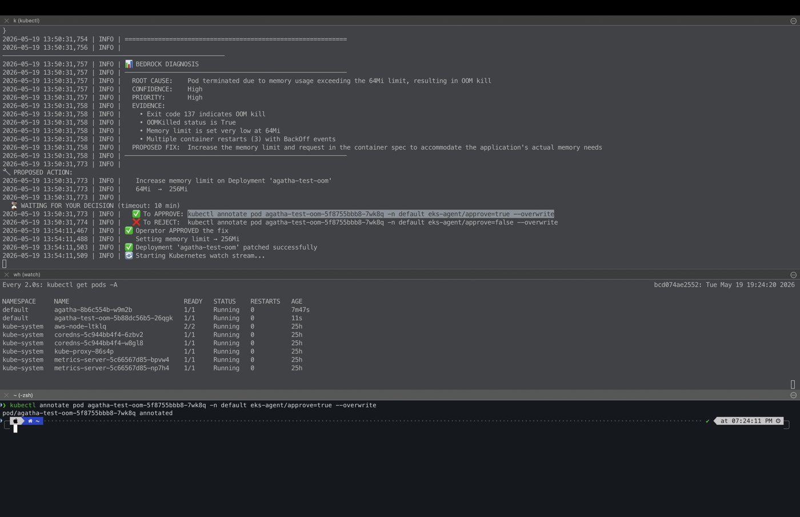

# EKS Self-Healing Agent (Agatha)
*Crashing pods on Amazon EKS restart without anyone asking why. Agatha uses Amazon Bedrock to find the root cause and proposes a fix that an operator approves before it is applied.*

## Overview

Agatha is a Kubernetes-native agent that runs as a pod inside an existing Amazon EKS cluster. It watches every pod through the Kubernetes watch stream. When a container reaches `CrashLoopBackOff` after a set number of restarts, Agatha collects the exit code, resource limits, events and logs, and sends them to Amazon Bedrock for root cause analysis.

For out-of-memory failures (exit code 137), Agatha proposes a new memory limit for the owning Deployment and waits for an operator to approve it with a pod annotation. After approval it patches the Deployment and Kubernetes rolls out a healthy pod. For application errors (exit code 1) it reports the diagnosis and leaves the fix to the operator.

The agent runs in ASSIST mode: detect, diagnose, recommend, then wait for a human decision. See [ARCHITECTURE.md](ARCHITECTURE.md) for the design.

## At a Glance

- **Duration**: 20 minutes, with an existing EKS cluster
- **Difficulty**: Intermediate
- **Target Audience**: Platform engineers, SREs, DevOps engineers, Kubernetes operators
- **Key Technologies**: Amazon EKS, Amazon Bedrock (Anthropic Claude), IAM Roles for Service Accounts (IRSA), AWS CDK, Helm, Python (boto3, Kubernetes client)
- **Estimated Cost**: Under USD 1 for a demo run on an existing cluster (estimate, see [Estimated Cost Breakdown](#estimated-cost-breakdown))

## Business Value

Most downtime is spent between a failure and its resolution. Kubernetes restarts failing pods, but a restart does not explain why the pod failed or whether a restart will help. An engineer is paged, rebuilds context by hand, guesses a root cause and applies a fix.

Agatha shortens that gap:

- **Faster diagnosis**: the incident package (exit code, limits, events, logs) is assembled and analyzed within seconds of the trigger.
- **Consistent evidence**: every diagnosis lists the root cause, the evidence, a confidence level and a priority.
- **Safe remediation**: no workload changes without an explicit operator approval.
- **Low footprint**: one small pod and one Helm chart on a cluster you already run.

## What You'll See

1. Agatha starts and opens a watch on all namespaces except the skipped ones.

   

2. A test Deployment with a 64Mi memory limit is OOMKilled and enters `CrashLoopBackOff`.

   

3. After 3 restarts Agatha detects the incident, takes the exit code 137 path and calls Amazon Bedrock. The diagnosis shows the root cause, evidence, confidence and priority, followed by the proposed action (64Mi to 256Mi) and the approval commands.

   

4. The operator approves with `kubectl annotate`. Agatha patches the Deployment.

   

5. Kubernetes rolls out a new pod with the higher limit and it stays `Running`.

   

### Guardrail modes

| Mode | Behavior | Status |
|------|----------|--------|
| OBSERVE | Detect, analyze, report. No action | Planned |
| ASSIST | Detect, diagnose, recommend, wait for approval | Implemented |
| AUTO | Detect, diagnose, fix without approval | Planned |

### Exit code routing

| Exit code | Meaning | Agatha's action |
|-----------|---------|-----------------|
| `137` | OOMKilled | Read memory limit, send to Bedrock, propose a new limit, wait for approval |
| `1` | Application error | Read the last 80 log lines, send to Bedrock, report the diagnosis |
| Other | Not handled yet | Send the base incident package to Bedrock, report the diagnosis |

## Prerequisites

- An AWS account with permissions to deploy AWS CDK stacks (CloudFormation, IAM, Lambda, S3, ECR) and to read the EKS cluster
- An existing Amazon EKS cluster with an IAM OIDC provider and an API server endpoint that is publicly reachable. The CDK kubectl handler runs in a Lambda function outside your VPC and installs the Helm chart through that endpoint
- An IAM role that the CDK kubectl handler can assume and that has cluster admin rights on the cluster (see [Create the kubectl role](#create-the-kubectl-role))
- Amazon Bedrock access to the default Anthropic Claude model (Claude Sonnet 4.5) in your region. The agent sends the Anthropic Messages request format, so the model must be an Anthropic Claude model or a Claude inference profile
- Tools: AWS CLI v2 (2.31.13 or later), Node.js 20 or later, and Docker or Finch running (`export CDK_DOCKER=finch` for Finch). `kubectl` is needed for the demo steps
- Nodes: `amd64` by default. For Graviton nodes pass `--node-architecture arm64`

```bash
aws sts get-caller-identity
aws eks describe-cluster --name <CLUSTER_NAME> --query "cluster.{publicEndpoint:resourcesVpcConfig.endpointPublicAccess,oidcIssuer:identity.oidc.issuer}"
node --version
docker --version   # or: finch --version
```

The deploy scripts use the shared prerequisites check in `shared/scripts/`, which verifies these tools before it deploys.

## Deployment

The deploy script installs Agatha onto a cluster you name. It does not create a cluster. It deploys one CDK stack, `EksSelfHealingAgent-<region>`, that builds the agent image, creates an IAM role for the pod (IRSA) and installs the Helm chart in `helm/agatha`.

### Solution adoption tracking

The stack description carries the adoption tracking tag `(uksb-do9bhieqqh)(tag:eks-self-healing-agent,resilience)`. It is set in `infrastructure/cdk/bin/app.ts`.

### Inputs

| Input | Script flag (bash / PowerShell) | Environment variable | Required | Notes |
|-------|---------------------------------|----------------------|----------|-------|
| Cluster name | `--cluster-name` / `-ClusterName` | `CLUSTER_NAME` | Yes | Existing EKS cluster in the deploy region |
| kubectl role ARN | `--kubectl-role-arn` / `-KubectlRoleArn` | `KUBECTL_ROLE_ARN` | Yes | Role with cluster admin rights, assumed by the CDK kubectl handler |
| OIDC issuer URL | `--oidc-issuer` / `-OidcIssuer` | `OIDC_ISSUER` | No | Read from the cluster when omitted |
| Node architecture | `--node-architecture` / `-NodeArchitecture` | `NODE_ARCHITECTURE` | No | `amd64` (default) or `arm64` |
| Base model ID | `--model-id` / `-ModelId` | `MODEL_ID` | No | Model ID without a region prefix. Default `anthropic.claude-sonnet-4-5-20250929-v1:0` |

The region comes from `AWS_REGION`, `AWS_DEFAULT_REGION` or the AWS CLI configuration, and must be the region of the cluster. CDK computes the geography prefix of the Bedrock model ID (`us`, `eu`, `apac` or `global`) from that region and passes the result to the pod as `BEDROCK_MODEL`.

### Create the kubectl role

Skip this step if you already have a role that is cluster admin on the cluster. Replace the `<...>` tokens.

```bash
cat > agatha-kubectl-trust.json <<EOF
{
  "Version": "2012-10-17",
  "Statement": [
    {
      "Effect": "Allow",
      "Principal": { "AWS": "arn:aws:iam::<AWS_ACCOUNT_ID>:root" },
      "Action": "sts:AssumeRole"
    }
  ]
}
EOF

aws iam create-role \
  --role-name agatha-kubectl-admin \
  --assume-role-policy-document file://agatha-kubectl-trust.json

aws eks create-access-entry \
  --cluster-name <CLUSTER_NAME> \
  --principal-arn arn:aws:iam::<AWS_ACCOUNT_ID>:role/agatha-kubectl-admin

aws eks associate-access-policy \
  --cluster-name <CLUSTER_NAME> \
  --principal-arn arn:aws:iam::<AWS_ACCOUNT_ID>:role/agatha-kubectl-admin \
  --policy-arn arn:aws:eks::aws:cluster-access-policy/AmazonEKSClusterAdminPolicy \
  --access-scope type=cluster
```

If `create-access-entry` fails with `The specified principalArn is invalid` right after `create-role`, the new role has not propagated in IAM yet. Wait about 10 seconds and run it again.

Access entries need a cluster whose authentication mode includes `API`. On a cluster that uses only the `aws-auth` ConfigMap, map the role to the `system:masters` group instead.

If the cluster has no IAM OIDC provider, create one:

```bash
eksctl utils associate-iam-oidc-provider --cluster <CLUSTER_NAME> --region <AWS_REGION> --approve
```

### Quick Start

macOS or Linux:

```bash
cd resilience/eks-self-healing-agent
./deploy-all.sh --cluster-name <CLUSTER_NAME> --kubectl-role-arn <KUBECTL_ROLE_ARN>
```

Windows PowerShell:

```powershell
cd resilience\eks-self-healing-agent
.\deploy-all.ps1 -ClusterName <CLUSTER_NAME> -KubectlRoleArn <KUBECTL_ROLE_ARN>
```

The script runs the shared prerequisites check, finds the cluster OIDC issuer, checks that the IAM OIDC provider exists, then deploys the stack through `shared/scripts/deploy-cdk.sh` (or `.ps1`). CDK bootstraps the account and region on the first run. It ends with a summary of the region, cluster, role, model and image.

Check the agent:

```bash
kubectl get pods -l app=agatha
kubectl logs -f deployment/agatha
```

Expected startup logs:

```
============================================================
  AGATHA  |  EKS Self-Healing Agent  |  ASSIST MODE  |  POC v0.1
============================================================
✅ Loaded in-cluster config
👁️  Watching all namespaces (skipping: ['kube-system', 'kube-public'])
⚡ Trigger after 3+ restarts
────────────────────────────────────────────────────────────
🔄 Starting Kubernetes watch stream...
```

### What the stack creates

| Resource | Purpose |
|----------|---------|
| Container image asset | Built from `agent/` and pushed to the CDK bootstrap asset repository |
| IAM role `AgathaAgentRole` | Trusted by the cluster OIDC provider for `system:serviceaccount:default:agatha-sa`. Allows `bedrock:InvokeModel` on the chosen model only |
| Helm release `agatha` | Installs `helm/agatha` into the `default` namespace with the image, region, model and role ARN as values |
| CDK kubectl handler | Lambda function and layer that assume the kubectl role to run Helm |

## Run the Demo

### Deploy a faulty workload (OOMKilled, exit code 137)

```bash
kubectl apply -f - <<EOF
apiVersion: apps/v1
kind: Deployment
metadata:
  name: agatha-test-oom
  namespace: default
spec:
  replicas: 1
  selector:
    matchLabels:
      app: agatha-test-oom
  template:
    metadata:
      labels:
        app: agatha-test-oom
    spec:
      containers:
      - name: oom-container
        image: polinux/stress
        command: ['stress']
        args: ['--vm', '1', '--vm-bytes', '200M', '--vm-hang', '1']
        resources:
          requests:
            memory: "64Mi"
          limits:
            memory: "64Mi"    # Needs 200M, gets 64M, so it is OOMKilled
EOF
```

### Watch the pod crash

```bash
kubectl get pods -w
```

```
agatha-test-oom-xxx   0/1   OOMKilled          0    5s
agatha-test-oom-xxx   0/1   CrashLoopBackOff   1    10s
agatha-test-oom-xxx   0/1   CrashLoopBackOff   3    60s  <- Agatha triggers here
```

### Watch Agatha react (second terminal)

```bash
kubectl logs -f deployment/agatha
```

```
🚨 INCIDENT DETECTED
   Pod:       agatha-test-oom-xxx
   Namespace: default
   Restarts:  3
   Exit Code: 137

💾 Exit Code 137 → OOMKilled path
🤖 Contacting Amazon Bedrock for root cause analysis...

📊 BEDROCK DIAGNOSIS
────────────────────────────────────────────────────────────
  ROOT CAUSE:    Pod exceeded memory limit of 64Mi causing OOM kill
  CONFIDENCE:    High
  PRIORITY:      High
  EVIDENCE:
    • Exit code 137 indicates OOM kill
    • OOMKilled status is True
    • Container has very low memory limit of 64Mi
    • Multiple restarts indicating persistent memory issues
  PROPOSED FIX:  Increase memory limit and request in deployment
────────────────────────────────────────────────────────────

🔧 PROPOSED ACTION:
   Increase memory limit on Deployment 'agatha-test-oom'
   64Mi → 256Mi

⏳ WAITING FOR YOUR DECISION (timeout: 10 min)
✅ To APPROVE: kubectl annotate pod agatha-test-oom-xxx -n default eks-agent/approve=true --overwrite
❌ To REJECT:  kubectl annotate pod agatha-test-oom-xxx -n default eks-agent/approve=false --overwrite
```

### Approve the fix

Use the exact pod name from the log:

```bash
kubectl annotate pod <POD_NAME> \
  -n default \
  eks-agent/approve=true \
  --overwrite
```

```
✅ Operator APPROVED the fix
   Setting memory limit → 256Mi
✅ Deployment 'agatha-test-oom' patched successfully
```

### Verify the fix

```bash
kubectl describe deployment agatha-test-oom | grep -A2 Limits

# Expected:
# Limits:
#   memory: 256Mi     <- updated by Agatha
```

## Upgrading Agatha

After a code or chart change, run the deploy script again with the same inputs. CDK builds a new image tag and upgrades the Helm release, and Kubernetes rolls out the new pod.

## Estimated Cost Breakdown

All figures are estimates in USD based on public on-demand pricing at the time of writing. Prices vary by region and change over time; check the [Amazon Bedrock pricing](https://aws.amazon.com/bedrock/pricing/), [Amazon EKS pricing](https://aws.amazon.com/eks/pricing/) and [Amazon ECR pricing](https://aws.amazon.com/ecr/pricing/) pages.

### Demo cost (one test run on an existing cluster)

| Item | Assumption | Estimated cost |
|------|------------|----------------|
| Amazon Bedrock (Claude Sonnet class) | 1 to 3 analyses, about 1,000 input and 300 output tokens each, at about USD 3 per million input and USD 15 per million output tokens | Under USD 0.03 |
| Amazon ECR storage | About 0.2 GB image in the CDK asset repository, a few hours | Under USD 0.01 |
| CDK kubectl handler | Lambda invoked a few times during deploy and teardown | Near zero |
| Agent pod | 100m CPU, 128Mi memory on an existing node | No extra node cost |
| EKS control plane | Only if you create a cluster for the demo: USD 0.10 per hour plus node cost | About USD 0.10 per hour |

Total on an existing cluster: under USD 0.05 (estimate).

### Monthly cost (ongoing use)

| Item | Assumption | Estimated monthly cost |
|------|------------|------------------------|
| Amazon Bedrock | 100 incidents per month, about USD 0.0075 per analysis | About USD 0.75 |
| Amazon ECR storage | 0.2 GB at about USD 0.10 per GB-month | About USD 0.02 |
| Agent pod | Share of an existing node (100m CPU, 128Mi requested) | Depends on node type, usually a small fraction of one node |
| Data transfer | Small JSON requests to Bedrock in the same region | Negligible |

Total: about USD 1 per month plus the pod's share of node capacity (estimate). The cluster itself is not counted because the demo installs onto an existing cluster.

Cost tips:

- Raise `config.restartThreshold` or add noisy namespaces to `config.skipNamespaces` to reduce Bedrock calls.
- Each pod is analyzed once per agent lifetime, which limits repeat calls for the same failure.
- Delete the agent image from the CDK asset repository after the demo if you do not plan to reuse it.

## Troubleshooting

| Symptom | Likely cause | What to check |
|---------|--------------|---------------|
| Script stops with "No IAM OIDC provider" | The cluster has no IAM OIDC provider | Run the `eksctl utils associate-iam-oidc-provider` command from the Deployment section |
| Deploy fails in the Helm resource with an authorization or `Unauthorized` error | The kubectl role is not cluster admin, or the Lambda cannot assume it | The role has an access entry with `AmazonEKSClusterAdminPolicy` (or `system:masters` in `aws-auth`) and its trust policy allows your account |
| Deploy times out or the Helm resource cannot connect | The API server endpoint is private | Enable public access on the endpoint, or allow the CDK Lambda to reach it |
| Docker or Finch error during deploy | The container engine is not running | Start Docker, or run `export CDK_DOCKER=finch` and start Finch |
| Agent pod in `ImagePullBackOff` | Image built for the wrong CPU architecture | Redeploy with `--node-architecture arm64` for Graviton nodes |
| `NoCredentialsError` or `Unable to locate credentials` | IRSA not wired | `kubectl get sa agatha-sa -o yaml` shows `eks.amazonaws.com/role-arn`; the role trust policy names `system:serviceaccount:default:agatha-sa` |
| `AccessDeniedException` from Bedrock | Model access not enabled, or `--model-id` is not available in the region | Enable model access in the Bedrock console; confirm the model ID exists in the region |
| `ValidationException` about on-demand throughput | The model needs an inference profile in this region | Use a model that supports the region's inference profile prefix |
| No incident logged | Threshold not reached, namespace skipped, or pod already analyzed | Restart count is at or above `config.restartThreshold`; namespace is not in `config.skipNamespaces`; run `kubectl rollout restart deployment/agatha` to clear the in-memory record |
| Approval not picked up | Wrong pod name or namespace, or the 10 minute window expired | Copy the exact command from the agent log; check for `Approval window expired` in the log |
| `No Deployment found` | Pod is not owned by a Deployment | Only Deployments are patched today; apply the fix manually |
| Other pods are not analyzed while a decision is pending | The approval wait blocks the watch loop | Approve or reject the pending fix, or wait for the timeout |
| A fix is rejected immediately on a repeat run | An old pod still carries `eks-agent/approve=false` from an earlier run | Delete the test deployment and create it again so the pod is new |

## Cleanup

```bash
# Test workload
kubectl delete deployment agatha-test-oom

# Agent image reference, IAM role and Helm release
./deploy-all.sh --destroy
```

On Windows PowerShell, run `.\deploy-all.ps1 -Destroy`.

The teardown reads the cluster name, kubectl role and OIDC issuer from the stack outputs, so it needs no flags. It does not need Docker. It removes the Helm release, the IAM role and the stack, then deletes the `/aws/lambda/EksSelfHealingAgent-*` log groups that the kubectl provider Lambdas create at runtime.

The agent image is stored in the shared CDK bootstrap asset repository (`cdk-*-container-assets-*`), not in a repository owned by this demo, so teardown leaves it there. Delete that image by hand, or leave it for other CDK apps that share the repository. If you created the `agatha-kubectl-admin` role for this demo, remove its access entry and delete the role:

```bash
aws eks delete-access-entry --cluster-name <CLUSTER_NAME> \
  --principal-arn arn:aws:iam::<AWS_ACCOUNT_ID>:role/agatha-kubectl-admin
aws iam delete-role --role-name agatha-kubectl-admin
```

If you associated an OIDC provider only for this demo and no other workload uses it, you can remove it from the IAM console.

## Project Structure

```
eks-self-healing-agent/
├── README.md
├── ARCHITECTURE.md
├── deploy-all.sh             # Deploy or tear down (macOS/Linux)
├── deploy-all.ps1            # Deploy or tear down (Windows)
├── validation.yaml           # Demo validation settings
├── agent/
│   ├── agent.py              # Agent logic
│   ├── requirements.txt      # boto3, kubernetes
│   └── Dockerfile
├── helm/
│   └── agatha/
│       ├── Chart.yaml
│       ├── values.yaml       # Placeholders, set by CDK at install time
│       └── templates/
│           ├── serviceaccount.yaml
│           ├── clusterrole.yaml
│           ├── clusterrolebinding.yaml
│           └── deployment.yaml
├── infrastructure/
│   └── cdk/
│       ├── bin/app.ts        # App entry, stack description with the tracking tag
│       ├── lib/agatha-stack.ts
│       ├── lib/bedrock-model.ts
│       ├── cdk.json
│       ├── package.json
│       └── tsconfig.json
└── docs/                     # Screenshots
```

## Roadmap

| Phase | Feature | Status |
|-------|---------|--------|
| POC | CrashLoopBackOff detection | Done |
| POC | Exit code 137 OOMKilled path | Done |
| POC | Amazon Bedrock root cause analysis | Done |
| POC | ASSIST mode with approval | Done |
| Next | Exit code 1 application error fixes | Planned |
| Next | OBSERVE mode toggle | Planned |
| Next | Slack notifications | Planned |
| Next | Node NotReady scenario | Planned |
| Next | IRSA failure scenario | Planned |
| Future | AUTO mode | Planned |

## Known Limitations

This is a proof of concept. Before using it beyond a test cluster, note the following:

- **Only the memory limit is raised.** The OOMKilled fix patches `resources.limits.memory` and leaves the request unchanged, so the scheduler still reserves the old request. Raise the request yourself if the workload needs the memory reserved.
- **No upper bound on the new limit.** The value comes from the model's suggestion, or doubles the current limit when there is none. Review the proposed value before you approve.
- **One snapshot per incident.** The diagnosis uses the pod's exit code, limits, recent events and logs at one point in time. It does not use memory trends, so it cannot tell a too-low limit from a leak.
- **Approval is a pod annotation.** Anyone who can patch pods can approve, including the agent's own service account. Use it on clusters where you control who has that permission.
- **Cluster-wide permissions.** The chart uses a ClusterRole. `config.skipNamespaces` filters namespaces in the agent, not in RBAC.
- **No dry run or cooldown.** Approved patches are applied directly. The record of analyzed pods is in memory and is lost when the agent restarts.

## Contributing

We welcome community contributions! Please see [CONTRIBUTING.md](../../CONTRIBUTING.md) for guidelines.

## Security

See [CONTRIBUTING](../../CONTRIBUTING.md#security-issue-notifications) for more information.

## License

This library is licensed under the MIT-0 License. See the [LICENSE](../../LICENSE) file.
