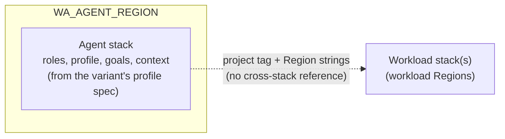
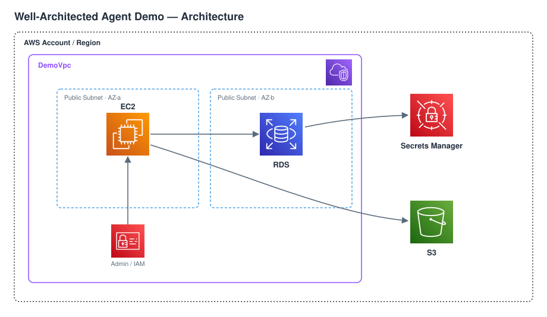
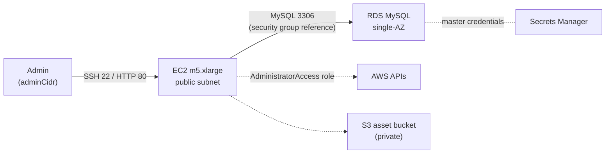
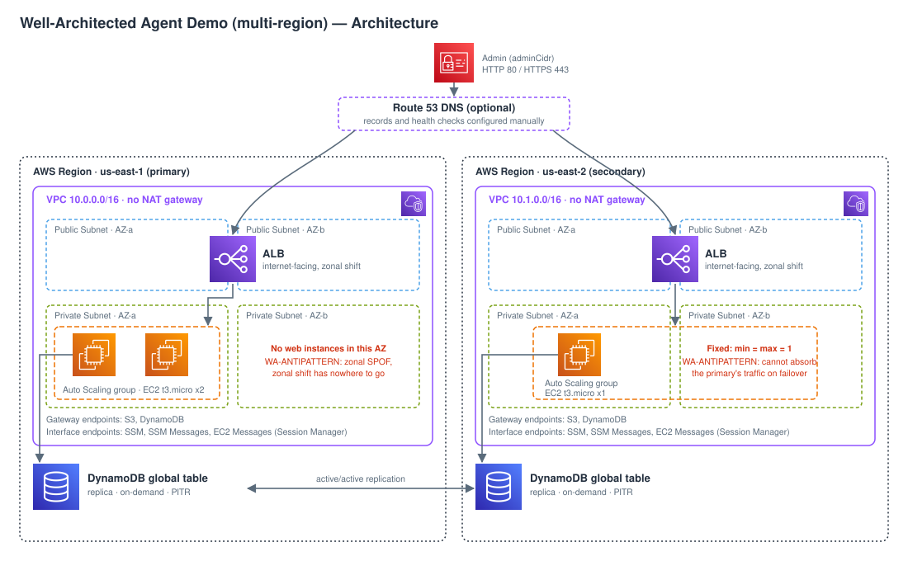
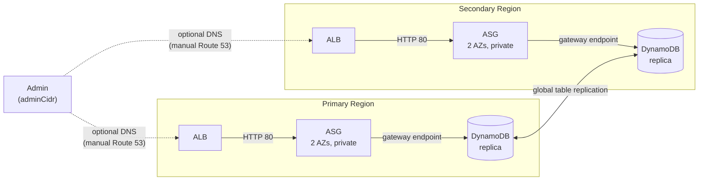
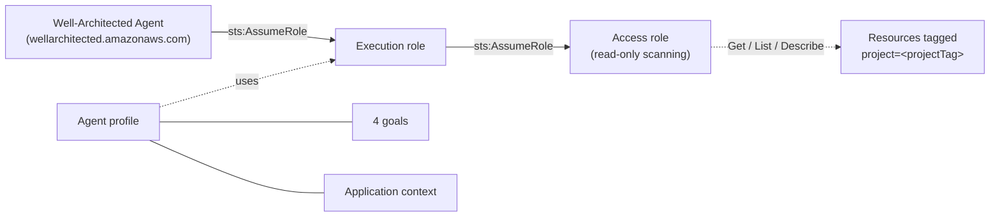

# Architecture: Well-Architected Agent demo

This demo deploys a target workload for the Well-Architected Agent to review, plus a
correctly configured agent profile that reviews it. The workloads are not a recommended
pattern: they exist so the agent has realistic findings to report. Each anti-pattern is
marked inline in the stacks with a `WA-ANTIPATTERN` comment.

A deployment is one variant, `single` (default) or `multi`, never both in one account and
agent Region. It has two blocks:

| Block | `single` | `multi` | Region |
| --- | --- | --- | --- |
| Workload: the architecture under test | `WAAgentDemoSingleWorkload-<region>` | `WAAgentDemoMultiWorkloadPrimary-<primary>`, `WAAgentDemoMultiWorkloadSecondary-<secondary>` | workload Region (and the secondary) |
| Agent: roles, profile, goals, one application context. Main stack (adoption tracking) | `WAAgentDemoProfile-<agent-region>` | `WAAgentDemoProfile-<agent-region>` | `WA_AGENT_REGION` |



The workload stacks contain nothing of the agent. The agent stack is built from the
profile spec of the variant (`lib/single-region-profile.ts` or
`lib/multi-region-profile.ts`): display name, scanned Regions, goals and application
context. Pillars and roles are the same for both variants. The context finds the workload
by its `project` tag and Region strings only, so the stacks share no export, import or
cross-stack reference.

The pieces both variants use (variant selection, agent stack, agent Region, managed Lambda
log groups) are described once in [Shared building blocks](#shared-building-blocks).

## Variant `single`



### Components

The workload lives in one CloudFormation stack, `WAAgentDemoSingleWorkload-<region>`,
defined in `infrastructure/cdk/lib/single-region-workload-stack.ts`. Every resource carries
the tag `project=wa-agent-demo-single`.

| Component | Configuration |
| --- | --- |
| VPC (`DemoVpc`) | 2 AZs, one public subnet per AZ, no NAT gateway, no private or isolated subnets |
| Security group (`OpenSecurityGroup`) | SSH (22) and HTTP (80) from the `adminCidr` context value only; shared by the instance and the database |
| EC2 (`AppInstance`) | One `m5.xlarge`, Amazon Linux 2, public subnet with a public IP, 50 GiB unencrypted root volume, no Auto Scaling group, no load balancer |
| IAM (`InstanceRole`) | Instance role with the `AdministratorAccess` managed policy |
| RDS (`Database`) | MySQL 8.0 on `db.t3.micro`, single-AZ, 20 GiB unencrypted storage, backups disabled, no deletion protection, `publiclyAccessible: false` |
| Secrets Manager | Generated master credentials for the database; no password in the template |
| S3 (`AssetBucket`) | Public access blocked, no versioning, TLS not enforced, no access logging, no lifecycle rules, objects auto-deleted with the stack |
| CloudWatch Logs (`AutoDeleteObjectsLogGroup`) | Log group of the CDK bucket-emptying Lambda, 30-day retention, deleted with the stack |

The VPC spans two AZs only because an RDS subnet group must cover at least two. The
database itself stays single-AZ.

### Profile spec

`singleRegionProfile()` in `lib/single-region-profile.ts`:

| Field | Value |
| --- | --- |
| Display name | `WA Agent Demo Profile (single-region)` |
| Scanned Regions | the workload Region |
| Goals | Resilience: meet the declared RPO of 5 minutes and RTO of 2 hours by removing single points of failure. Security: enforce least-privilege access and encryption of all workload data at rest and in transit. Cost Optimization: reduce compute spend by at least 30% by rightsizing over-provisioned resources. Performance: scale the web tier automatically to sustain peak load without manual intervention |
| Context scope | tag `project=wa-agent-demo-single`, this account, the workload Region |
| Criticality and type | `BUSINESS_CRITICAL`, `OTHER` |
| Declared requirements | "Business critical, RPO 5 minutes, RTO 2 hours, HA and DR in place" |

### Traffic and access



- Inbound traffic reaches the instance only from `adminCidr`. Without the context value
  the stack falls back to `10.0.0.0/32`, which allows no public access.
- The database port is opened to the shared security group only, and the database has
  no public endpoint.
- The instance role can call any AWS API, which is the most severe security finding.

### Intended findings by pillar

The agent analyzes four pillars. Operational Excellence and Sustainability are out of its
scope, so they are not listed.

| Pillar | Anti-pattern |
| --- | --- |
| Resilience | Single-AZ RDS, no backups, single instance, no Auto Scaling, no load balancer; declared RPO/RTO and HA/DR not achievable |
| Security | `AdministratorAccess` instance role, unencrypted EBS and RDS storage, TLS not enforced on S3, public subnets for every tier |
| Cost Optimization | Oversized `m5.xlarge` for a demo workload |
| Performance | Single manually sized instance with no scaling |

### Kept correct on purpose

- S3 public access is fully blocked.
- The database is not publicly accessible.
- Ingress is limited to one admin CIDR on two ports, never `0.0.0.0/0`.
- Database credentials are generated and stored in Secrets Manager.

### Deployment flow

`deploy-all.ps1` / `deploy-all.sh` (default variant) call the library's shared
`check-prerequisites` script (AWS CLI, credentials, region, Node.js 20+, CDK, and the
agent Region), check that no other variant is deployed (see
[One variant at a time](#one-variant-at-a-time)), resolve the admin CIDR, then call the
shared `deploy-cdk` script once per stack:

1. Workload stack, in the workload Region (bootstraps it), with `adminCidr` as CDK context.
2. Agent stack, in `WA_AGENT_REGION` (bootstraps it when it differs).

### Teardown

`deploy-all.ps1 -Destroy` / `deploy-all.sh --destroy` destroy the agent stack, then the
workload stack (see [Teardown](#teardown-shared)).

Every resource uses `RemovalPolicy.DESTROY` or the service default delete behavior. The
S3 bucket is emptied by the CDK auto-delete custom resource before deletion. That custom
resource runs a CDK-managed Lambda whose log group is managed by the stack (see
[CDK-managed Lambda log groups](#cdk-managed-lambda-log-groups-shared)).

## Variant `multi`

In the examples the primary Region is us-east-1 (N. Virginia) and the secondary is
us-east-2 (Ohio); both are configurable (see below).



### Stacks

| Stack (default Regions) | Region | Defined in | Contents |
| --- | --- | --- | --- |
| `WAAgentDemoMultiWorkloadPrimary-us-east-1` | primary | `lib/multi-region-workload-stack.ts` | Region resources, DynamoDB global table, `SecondaryRegion` output |
| `WAAgentDemoMultiWorkloadSecondary-us-east-2` | secondary | `lib/multi-region-workload-stack.ts` | Region resources |
| `WAAgentDemoProfile-us-east-1` | `WA_AGENT_REGION` | `lib/agent-profile-stack.ts`, `lib/multi-region-profile.ts` | Agent stack of the `multi` variant |

The primary Region comes from `WA_DEMO_PRIMARY_REGION` when the deploy script sets it,
otherwise from the shared `getRegion()` resolution (`AWS_DEFAULT_REGION`, `AWS_REGION`,
CLI configuration). Any Region works: only the agent profile is limited to the hosting
Regions (see [Agent Region](#agent-region-shared)). The secondary Region comes from
`-c secondaryRegion=...` or `WA_DEMO_SECONDARY_REGION`; with neither the synth stops. The
CDK app keeps no Region list and chooses nothing. The deploy scripts set the variable:

1. `-SecondaryRegion` / `--secondary-region` when passed;
2. otherwise the deployed one: the `SecondaryRegion` output of the agent stack, or of the
   primary stack after a partial deployment, so a redeploy or a destroy never moves it
   (passing a different one is an error);
3. otherwise, on a first deploy in a `us-*` or `eu-*` Region, a Region chosen from the
   account's enabled Regions (`aws ec2 describe-regions`) with the same Region-code
   prefix: primary excluded, alphabetical order, Regions without opt-in first. us-east-1
   gives us-east-2, eu-west-3 gives eu-central-1. In any other Region the scripts stop and
   ask for `-SecondaryRegion` / `--secondary-region`.

On deploy, the scripts require the secondary Region to have the primary's Region-code
prefix, whatever its source: the code without its last two segments (`us-east-1` is `us`,
`ap-southeast-1` is `ap`, `us-gov-west-1` is `us-gov`). The prefix is not a data
residency boundary (`ap` covers Tokyo, Mumbai and Sydney), which is why the scripts only
choose by themselves in `us` and `eu`. They do not check that the secondary Region offers
every service the variant uses.

The secondary stack depends on the primary because the primary creates the DynamoDB
replica in the secondary Region and, with HTTPS, the shared ACM validation records. The
stacks share no CloudFormation cross-Region references.

### Components (per Region)

| Component | Configuration |
| --- | --- |
| VPC (`Vpc`) | 2 AZs, 2 public `/24` subnets (ALB only), 2 private isolated `/24` subnets (web tier and interface endpoints), no NAT gateway. CIDR `10.0.0.0/16` (primary) / `10.1.0.0/16` (secondary) |
| Gateway endpoints | S3 (Amazon Linux 2023 package repositories) and DynamoDB, on the private route tables |
| Interface endpoints | `ssm`, `ssmmessages`, `ec2messages` with private DNS, in both private subnets; security group allows HTTPS from the VPC CIDR only |
| ALB (`Alb`) | Internet-facing, in both public subnets, ARC zonal shift enabled. HTTP 80 forwards to the target group, or redirects to 443 when HTTPS is enabled |
| ALB security group (`AlbSg`) | HTTP 80 (and HTTPS 443) from `adminCidr` and from the AWS-managed prefix list `com.amazonaws.<region>.route53-healthchecks` only |
| Target group (`TargetGroup`) | HTTP 80, health check `GET /` expecting `200`, 30 s interval, 2 healthy / 3 unhealthy |
| Auto Scaling group (`WebAsg`) | Launch template with Amazon Linux 2023 (latest AMI from the public SSM parameter), `t3.micro`, 8 GiB encrypted gp3 root volume, IMDSv2 only, no public IP. ELB health checks with a 300 s grace period, rolling replacement of one instance at a time. Shape per Region (deliberate gaps, `web` in `lib/multi-region-config.ts`): **primary** min 2 / max 4 in **one** private subnet (one AZ); **secondary** min 1 / max 1 across both private subnets |
| Web tier security group (`Ec2Sg`) | HTTP 80 from the ALB security group only |
| IAM (`Ec2Role`) | `AmazonSSMManagedInstanceCore` plus `PutItem`, `UpdateItem`, `GetItem`, `Query`, `DescribeTable` on the table ARN in the same Region only |
| CloudWatch Logs (`RestrictDefaultSgLogGroup`) | Log group of the CDK Lambda that strips the rules of the VPC default security group (feature flag `@aws-cdk/aws-ec2:restrictDefaultSecurityGroup`, set on the workload stacks only), 30-day retention, managed as in [CDK-managed Lambda log groups](#cdk-managed-lambda-log-groups-shared) |
| Optional single instance (`Web`) | `keepSingleInstance=true`: one instance in the first private subnet, registered to the same target group (single-instance baseline with `useAsg=false`) |
| Optional HTTPS | `appDomainName` + `route53ZoneName`: public ACM certificate per Region (DNS validation), HTTPS 443 listener with `ELBSecurityPolicy-TLS13-1-2-2021-06` |

Every resource carries the tag `project=wa-agent-demo-multi`.

### Shared components

| Component | Configuration |
| --- | --- |
| DynamoDB global table (`GlobalTable`) | Partition key `pk` (string), on-demand billing, encryption at rest with the AWS owned key (declared explicitly), point-in-time recovery on both replicas, replicas in both Regions. Both replicas accept writes. Owned by the primary stack |

### Profile spec

`multiRegionProfile()` in `lib/multi-region-profile.ts`:

| Field | Value |
| --- | --- |
| Display name | `WA Agent Demo Profile (multi-region)` |
| Scanned Regions | the primary and secondary Regions |
| Goals | Resilience: fail over between Regions automatically within the declared RTO of 15 minutes. Security: protect the internet-facing endpoints and encrypt all traffic in transit. Cost Optimization: match web tier capacity to demand in both Regions. Performance: scale the web tier automatically to sustain peak load in each Region |
| Context scope | tag `project=wa-agent-demo-multi`, this account, both workload Regions |
| Criticality and type | `BUSINESS_CRITICAL`, `OTHER` |
| Declared requirements | "Business critical, RPO 1 minute, RTO 15 minutes, active/active in two Regions with automatic Regional failover, failures detected and alerted within 5 minutes" |

### Traffic and access



- Inbound traffic reaches an ALB only from `adminCidr`, plus the Route 53 health checkers
  so that endpoint health checks against the ALB work out of the box. Without the context
  value the stacks fall back to `10.0.0.0/32`, which allows no public access.
- The web tier accepts traffic only from its ALB. It has no public IP and no SSH; operators
  connect through Session Manager over the interface endpoints.
- Each Region writes to its local replica through the DynamoDB gateway endpoint;
  DynamoDB replicates the writes to the other Region.
- The application page (`/cgi-bin/app.sh`) shows the serving Region and instance and a
  visit counter shared by both Regions. `/` is a static page used as the health check
  target and does not touch DynamoDB.

### Routing one hostname to both Regions (manual)

The stacks do not create Route 53 records or health checks (this is one of the built-in
gaps). To put one hostname in front of both ALBs:

1. Create one Route 53 health check per Region: type endpoint, by domain name, protocol
   HTTP, port 80, path `/`, domain name = the Region's `AlbDnsName` output.
2. In your public hosted zone, create two alias `A` records with the same name (for
   example `app.example.com`), one per ALB, each with its health check. Pick a routing
   policy:
   - **Latency**: each client goes to the closest healthy Region (active/active).
   - **Weighted**: split traffic by weight, for example 50/50 or a gradual shift.
   - **Failover**: primary record for the primary Region, secondary for the other
     (active/passive).
3. Verify with `dig +short app.example.com` and `curl -s http://app.example.com/`.

With HTTPS enabled, port 80 answers with a 301 redirect, which Route 53 endpoint health
checks treat as healthy, so the same health checks keep working.

### Intended findings by pillar

The agent analyzes four pillars. Operational Excellence and Sustainability are out of its
scope, so they are not listed.

| Pillar | Gap | Where |
| --- | --- | --- |
| Resilience | Primary web tier confined to one Availability Zone: zonal single point of failure; ARC zonal shift on the ALB has no other AZ with targets to shift to | `multi-region-workload-stack.ts`, ASG (`primaryWebAzCount=1`) |
| Resilience / Performance | Secondary web tier fixed at one instance: cannot absorb the primary Region's traffic on failover (no static stability); a launch template change replaces it with an outage | `multi-region-workload-stack.ts`, ASG (`secondaryAsgMinSize=1`, `secondaryAsgMaxSize=1`) |
| Resilience | Cross-Region routing and failover not codified (no Route 53 records or health checks), contradicting the declared automatic Regional failover | `multi-region-workload-stack.ts`, outputs |
| Resilience | No CloudWatch alarms or notifications, contradicting the declared 5-minute detection | `multi-region-workload-stack.ts`, outputs |
| Resilience | Single point of failure when run as a single instance (`useAsg=false`) | `multi-region-workload-stack.ts`, single instance |
| Security | No AWS WAF web ACL on the internet-facing ALBs | `multi-region-workload-stack.ts`, ALB |
| Security | No ALB access logs | `multi-region-workload-stack.ts`, ALB |
| Security | Plain HTTP by default when no domain is configured | `multi-region-workload-stack.ts`, HTTP listener |
| Cost Optimization / Performance | Auto Scaling group without scaling policies: fixed capacity, no scale-out or scale-in | `multi-region-workload-stack.ts`, ASG |

### Kept correct on purpose

- Active/active data across two Regions with a DynamoDB global table; ALBs across two AZs in each Region.
- ARC zonal shift enabled on both ALBs.
- Compute in private subnets: no public IP, no SSH, IMDSv2 only, Session Manager access.
- No NAT gateway; AWS service traffic stays on VPC endpoints.
- Least-privilege instance role scoped to the local table replica.
- ALB ingress limited to one admin CIDR and the Route 53 health checkers, never `0.0.0.0/0`.
- Encryption at rest declared explicitly: encrypted gp3 root volumes, DynamoDB AWS owned key.
- Point-in-time recovery on both table replicas.
- With HTTPS: TLS 1.3 security policy and HTTP to HTTPS redirect.
- The agent stack.

### Deployment flow

`deploy-all.ps1 -Variant multi` / `deploy-all.sh --variant multi` call the library's
shared `check-prerequisites` script (AWS CLI 2.31.13+, credentials, Region, Node.js 20+,
CDK, and the agent Region, see [Agent Region](#agent-region-shared)), check that no other
variant is deployed (see [One variant at a time](#one-variant-at-a-time)), resolve the
secondary Region and the admin CIDR (auto-detected `/32` or passed explicitly, fail
closed on anything that is not an IPv4 CIDR). They then call the shared `deploy-cdk`
script once per stack, with `AWS_REGION` pinned to the stack's Region and
`WA_DEMO_VARIANT`, `WA_DEMO_PRIMARY_REGION`, `WA_DEMO_SECONDARY_REGION` and
`WA_AGENT_REGION` pinned, so every call synthesizes the same stacks:

1. Primary stack, in the primary Region (bootstraps it).
2. Secondary stack, in the secondary Region (bootstraps it).
3. Agent stack, in `WA_AGENT_REGION` (bootstraps it when it is neither workload Region).

### Teardown

`deploy-all.ps1 -Destroy` / `deploy-all.sh --destroy` destroy the agent stack, then the
secondary and primary stacks (see [Teardown](#teardown-shared)). The synth that
`cdk destroy` runs needs no context: the Regions come from the environment variables
above and the admin CIDR falls back to a no-access value.

Every resource uses `RemovalPolicy.DESTROY` or the service default delete behavior. The
DynamoDB table has deletion protection off, so the table and its replica are removed with
the primary stack.

Each workload stack contains one CDK-managed Lambda, the custom resource that removes the
rules of the VPC default security group; its log group is managed by the stack (see
[CDK-managed Lambda log groups](#cdk-managed-lambda-log-groups-shared)). The stacks use
no CDK cross-Region references, so no other CDK-managed Lambdas exist. The CDK bootstrap
stacks (`CDKToolkit`) are left in place in both Regions.

## Resilience design rationale

The resilience anti-patterns in each variant are not arbitrary. Each one deliberately
breaks a specific best-practice area of the AWS Well-Architected Reliability Pillar, so
the recommendations the agent produces can be read against the framework rather than as a
flat list. The tables below pair each planted resilience gap with what is made deficient
on purpose and the Reliability Pillar best-practice area it maps to. Security, cost and
performance are covered by the "Intended findings by pillar" table of each variant.

The declared requirements in the application context (RPO, RTO, HA/DR) are the fixed
point: the architecture cannot meet them on purpose, so the agent has a stated objective
to contrast its findings against. That gap is itself a Reliability Pillar concern
(REL13, plan for disaster recovery).

### Variant `single`

| Planted gap | What is deficient on purpose | Reliability Pillar best-practice area |
| --- | --- | --- |
| Single EC2 instance, no Auto Scaling group, no load balancer | No healthy resource to fail over to: the web tier is a single point of failure | [REL11-BP02 Fail over to healthy resources](https://docs.aws.amazon.com/wellarchitected/latest/framework/rel11.html); [REL10-BP01 Deploy the workload to multiple locations](https://docs.aws.amazon.com/wellarchitected/latest/framework/rel10.html) |
| Single-AZ RDS | The data tier is confined to one Availability Zone | [REL10 Use fault isolation to protect your workload](https://docs.aws.amazon.com/wellarchitected/latest/framework/rel10.html) |
| RDS automated backups disabled | No backup to recover from within the declared RPO | [REL09 Back up data](https://docs.aws.amazon.com/wellarchitected/latest/framework/rel09.html) |
| Declared RPO 5 minutes, RTO 2 hours and HA/DR on a single-instance, single-AZ, backup-less design | No recovery objective can actually be met | [REL13 Plan for Disaster Recovery (DR)](https://docs.aws.amazon.com/wellarchitected/latest/framework/rel13.html) |

### Variant `multi`

| Planted gap | What is deficient on purpose | Reliability Pillar best-practice area |
| --- | --- | --- |
| Primary web tier confined to one Availability Zone; ARC zonal shift has no second AZ with targets to shift to | Fault isolation and automatic failover are present but cannot act | [REL10-BP01 Deploy the workload to multiple locations](https://docs.aws.amazon.com/wellarchitected/latest/framework/rel10.html); [REL11-BP02 Fail over to healthy resources](https://docs.aws.amazon.com/wellarchitected/latest/framework/rel11.html) |
| Secondary web tier fixed at one instance (min = max = 1) | No capacity provisioned ahead of a Regional failover, so the workload behaves one way in normal operation and another during failure (bimodal) | [REL11-BP05 Use static stability to prevent bimodal behavior](https://docs.aws.amazon.com/wellarchitected/latest/framework/rel11-bp05.html) |
| No Route 53 records or health checks | Regional failover depends on a manual control-plane change, contradicting the declared automatic failover | [REL13-BP02 Use defined recovery strategies to meet the recovery objectives](https://docs.aws.amazon.com/wellarchitected/latest/framework/rel13.html); [REL11-BP02 Fail over to healthy resources](https://docs.aws.amazon.com/wellarchitected/latest/framework/rel11.html) |
| No CloudWatch alarms or notifications | A failure is not detected or announced within the declared 5 minutes | [REL11-BP01 Monitor all components of the workload to detect failures](https://docs.aws.amazon.com/wellarchitected/latest/framework/rel11.html); [REL11-BP06 Send notifications when events impact availability](https://docs.aws.amazon.com/wellarchitected/latest/framework/rel11.html) |

Sources: AWS Well-Architected Framework, Reliability Pillar — REL09, REL10, REL11 (incl. REL11-BP05), REL13 (`docs.aws.amazon.com/wellarchitected/latest/framework/`).

## Shared building blocks

### Variant selection

`infrastructure/cdk/bin/app.ts` picks the variant in `WA_DEMO_VARIANT` (set by the deploy
scripts) or `-c variant=...`, `single` by default. It instantiates the variant's workload
stacks and the agent stack with the variant's profile spec:

```typescript
const spec = variant === 'single' ? singleRegionProfile(workloadRegion) : multiRegionProfile(cfg);
new AgentProfileStack(app, `WAAgentDemoProfile-${agentRegion}`, {
  env: { region: agentRegion },
  description: `Well-Architected Agent demo profile (${variant}) (uksb-do9bhieqqh)(tag:well-architected-agent-demo,resilience)`,
  spec,
});
```

The environment variables are what reach `cdk destroy`, because the deploy scripts pass
no `--context` on destroy:

| Variable | Meaning | Default |
| --- | --- | --- |
| `WA_DEMO_VARIANT` | `single` or `multi` | `single` |
| `WA_DEMO_PRIMARY_REGION` | workload Region (primary for `multi`), pinned by the scripts | the library's shared `getRegion()` (`shared/utils/aws-utils.ts`), in `lib/regions.ts` |
| `WA_AGENT_REGION` | Region of the agent stack | the workload Region |
| `WA_DEMO_SECONDARY_REGION` | secondary Region of `multi` | none: required for `multi` |

Both variants use the same `adminCidr` context value with the `10.0.0.0/32` no-access
fallback. Solution adoption tracking is on the agent stack only, the one stack every
deployment has; the workload stacks carry none.

**Adding a variant.** Write `<variant>-workload-stack.ts` (the architecture under test,
tagged with its own `project` value) and `<variant>-profile.ts` (a function that returns
its `AgentProfileSpec`), and add one branch in `bin/app.ts`. The agent stack does not
change. The names `WAAgentDemoArchitectureReview-<agent-region>` and similar are left free
for future blocks, such as one that runs architecture reviews.

### Agent stack

`AgentProfileStack` in `lib/agent-profile-stack.ts`, `WAAgentDemoProfile-<agent-region>`.
It is configured correctly; none of it is an anti-pattern. With fixed construct ids, so
logical IDs stay stable and an update never replaces the profile:

| Component | Configuration |
| --- | --- |
| Execution role (`AgentExecutionRole`) | Named by CloudFormation. Trusted by `wellarchitected.amazonaws.com` with `aws:SourceAccount` and `aws:SourceArn` conditions (see below); only permission is `sts:AssumeRole` on the access role |
| Access role (`AgentAccessRole`) | Named by CloudFormation. Trusted by the execution role ARN; AWS managed policy `WellArchitectedAgentResourceScanning` (read-only) |
| Agent profile (`AgentProfile`) | Name `wa-agent-demo-profile`; display name and description from the spec; pillars Resilience, Security, Cost Optimization, Performance; this account; scans the spec's Regions only; termination protection off |
| Goals (`AgentGoal<Pillar>`) | One per pillar, from the spec |
| Application context (`AgentApplicationContext`) | One `APPLICATION` context: criticality, application type, overviews and declared requirements from the spec; scoped by the spec's `project` tag, this account and the spec's Regions |
| Outputs | `AgentProfileArn`, `ExecutionRoleArn`, `AccessRoleArn`, `Variant`, `WorkloadRegion`, and `SecondaryRegion` for `multi` |



**Why the roles have no fixed names.** Nothing derives their ARN from a name: the profile
takes both ARNs by reference, and the access role trusts the execution role by ARN. A
fixed name would collide with roles left by an earlier deployment or used by another
demo, so CloudFormation names them and the stack outputs the ARNs.

**Why the context is in the agent stack.** A context belongs to its profile, and one
deployment reviews one workload, so the context lives with the profile in the agent
Region. It points at the workload by tag and Region strings, which keeps the workload
stacks free of anything agent-specific and needs no cross-stack reference.

The execution role trust policy names the exact service principal and carries the same
confused-deputy conditions as the role the console creates: `aws:SourceAccount` equal to
this account, and `aws:SourceArn` matching any agent profile of this account
(`arn:<partition>:wellarchitected:*:<account>:agent-profile/*`). The profile ARN itself
cannot be used, because the profile depends on the role.

### One variant at a time

The agent stack records the deployment in its outputs: `Variant`, `WorkloadRegion` and,
for `multi`, `SecondaryRegion`. The deploy scripts read them (read-only
`describe-stacks` in `WA_AGENT_REGION`) before doing anything:

- **Deploy**: if the agent stack exists with another variant or another workload Region,
  the script stops and prints the destroy command. The guard reads the agent stack
  because its Region is known, while a workload stack can be in any Region.
- **Destroy**: the script takes the variant and the Regions from the same outputs, so it
  needs neither `-Variant` nor the Regions.

### Teardown (shared)

`-Destroy` / `--destroy` destroys the agent stack first, then the workload stacks, all
through the shared `deploy-cdk` script. When the agent stack is missing (for example after
a failed deploy), the script removes what is left of the variant passed with `-Variant` /
`--variant` (default `single`) in the current Region; for `multi` it reads the secondary
Region from the primary stack, or takes `-SecondaryRegion` / `--secondary-region`.

### Agent Region (shared)

The workloads deploy in the user's Region. The profile can only be hosted in the Regions
on the [quotas page](https://docs.aws.amazon.com/wellarchitected/latest/userguide/agent-quotas.html),
and can scan resources in any commercial Region wherever it is hosted. The agent stack
lives in `WA_AGENT_REGION`, default the workload Region (primary Region for `multi`):

- The deploy scripts ask the library's shared prerequisites check for it
  (`wellarchitected-agent`). That check holds the only copy of the hosting-Region list,
  because hosting cannot be probed through the API, and stops with guidance to set
  `WA_AGENT_REGION` in a Region that cannot host a profile. The demo keeps no copy. See
  [AWS Well-Architected Agent Region](../../shared/README.md#aws-well-architected-agent-region).
- `bin/app.ts` reads the resolved value (`resolveAgentRegion()` in `lib/regions.ts`). The
  stack layout is the same whether or not it equals the workload Region.

### CDK-managed Lambda log groups (shared)

Both workloads contain one CDK-managed custom resource Lambda: the S3 auto-delete-objects
Lambda in `single`, the VPC default security group Lambda in each `multi` workload stack.
The agent stack contains none.
Left alone, such a Lambda creates its own log group at runtime and leaves it behind after
`cdk destroy`. Because Lambda delivers logs a few seconds late, the run on destroy can
recreate the group even after CloudFormation deleted it (seen in a real teardown).
`lockProviderLogGroup()` in `lib/cdk-log-groups.ts` therefore:

- gives the function a fixed name and declares its log group explicitly (30-day
  retention, deleted with the stack, created before the function and deleted after it);
- removes the default `AWSLambdaBasicExecutionRole` and appends to the role's existing
  inline policies one that allows only `logs:CreateLogStream` and `logs:PutLogEvents` on
  that log group, with no `logs:CreateLogGroup`, so late log events are dropped instead of
  recreating the group. The provider's own inline permissions (for example the EC2
  actions of the default security group Lambda) are kept.

The synth fails if a future `aws-cdk-lib` renames the internal constructs, rather than
silently shipping an orphaning teardown.
