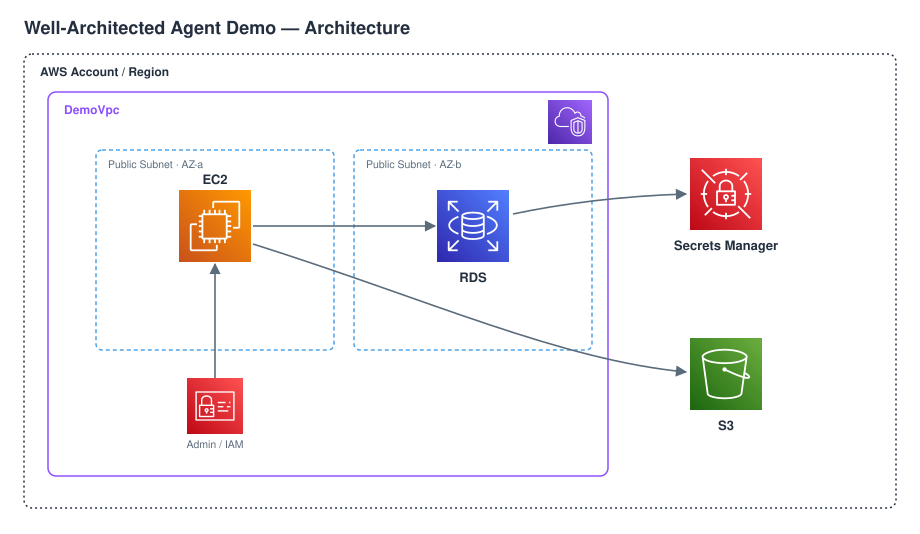
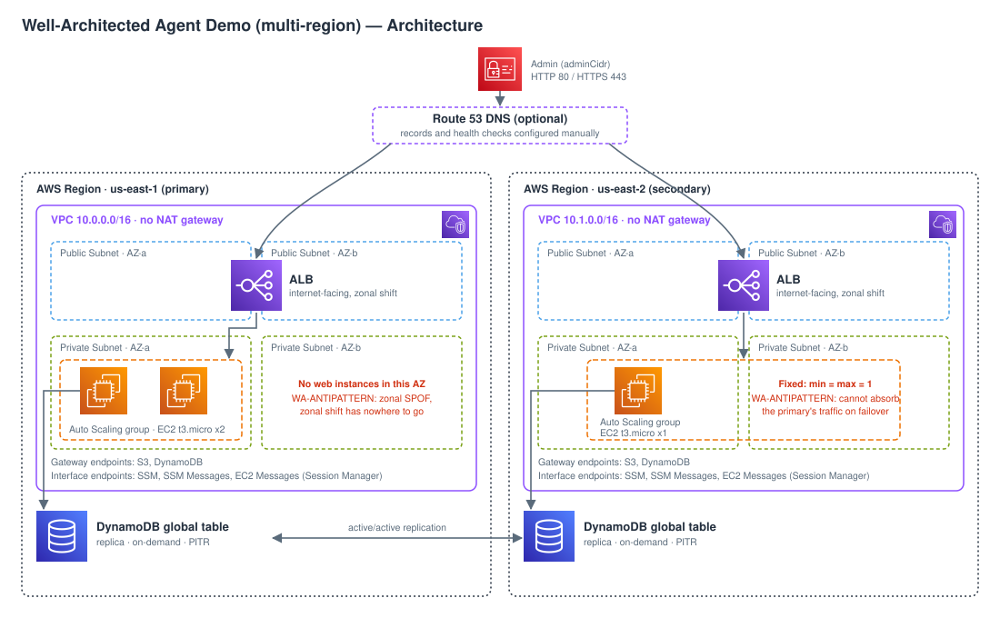

# Well-Architected Agent demo
*Give the Well-Architected Agent a realistic, flawed AWS workload so it has something worth reviewing*

## Overview

This demo deploys an AWS CDK (TypeScript) workload for the Well-Architected Agent to
review, together with a correctly configured agent profile that reviews it. A deployment
is one variant, made of two blocks:

| Block | What it deploys | What it shows |
| --- | --- | --- |
| Workload | Variant `single` (default): intentionally non-optimized single-instance web app (EC2, MySQL RDS, S3, in one Region). Variant `multi`: active/active web app in two Regions (ALB, Auto Scaling group, DynamoDB global table) | `single`: obvious anti-patterns across all four pillars the agent analyzes. `multi`: a design that looks resilient, with documented gaps that break its stated recovery objectives |
| Agent | Execution and access roles, one agent profile, one goal per pillar and one application context, all configured for the variant | The agent side, configured correctly |

In both variants the anti-patterns span the four pillars the Well-Architected Agent
analyzes (resilience, security, cost optimization and performance), so the agent can
produce recommendations you can check against a known list. The application context
declares requirements the deployed architecture deliberately cannot meet.

The variants are mutually exclusive: one account and agent Region runs either `single`
or `multi`, never both. Adding a variant means adding its workload stack and its profile
spec (see [ARCHITECTURE.md](ARCHITECTURE.md)).

> Do not use this as a production template. The anti-patterns are deliberate.

## Business Value

Reviewing an architecture against the Well-Architected Framework is slow when it is
done by hand. The `single` variant shows the agent finding resilience, security, cost and
performance issues on its own, on a workload where the expected findings are documented
in advance. The `multi` variant raises the bar: a workload that already uses multiple
AZs and multiple Regions, where the remaining issues are subtle, so you can see whether
the agent recognizes what is done well and still finds the gaps that matter. Both make
the quality of the recommendations easy to judge.

## At a Glance

- **Duration**: 20 minutes (`single`) or 30 minutes (`multi`) to deploy, plus usually a few hours (at most 48 hours) before the first scheduled recommendations
- **Requires**: an AWS Support plan with access to the Well-Architected Agent. The demo targets **Enterprise Support** and **Unified Operations** customers; Business+ and Enterprise On-Ramp have access too. Basic, Developer and Business do not (see [Prerequisites](#prerequisites))
- **Difficulty**: Beginner (`single`), Intermediate (`multi`)
- **Target Audience**: Solutions architects, cloud engineers, platform and resilience teams
- **Key Technologies**: AWS Well-Architected Agent (preview), AWS CDK, Amazon EC2, Amazon RDS, Amazon S3, AWS Secrets Manager, IAM; for `multi` also Amazon EC2 Auto Scaling, Elastic Load Balancing (ALB), Amazon DynamoDB global tables, Amazon VPC endpoints, AWS Systems Manager Session Manager
- **Estimated Cost**: about $0.22 to $0.23/hour (about $158 to $165/month if left running) depending on the variant, see breakdown below

## Walkthrough after deployment

Deploy one variant first (see [Deployment](#deployment)). The deploy script prints
`<AGENT_PROFILE_ARN>` and the agent Region, `<AGENT_REGION>` (`WA_AGENT_REGION`, default
your Region). Every command below runs against the agent Region, and the AWS WA Agent
console must be switched to that Region too.

### 1. Check the setup

Confirm that the profile can run scheduled recommendations:

```bash
aws wellarchitected get-agent-profile --profile-arn "<AGENT_PROFILE_ARN>" --region "<AGENT_REGION>" --query "{eligible: eligibleForScheduledGeneration, errors: fieldErrors}"
```

`eligible` must be `true`; otherwise `errors` names the field to fix.

In the console, open **Agent profiles**, then **WA Agent Demo Profile (single-region)** or
**WA Agent Demo Profile (multi-region)** (name `wa-agent-demo-profile`):

- **Profile details** lists the four goals of the variant, one per pillar
  (`lib/single-region-profile.ts` or `lib/multi-region-profile.ts`).
- The **Application context** tab lists the context of the workload, with its declared
  requirements, its account and Regions, and its `project` tag: `wa-agent-demo-single`
  for `single`, `wa-agent-demo-multi` for `multi`. That tag is how the agent finds the
  workload: only resources that carry it are reviewed as part of the application. The
  profile's **Edit** page does not show the application context at all, so check it on
  this tab.

The same context from the CLI:

```bash
aws wellarchitected list-agent-contexts --profile-arn "<AGENT_PROFILE_ARN>" --region "<AGENT_REGION>"
```

### 2. Know when results are ready

The first scheduled run usually starts within a few hours of profile setup, at most 48 hours
(see [When recommendations appear](#when-recommendations-appear)). List the runs:

```bash
aws wellarchitected list-agent-recommendation-generations --profile-arn "<AGENT_PROFILE_ARN>" --region "<AGENT_REGION>" --query "items[].{id: id, name: name, status: status, created: createdAt}"
```

Results are ready when the scheduled run (`scheduled-generation`) is `COMPLETED`. Before
that it is `QUEUED` or `IN_PROGRESS`. If it ends in `ERROR`, read the reason with
`aws wellarchitected get-agent-recommendation-generation --profile-arn "<AGENT_PROFILE_ARN>" --generation-id <ID> --region "<AGENT_REGION>" --query errorDetails`.

### 3. Open the results under Recommendations, not Reviews

In the console, open **Recommendations**. **Reviews** only lists on-demand architecture
reviews (step 8), so it stays empty after a scheduled run. From the CLI:

```bash
aws wellarchitected list-agent-recommendations --profile-arn "<AGENT_PROFILE_ARN>" --region "<AGENT_REGION>" --state OPEN --query "items[].{title: title, pillar: pillar, priority: priority, arn: recommendationArn}"
```

Add `--pillar RESILIENCE` (or `SECURITY`, `COST_OPTIMIZATION`, `PERFORMANCE`) to filter.
One run produces at most 30 recommendations. Most of them are of type **Application**
(beta): they look at the application as a whole, through its context, and name it
(*Well-Architected Agent demo web application* or *Multi-region active/active web
application*). Recommendations of type **Resource** target one resource, for example
one RDS instance or one S3 bucket. Expect several recommendations that say nearly the
same thing in different pillars or with different priorities, for example several
variants of "put the web tier behind a load balancer and an Auto Scaling group".

### 4. Read one recommendation end to end

For `single`, take the recommendation to put the web tier behind an Application Load
Balancer and a multi-AZ Auto Scaling group (resilience pillar): the single public
instance is the most visible gap of the variant. In the console, open it from
**Recommendations**; from the CLI, pass its ARN from step 3:

```bash
aws wellarchitected get-agent-recommendation --recommendation-arn "<RECOMMENDATION_ARN>" --region "<AGENT_REGION>"
```

Read it in this order:

- **Insights**: the signals the agent detected on the deployed resources, here one
  instance with a public IP, no load balancer and no Auto Scaling group.
- **Remediation steps**: what to change, step by step.
- **Cross-pillar benefits**: what the fix also improves outside the resilience pillar,
  typically performance (elastic capacity).
- **Trade-offs**: what the fix costs or risks, for example the hourly cost of the load
  balancer and of the extra instances.
- **Goals**: the profile goal the recommendation serves, here the resilience goal about
  the declared RPO of 5 minutes and RTO of 2 hours.

### 5. Compare expected and found

Each variant section lists its built-in anti-patterns as a checklist, with what to expect
from the agent: [`single`](#expected-findings) and [`multi`](#expected-findings-1). Search
the stacks for `WA-ANTIPATTERN` to see each one called out inline in the code.

### 6. Find the declared RPO and RTO against the real architecture

The declared requirements live in the application context (step 1): for `single`,
RPO 5 minutes, RTO 2 hours, HA and DR in place; for `multi`, RPO 1 minute, RTO 15 minutes,
automatic Regional failover, alerting within 5 minutes. The deployed architecture cannot
meet them on purpose. Look for the gap in the resilience recommendations
(`--pillar RESILIENCE` in step 3): their description, impact and insights are where the
agent can contrast the declared objective with what it found (for `single`, HA and DR
declared on one public instance and a single-AZ database; for `multi`, alerting within
5 minutes with no alarms). Their **Goals** entry points to the resilience goal of the
variant, which names the same objectives. The wording varies between runs, so treat this
as where to look rather than a fixed sentence.

### 7. Optional: fix one anti-pattern and watch it clear

Remove `AdministratorAccess` from the `single` instance role. This also removes the
main risk of the variant (see [Prerequisites](#prerequisites)). Find the role and the
policy ARN, then detach it:

```bash
aws cloudformation describe-stack-resources --stack-name "WAAgentDemoSingleWorkload-<WORKLOAD_REGION>" --region "<WORKLOAD_REGION>" --query "StackResources[?ResourceType=='AWS::IAM::Role' && starts_with(LogicalResourceId, 'InstanceRole')].PhysicalResourceId" --output text
aws iam list-attached-role-policies --role-name <INSTANCE_ROLE_NAME>
aws iam detach-role-policy --role-name <INSTANCE_ROLE_NAME> --policy-arn <ADMIN_POLICY_ARN>
```

The change is picked up at the next scheduled run, and scheduled runs have a cooldown of
7 days per profile, so expect the recommendation about `AdministratorAccess` to leave the
open list up to a week later (check with `--state CLOSED` in step 3). Resource and
application recommendations cannot be triggered on demand. A later deploy of the stack
attaches the policy again.

### 8. Optional: run an on-demand architecture review

An architecture review analyzes infrastructure as code instead of deployed resources, and
returns recommendations of type `ARCHITECTURE` in minutes. It is not subject to the 7-day
cooldown; the quota is 5 reviews per day per profile. The input must be in an S3 bucket
in the agent Region. For `single`, synthesize the template and upload it (from
`infrastructure/cdk`):

```bash
npx cdk synth -c "adminCidr=<YOUR_IP>/32"
aws s3 mb "s3://wa-agent-demo-input-<ACCOUNT_ID>-<AGENT_REGION>" --region "<AGENT_REGION>"
aws s3 cp "cdk.out/WAAgentDemoSingleWorkload-<WORKLOAD_REGION>.template.json" "s3://wa-agent-demo-input-<ACCOUNT_ID>-<AGENT_REGION>/single.template.json" --region "<AGENT_REGION>"
```

Then start the review from the console (**Architecture review**, with the S3 URI of the
template) or from the CLI. Bash:

```bash
aws wellarchitected start-agent-recommendation-generation --region "<AGENT_REGION>" \
  --profile-arn "<AGENT_PROFILE_ARN>" --types ARCHITECTURE --name single-template-review \
  --scope '{"pillars": ["RESILIENCE", "SECURITY", "COST_OPTIMIZATION", "PERFORMANCE"]}' \
  --additional-context '{"s3Uri": "s3://wa-agent-demo-input-<ACCOUNT_ID>-<AGENT_REGION>/single.template.json", "lensArns": ["arn:aws:wellarchitected::aws:lens/wellarchitected"]}'
```

PowerShell 5.1 strips the inner double quotes of JSON arguments passed to native
commands, so write the JSON to files and pass them with `file://`:

```powershell
'{"pillars": ["RESILIENCE", "SECURITY", "COST_OPTIMIZATION", "PERFORMANCE"]}' | Set-Content scope.json -Encoding ascii
'{"s3Uri": "s3://wa-agent-demo-input-<ACCOUNT_ID>-<AGENT_REGION>/single.template.json", "lensArns": ["arn:aws:wellarchitected::aws:lens/wellarchitected"]}' | Set-Content context.json -Encoding ascii
aws wellarchitected start-agent-recommendation-generation --region "<AGENT_REGION>" `
  --profile-arn "<AGENT_PROFILE_ARN>" --types ARCHITECTURE --name single-template-review `
  --scope file://scope.json --additional-context file://context.json
```

Follow it with step 2; the review appears under **Reviews** and its recommendations
under **Recommendations**. The service documentation lists AWS CDK and Terraform projects
as supported inputs; if it rejects the synthesized CloudFormation template, upload a .zip
of `infrastructure/cdk` without `node_modules` and `cdk.out` instead (25 MB at most).
Remove the bucket afterwards: `aws s3 rb "s3://wa-agent-demo-input-<ACCOUNT_ID>-<AGENT_REGION>" --force --region "<AGENT_REGION>"`.

### For `multi`

Follow the same steps with the `multi` profile (`project` tag `wa-agent-demo-multi`, both
Regions in its scope). Use the [expected findings of `multi`](#expected-findings-1), per
Region, and its list of
[what should not be flagged](#kept-intentionally-correct-should-not-be-flagged-1). For
step 4, a good example is the recommendation about the primary web tier confined to one
Availability Zone. For step 8, upload the primary and secondary templates
(`WAAgentDemoMultiWorkloadPrimary-<primary>.template.json` and
`WAAgentDemoMultiWorkloadSecondary-<secondary>.template.json`) in one folder and pass the
folder URI (synthesize with the `multi` command of [Manual synth](#manual-synth)).

## Variant `single`: non-optimized single-region workload



### Expected findings

The built-in anti-patterns, as a checklist for step 5 of the
[walkthrough](#walkthrough-after-deployment). Recommendations vary between runs.

| Pillar | Anti-pattern | Expected from the agent |
| --- | --- | --- |
| Resilience, Performance | Single public instance, no load balancer, no Auto Scaling | Dedicated recommendations, usually several similar ones across resilience and performance |
| Security | Database in public subnets, sharing the app security group | Dedicated recommendations: move the database to isolated private subnets, split the security group |
| Security | `AdministratorAccess` on the instance role | Dedicated recommendation (replace the admin grant, add a permissions boundary) |
| Security | Public IPv4 address on the instance | Dedicated recommendation (remove it, put the instance behind a managed entry point) |
| Security | RDS storage not encrypted | Dedicated recommendation, often of type Resource (restore from an encrypted snapshot) |
| Security | No server access logging on the S3 bucket | Dedicated recommendation, often of type Resource |
| Resilience | Single-AZ RDS, automated backups disabled | May appear inside broader resilience recommendations rather than on its own |
| Security | EBS root volume not encrypted; TLS not enforced on the S3 bucket | May appear only as evidence in other recommendations, or not at all |
| Cost Optimization | Oversized instance (`m5.xlarge` for a demo web app) | Right-sizing recommendation, against the goal to reduce compute spend by 30%; may be generic, without a target size |

Count a row as found when it appears in the insights of another recommendation. The agent
also raises legitimate findings beyond this list, because the variant is weak in more
ways than the planted ones: SSH access instead of Session Manager, no automatic rotation
of the database secret, no patching or vulnerability scanning, no detailed monitoring,
no MySQL log exports, no incident-response tags, an interactive deployment instead of a
pipeline.

### Agent configuration

Defined in `singleRegionProfile()` in `lib/single-region-profile.ts`:

| Item | Value |
| --- | --- |
| Display name | `WA Agent Demo Profile (single-region)` |
| Scanned Regions | The workload Region |
| Goals | Meet the declared RPO of 5 minutes and RTO of 2 hours by removing single points of failure; enforce least-privilege access and encryption of all workload data at rest and in transit; reduce compute spend by at least 30% by rightsizing over-provisioned resources; scale the web tier automatically to sustain peak load |
| Application context | Business critical, RPO 5 minutes, RTO 2 hours, HA and DR in place; scoped by the `project=wa-agent-demo-single` tag, this account and the workload Region |

The declared RPO, RTO and HA/DR contradict the single-AZ, backup-less architecture on
purpose: the agent should flag the gap between stated requirements and reality.

### Kept intentionally correct (should not be flagged)

A recommendation against any of these is a false positive:

- The S3 bucket is private (public access fully blocked).
- The database is not publicly accessible.
- Ingress is restricted to one trusted admin CIDR on SSH and HTTP, never `0.0.0.0/0`.
  The agent may still recommend replacing SSH with Session Manager: that targets SSH
  itself, not the CIDR.
- The database password is generated and stored in Secrets Manager, never in the
  template. The agent may still recommend automatic rotation.

## Variant `multi`: active/active multi-region workload



In the examples the primary Region is **us-east-1 (N. Virginia)** and the secondary is
**us-east-2 (Ohio)**; both are configurable (see [Prerequisites](#prerequisites)). Per
Region:

- **VPC**: 2 AZs, 2 public subnets (ALB only) and 2 private subnets (web tier), no NAT
  gateway. Egress to AWS services goes only through VPC endpoints.
- **VPC endpoints**: gateway endpoints for S3 (package repositories) and DynamoDB;
  interface endpoints for SSM, SSM Messages and EC2 Messages (Session Manager).
- **ALB**: internet-facing, ARC zonal shift enabled. Ingress only from the admin CIDR
  and the AWS-managed Route 53 health checker prefix list. Optional HTTPS with an ACM
  certificate (TLS 1.3 policy) and an HTTP to HTTPS redirect.
- **Auto Scaling group**: `t3.micro`, Amazon Linux 2023, encrypted gp3 root volume,
  IMDSv2 only, no public IP, no SSH. Reachable only from the ALB security group. Its shape
  differs per Region on purpose (see the two deliberate inefficiencies below).
- **IAM**: instance role with `AmazonSSMManagedInstanceCore` plus read/write access to
  the local DynamoDB replica only.

Shared: a DynamoDB global table (on-demand, encrypted at rest, point-in-time recovery on
both replicas), owned by the primary stack.

### Deliberate inefficiencies in the web tier

The two Regions are deployed with different, deliberately weak web tiers, so the agent has
one distinct resilience story per Region:

| Region | Default shape | Why it is a problem |
| --- | --- | --- |
| Primary (`us-east-1`) | Auto Scaling group of 2 to 4 instances, **all in one Availability Zone** | Zonal single point of failure: an AZ impairment takes down the primary web tier. The ALB still spans two AZs with ARC zonal shift enabled, but shifting away from the only AZ that has instances leaves no healthy target, so the control is present but cannot help. |
| Secondary | **One instance, fixed** (min = max = 1), across two AZs | No static stability: on a Regional failover a single instance that cannot scale must absorb all the traffic of the primary Region, so the declared active/active failover within an RTO of 15 minutes is not achievable. A launch template change also replaces the only instance with an outage. |

Both are marked `WA-ANTIPATTERN` in `lib/multi-region-workload-stack.ts` and set by
defaults in `lib/multi-region-config.ts`. `deploy-all` always deploys these defaults. The
resilient shape (2 to 4 instances across two AZs in both Regions) is available through
CDK context, from `infrastructure/cdk`, for example to compare the two templates:

Windows (PowerShell):

```powershell
cd infrastructure\cdk
npx cdk synth -c variant=multi -c secondaryRegion=us-east-2 -c "adminCidr=<YOUR_IP>/32" `
  -c primaryWebAzCount=2 -c secondaryAsgMinSize=2 -c secondaryAsgMaxSize=4
```

Linux / macOS (Bash):

```bash
cd infrastructure/cdk
npx cdk synth -c variant=multi -c secondaryRegion=us-east-2 -c "adminCidr=<YOUR_IP>/32" \
  -c primaryWebAzCount=2 -c secondaryAsgMinSize=2 -c secondaryAsgMaxSize=4
```

### Expected findings

The built-in gaps, per Region, as a checklist for step 5 of the
[walkthrough](#walkthrough-after-deployment). Recommendations vary between runs.

| Region | Pillar | Gap | Expected from the agent |
| --- | --- | --- | --- |
| Primary | Resilience | Web tier in a single Availability Zone; ARC zonal shift cannot help, since no other AZ has instances | Dedicated recommendations, usually several (spread the instances across two AZs) |
| Secondary | Resilience | Web tier fixed at one instance: no static stability to absorb the primary's traffic on failover | Dedicated recommendation (pre-provision failover capacity, align the secondary with the primary) |
| Both | Resilience | No Route 53 records or health checks, so Regional failover depends on manual DNS | Dedicated recommendation (health-checked Route 53 routing), against the declared automatic failover |
| Both | Resilience | No CloudWatch alarms or notifications | Dedicated recommendations (alarms, SNS, canaries), against the declared 5-minute alerting |
| Both | Security | No ALB access logs | Dedicated recommendation |
| Both | Security | Plain HTTP by default (HTTPS only when a domain is provided) | Dedicated recommendation (HTTPS listener with ACM, HTTP to HTTPS redirect) |
| Both | Security, Resilience | No AWS WAF on the internet-facing ALBs | Dedicated recommendations, often framed as rate limiting |
| Both | Performance, Cost Optimization | Fixed-size Auto Scaling groups, no scaling policy | Dedicated recommendation (target-tracking scaling); the cost recommendation may target the burstable `t3.micro` instead of the missing scale-in |

The agent also raises findings that follow from demo choices, not from planted gaps:

- **Deletion protection off** on the DynamoDB replicas and **termination protection off**
  on the stacks. Both stay off so the demo can be destroyed cleanly.
- **Hardening beyond the scope of the demo**: least-privilege VPC endpoint policies,
  restricted security group egress, no automatic public IP on the ALB subnets, VPC flow
  logs, DynamoDB restore drills, Contributor Insights on the table, sharding of the visit
  counter item, emergency levers on the listeners.

### Agent configuration

Defined in `multiRegionProfile()` in `lib/multi-region-profile.ts`:

| Item | Value |
| --- | --- |
| Display name | `WA Agent Demo Profile (multi-region)` |
| Scanned Regions | The primary and secondary Regions |
| Goals | Fail over between Regions automatically within the declared RTO of 15 minutes; protect the internet-facing endpoints and encrypt all traffic in transit; match web tier capacity to demand in both Regions; scale the web tier automatically to sustain peak load in each Region |
| Application context | Business critical, RPO 1 minute, RTO 15 minutes, active/active with automatic Regional failover, failures detected and alerted within 5 minutes; scoped by the `project=wa-agent-demo-multi` tag, this account and both Regions |

### Kept intentionally correct (should not be flagged)

A recommendation against any of these is a false positive:

- Active/active data across two Regions (DynamoDB global table), ALBs across two AZs with ARC zonal shift.
- Compute in private subnets with no public IP, no SSH, IMDSv2 only, Session Manager access.
- No NAT gateway: AWS service traffic stays on VPC endpoints.
- Least-privilege instance role (local DynamoDB replica only, no admin policies).
- ALB ingress limited to one admin CIDR and the Route 53 health checkers, never `0.0.0.0/0`.
- Encryption at rest declared explicitly (EBS root volumes, DynamoDB).
- DynamoDB point-in-time recovery enabled in both Regions.

## Agent stack

Every deployment has one agent stack, `WAAgentDemoProfile-<agent-region>`, the main stack
of the demo. It is built from the profile spec of the deployed variant:

| Item | Value |
| --- | --- |
| Profile | `wa-agent-demo-profile`, hosted in the agent Region (`WA_AGENT_REGION`, default your Region), termination protection off. Display name and description from the variant |
| Scope | This account and the workload Regions of the variant only |
| Pillars | Resilience, Security, Cost Optimization, Performance, for both variants (Operational Excellence and Sustainability are not in scope for the agent) |
| Goals | One per pillar, specific to the variant (see the Agent configuration of each variant) |
| Application context | One, scoped by the variant's `project` tag and Regions. It finds the workload by tag and Region strings, so there is no cross-stack reference |
| Roles | An execution role (assumed by the service) and an access role (read-only scanning). CloudFormation names them; their ARNs are the `ExecutionRoleArn` and `AccessRoleArn` outputs of the stack |
| Outputs | `AgentProfileArn`, `ExecutionRoleArn`, `AccessRoleArn`, and `Variant`, `WorkloadRegion` (plus `SecondaryRegion` for `multi`), which the deploy scripts read back |

See [ARCHITECTURE.md](ARCHITECTURE.md) for the full design.

## Prerequisites

- **A sandbox account.** Deploy the demo in a dedicated sandbox account, never in an
  account with production workloads or data. In `single`, the EC2 instance has a public
  IP and an instance role with `AdministratorAccess`. Ingress is limited to your admin
  CIDR (`/32`), but anyone who reaches the instance gets administrator access to the
  whole account.
- An AWS account and credentials configured for your shell, allowed to create IAM roles
  and pass them to the agent (`iam:PassRole`)
- An AWS Support plan with access to the agent. The demo targets Enterprise Support and
  Unified Operations. Every tier with access, per the
  [quotas page](https://docs.aws.amazon.com/wellarchitected/latest/userguide/agent-quotas.html):

  | Support tier | Agent profiles per account | Applications per profile |
  | --- | --- | --- |
  | Business+ | 2 | 7 |
  | Enterprise On-Ramp | 10 | 30 |
  | Enterprise Support | 10 | 30 |
  | Unified Operations | 10 | 30 |

  Accounts on Basic, Developer or Business do not get the agent.
- **One free agent profile slot.** A deployment uses one profile and one application.
  List the existing profiles in each hosting Region with
  `aws wellarchitected list-agent-profiles --region <HOSTING_REGION>`.
- Regions: the workload deploys in your Region (`AWS_REGION` / `AWS_DEFAULT_REGION`). The
  agent profile (preview) can only be hosted in a few Regions, listed on the
  [quotas page](https://docs.aws.amazon.com/wellarchitected/latest/userguide/agent-quotas.html),
  but it can scan resources in any commercial Region. The agent stack goes to
  `WA_AGENT_REGION`, which defaults to your Region. If your Region cannot host a profile,
  the deploy script stops before deploying anything and asks you to set `WA_AGENT_REGION`
  to a hosting Region; the workload still deploys in your Region. See
  [AWS Well-Architected Agent Region](../../shared/README.md#aws-well-architected-agent-region).
- For `multi`, a secondary Region with the **same Region-code prefix** as the primary: the
  code without its last two segments (`us-east-1` and `us-west-2` are both `us`,
  `eu-west-3` and `eu-central-1` both `eu`; `us-gov-west-1` is `us-gov`). The prefix is
  not a data residency boundary: `ap` covers Tokyo, Mumbai and Sydney.
  - In `us-*` and `eu-*` Regions you can let the script choose: the first enabled Region
    with the same prefix in alphabetical order, preferring Regions that need no opt-in.
    For us-east-1 that is us-east-2; for eu-west-3, eu-central-1. This reads the account's
    enabled Regions, so the deploying identity needs `ec2:DescribeRegions`.
  - Elsewhere, pass it with `-SecondaryRegion` / `--secondary-region`.
  - A redeploy or a destroy reuses the secondary Region of the deployment, so you never
    pass it again. The script does not check that the secondary Region offers every
    service the variant uses.
- AWS CLI v2 (2.31.13 or later)
- Node.js 20+
- Outbound HTTPS to `checkip.amazonaws.com` (to detect your public IP), or your
  admin CIDR passed explicitly
- Optional, for HTTPS in `multi`: a public Route 53 hosted zone in the same account

## Deployment

Run the scripts from this demo folder, `resilience/well-architected-agent-demo/`. They
call the library's shared scripts at `../../shared/scripts`.

The script runs the library's shared prerequisites check, then the shared `deploy-cdk`
script once per stack: the workload stacks first, then the agent stack (Regions in the
examples: us-east-1, and us-east-2 as the secondary):

| Variant | Stacks, in deploy order | Prints |
| --- | --- | --- |
| `single` | `WAAgentDemoSingleWorkload-us-east-1`, `WAAgentDemoProfile-us-east-1` | Instance IP, database endpoint, bucket name, agent profile ARN |
| `multi` | `WAAgentDemoMultiWorkloadPrimary-us-east-1`, `WAAgentDemoMultiWorkloadSecondary-us-east-2`, `WAAgentDemoProfile-us-east-1`; CDK is bootstrapped in both Regions | ALB DNS names, table name, agent profile ARN |

**One variant at a time.** Before deploying, the script reads the outputs of the agent
stack in `WA_AGENT_REGION` (`Variant`, `WorkloadRegion`, `SecondaryRegion`). If it already
deploys another variant or another workload Region, the script stops and prints the
destroy command to run first. A redeploy of the same variant updates it in place.

Options, the same in both scripts:

| Option | Default | Meaning |
| --- | --- | --- |
| Variant | `single` | What to deploy: `single` or `multi`. Not needed to destroy |
| Admin CIDR | your public IPv4 `/32` (detected via `checkip.amazonaws.com`) | CIDR allowed to reach the workload. If detection fails, the script stops and asks for it |
| Domain and zone | none | HTTPS for `multi` only (ACM certificate per Region, DNS-validated in your hosted zone); both must be passed together |
| Secondary Region | the deployed one, else chosen by the script in `us-*` and `eu-*` (see [Prerequisites](#prerequisites)) | `multi` only: Region of the secondary stack |
| Destroy | off | Remove the deployed variant: agent stack, then workload stacks |

The workload and agent Regions are environment variables, not options: set `AWS_REGION`
and `AWS_DEFAULT_REGION` (workload) and, when needed, `WA_AGENT_REGION` (agent stack)
before running the script. Destroy needs only the same `WA_AGENT_REGION`. Invalid values
(an unknown variant, a domain without a zone, a domain or a secondary Region outside
`multi`, an agent Region that cannot host a profile, a secondary Region with another
prefix or different from the deployed one, another variant already deployed, or a run
outside the library checkout) stop the script with an error before anything is deployed.

### Windows (PowerShell)

If the execution policy blocks the script, allow it for the current session only:

```powershell
Set-ExecutionPolicy -Scope Process -ExecutionPolicy Bypass
```

Deploy one variant:

```powershell
$env:AWS_REGION = "us-east-1"; $env:AWS_DEFAULT_REGION = "us-east-1"

.\deploy-all.ps1                                                             # variant single
.\deploy-all.ps1 -Variant multi                                              # variant multi (us-east-1 + us-east-2)
.\deploy-all.ps1 -Variant multi -SecondaryRegion us-west-2                   # variant multi, secondary of your choice
.\deploy-all.ps1 -Variant multi -AdminCidr "<YOUR_IP>/32"                    # explicit admin CIDR
.\deploy-all.ps1 -Variant multi -Domain app.example.com -Zone example.com    # multi with HTTPS
```

Workload in a Region that cannot host the profile (example: Paris), agent stack in us-east-1:

```powershell
$env:AWS_REGION = "eu-west-3"; $env:AWS_DEFAULT_REGION = "eu-west-3"; $env:WA_AGENT_REGION = "us-east-1"

.\deploy-all.ps1                                                             # variant single
.\deploy-all.ps1 -Variant multi                                              # variant multi (eu-west-3 + eu-central-1)
```

Check that the agent profile is eligible for scheduled recommendations (the deploy script
prints the profile ARN and its Region):

```powershell
aws wellarchitected get-agent-profile --profile-arn "<AGENT_PROFILE_ARN>" --region "<AGENT_REGION>" `
  --query "{eligible: eligibleForScheduledGeneration, errors: fieldErrors}"
```

Clean up (whichever variant is deployed, same `WA_AGENT_REGION`):

```powershell
.\deploy-all.ps1 -Destroy
```

### Linux / macOS (Bash)

Deploy one variant:

```bash
export AWS_REGION=us-east-1 AWS_DEFAULT_REGION=us-east-1

./deploy-all.sh                                                               # variant single
./deploy-all.sh --variant multi                                               # variant multi (us-east-1 + us-east-2)
./deploy-all.sh --variant multi --secondary-region us-west-2                  # variant multi, secondary of your choice
./deploy-all.sh --variant multi --admin-cidr "<YOUR_IP>/32"                   # explicit admin CIDR
./deploy-all.sh --variant multi --domain app.example.com --zone example.com   # multi with HTTPS
```

Workload in a Region that cannot host the profile (example: Paris), agent stack in us-east-1:

```bash
export AWS_REGION=eu-west-3 AWS_DEFAULT_REGION=eu-west-3 WA_AGENT_REGION=us-east-1

./deploy-all.sh                                                               # variant single
./deploy-all.sh --variant multi                                               # variant multi (eu-west-3 + eu-central-1)
```

Check that the agent profile is eligible for scheduled recommendations (the deploy script
prints the profile ARN and its Region):

```bash
aws wellarchitected get-agent-profile --profile-arn "<AGENT_PROFILE_ARN>" --region "<AGENT_REGION>" \
  --query '{eligible: eligibleForScheduledGeneration, errors: fieldErrors}'
```

Clean up (whichever variant is deployed, same `WA_AGENT_REGION`):

```bash
./deploy-all.sh --destroy
```

### When recommendations appear

The documentation gives an upper bound: scheduled recommendations start within 24 hours
of profile setup according to the console guide, and within 48 hours according to the API
quickstart. In practice the first scheduled generation usually starts and completes much
sooner, often within a few hours. Follow it with `list-agent-recommendation-generations`
(step 2 of the [walkthrough](#walkthrough-after-deployment)); the deploy script prints the
command. If nothing is queued, run the eligibility check above for your shell: if
`eligible` is `false`, `errors` names the field to fix.

### Manual synth

Windows (PowerShell):

```powershell
cd infrastructure\cdk
npm install
npx cdk synth -c "adminCidr=<YOUR_IP>/32"                                                # single: workload + agent stack
npx cdk synth -c variant=multi -c secondaryRegion=us-east-2 -c "adminCidr=<YOUR_IP>/32"   # multi: primary, secondary + agent stack
```

Linux / macOS (Bash):

```bash
cd infrastructure/cdk
npm install
npx cdk synth -c "adminCidr=<YOUR_IP>/32"                                                # single: workload + agent stack
npx cdk synth -c variant=multi -c secondaryRegion=us-east-2 -c "adminCidr=<YOUR_IP>/32"   # multi: primary, secondary + agent stack
```

A manual synth differs from the scripts in two ways:
- `multi` needs the secondary Region (`-c secondaryRegion=...` or
  `WA_DEMO_SECONDARY_REGION`): only the deploy scripts choose one;
- `WA_AGENT_REGION` is read but not checked against the hosting Regions, and no check
  keeps one variant per agent Region: only the deploy scripts do both.

### Configuration of the `multi` variant

Settings are CDK context values, overridable with `-c key=value`; defaults live in
`infrastructure/cdk/lib/multi-region-config.ts`. Nothing account or deployment specific is
committed.

| Key | Default | Description |
| --- | --- | --- |
| `adminCidr` | `10.0.0.0/32` (no access) | CIDR allowed to reach the ALBs; the deploy scripts always set it |
| `secondaryRegion` | `WA_DEMO_SECONDARY_REGION`, set by the scripts; required for a manual synth | Region of the secondary stack |
| `primaryVpcCidr` / `secondaryVpcCidr` | `10.0.0.0/16` / `10.1.0.0/16` | VPC CIDRs |
| `instanceType` | `t3.micro` | Web tier instance type |
| `useAsg` / `keepSingleInstance` | `true` / `false` | Auto Scaling group and/or a single instance |
| `primaryWebAzCount` | `1` (deliberate gap) | Availability Zones the primary Auto Scaling group may use (1 or 2) |
| `primaryAsgMinSize` / `primaryAsgMaxSize` | `2` / `4` | Primary Auto Scaling group bounds |
| `secondaryWebAzCount` | `2` | Availability Zones the secondary Auto Scaling group may use (1 or 2) |
| `secondaryAsgMinSize` / `secondaryAsgMaxSize` | `1` / `1` (deliberate gap) | Secondary Auto Scaling group bounds |
| `appDomainName` / `route53ZoneName` | empty | Enable HTTPS for this FQDN, validated in this hosted zone |
| `appDomainAltNames` | `[]` | Extra certificate SANs |
| `createCertValidationRecords` | `true` | Set `false` if the ACM validation records already exist in the zone |
| `projectTag` | `wa-agent-demo-multi` | Value of the `project` tag, the scope of the application context |

To test the `multi` workload, open `http://<AlbDnsName>/cgi-bin/app.sh` in each Region:
the page shows the serving Region and instance and a visit counter shared by both
Regions through the global table.

## Troubleshooting

**The agent stack fails with `ServiceQuotaExceededException` on
`AWS::WellArchitected::AgentProfile`.** The account has reached the agent profile quota of
its Support tier (2 profiles on Business+, see [Prerequisites](#prerequisites)). The
workload stacks are deployed by then; the agent stack is not. List the profiles in each
hosting Region:

```bash
aws wellarchitected list-agent-profiles --region <HOSTING_REGION>
```

Then delete an unused profile or upgrade the Support tier, and run the deploy script
again. Or remove the workload with `-Destroy` / `--destroy`.

**The deploy stops with "already deploys variant ...".** Another variant, or the same
variant in another workload Region, is deployed with this `WA_AGENT_REGION`. Run the
destroy command the script prints, then deploy again.

**`eligibleForScheduledGeneration` is `false`, or no recommendations appear.** Read
`fieldErrors` (step 1 of the [walkthrough](#walkthrough-after-deployment)) and see
[Troubleshooting AWS Well-Architected Agent](https://docs.aws.amazon.com/wellarchitected/latest/userguide/agent-troubleshooting.html).

## Cleanup

One command removes whatever variant is deployed, with the same `WA_AGENT_REGION` as the
deploy:

```powershell
.\deploy-all.ps1 -Destroy
```

```bash
./deploy-all.sh --destroy
```

The script reads the variant and the workload Regions from the outputs of the agent stack,
so it needs neither the variant nor the Regions. It destroys the agent stack first, then
the workload stacks (for `multi`: secondary, then primary, which deletes the global table
and its replica). If the agent stack is missing, for example after a failed deploy, the
script removes what is left of the variant you pass (`-Variant` / `--variant`, default
`single`) in your Region; for `multi` it reads the secondary Region from the primary
stack, or asks for `-SecondaryRegion` / `--secondary-region`.

All stacks go through the shared `deploy-cdk` script. Every resource is removed with its
stack, including the log groups of the CDK-managed Lambdas; the CDK bootstrap stacks
(`CDKToolkit`) stay in place.

## Estimated Cost Breakdown

Approximate us-east-1 on-demand prices. Check the
[AWS Pricing Calculator](https://calculator.aws/) for your region.

### Variant `single`

| Resource | Hourly | Monthly (730 h) |
| --- | --- | --- |
| EC2 `m5.xlarge` | $0.192 | ~$140 |
| RDS `db.t3.micro` MySQL, single-AZ | $0.017 | ~$12 |
| RDS storage, 20 GiB | | ~$2.30 |
| EBS root volume, 50 GiB | | ~$4-5 |
| Public IPv4 address | $0.005 | ~$3.65 |
| Well-Architected Agent (preview) | | Not estimated here; see the [preview terms](https://aws.amazon.com/service-terms/) (Betas and Previews). Needs a Support plan with access to the agent |
| Secrets Manager secret | | $0.40 |
| S3 bucket (empty) | | < $0.01 |
| **Total** | **~$0.23** | **~$165** |

### Variant `multi`

On-demand prices for the default pair, us-east-1 (primary) and us-east-2 (secondary),
identical in both Regions for these items, taken from the AWS Price List bulk files.
Check the [AWS Pricing Calculator](https://calculator.aws/) for another pair.

| Resource | Primary, us-east-1 (hourly) | Secondary, us-east-2 (hourly) | Both Regions (hourly) | Both Regions (monthly, 730 h) |
| --- | --- | --- | --- | --- |
| EC2 `t3.micro`, Linux ($0.0104/h each): 2 primary + 1 secondary | $0.0208 | $0.0104 | $0.0312 | ~$22.78 |
| Application Load Balancer ($0.0225/h) | $0.0225 | $0.0225 | $0.0450 | ~$32.85 |
| Interface VPC endpoints, 3 x 2 AZs ($0.01/h per endpoint per AZ) | $0.0600 | $0.0600 | $0.1200 | ~$87.60 |
| Public IPv4 on the ALB, 2 addresses minimum, one per AZ ($0.005/h each) | $0.0100 | $0.0100 | $0.0200 | ~$14.60 |
| Well-Architected Agent (preview) | | | | Not estimated here; see the [preview terms](https://aws.amazon.com/service-terms/) (Betas and Previews). Needs a Support plan with access to the agent |
| **Total (fixed hourly items)** | **~$0.113** | **~$0.103** | **~$0.22** | **~$158** |

With the resilient shape (2 instances in each Region) add one `t3.micro`: about $0.23/hour,
about $165/month.

Not included for `multi` (usage-based, small for a demo): ALB LCUs, DynamoDB on-demand
requests and replicated writes, EBS root volumes, interface endpoint data processing,
cross-Region data transfer. Gateway endpoints (S3, DynamoDB) have no additional charge.

- **Demo cost**: a few dollars for a day-long session, plus the time you leave it running
  while waiting for recommendations. There are no Bedrock inference costs in this stack.
- **Production cost**: not applicable. This workload is never meant to run long-term.
- **Tip**: destroy the stacks as soon as you have the recommendations. In `single` the
  EC2 instance is most of the bill, and is itself one of the findings; in `multi` the
  interface endpoints are about half of it.

## Code Repository

This folder contains:

- `infrastructure/cdk/`: CDK app (`bin/app.ts`: picks the variant, then its workload
  stacks and the agent stack built from its profile spec) and `lib/`, one stack per file:
  - `agent-profile-stack.ts`: `AgentProfileStack`, the agent side of every variant: roles,
    profile, goals and application context, all from a profile spec
  - `single-region-workload-stack.ts`: `SingleRegionWorkloadStack`, the `single` workload;
    `single-region-profile.ts`: its profile spec (goals, context, Regions)
  - `multi-region-workload-stack.ts`: `MultiRegionWorkloadStack`, one per Region of the
    `multi` workload; `multi-region-profile.ts`: its profile spec;
    `multi-region-config.ts`: its settings; `multi-region-user-data.ts`: its instance
    user data
  - `regions.ts`: workload and agent Region resolution, with the library's
    `shared/utils/aws-utils.ts`
  - `cdk-log-groups.ts`: managed log groups for CDK Lambdas
- `deploy-all.ps1` / `deploy-all.sh`: deployment and cleanup scripts
- `validation.yaml`: deploy / verify / destroy contract (variant `single`)
- `ARCHITECTURE.md`, `assets/architecture.svg` and `assets/architecture-multiregion.svg`:
  design and diagrams

Solution adoption tracking: `(uksb-do9bhieqqh)(tag:well-architected-agent-demo,resilience)`,
set on the agent stack in `infrastructure/cdk/bin/app.ts`, the one stack every deployment
has. The workload stacks carry none.

## Available Extensions

- Fix one anti-pattern at a time and wait for the next generation to watch the
  recommendation clear.
- Change the goals of a variant (`lib/single-region-profile.ts` or
  `lib/multi-region-profile.ts`) to see how they reprioritize the recommendations.
- Deploy `single`, collect the recommendations, destroy it, then deploy `multi`, and
  compare how the agent scores an obviously flawed workload against a nearly resilient one.
- Add your own variant: `<variant>-workload-stack.ts`, `<variant>-profile.ts` and one more
  branch in `bin/app.ts` (see [ARCHITECTURE.md](ARCHITECTURE.md)).
- Assess the `multi` workload with AWS Resilience Hub as well, using its `project` tag as the
  discovery source, and compare the findings with the agent's.
- Add more anti-patterns for pillars you want to emphasize.

## Contributing

We welcome community contributions! Please see [CONTRIBUTING.md](../../CONTRIBUTING.md) for guidelines.

## Security

See [CONTRIBUTING](../../CONTRIBUTING.md#security-issue-notifications) for more information.

## License

This library is licensed under the MIT-0 License. See the [LICENSE](../../LICENSE) file.
