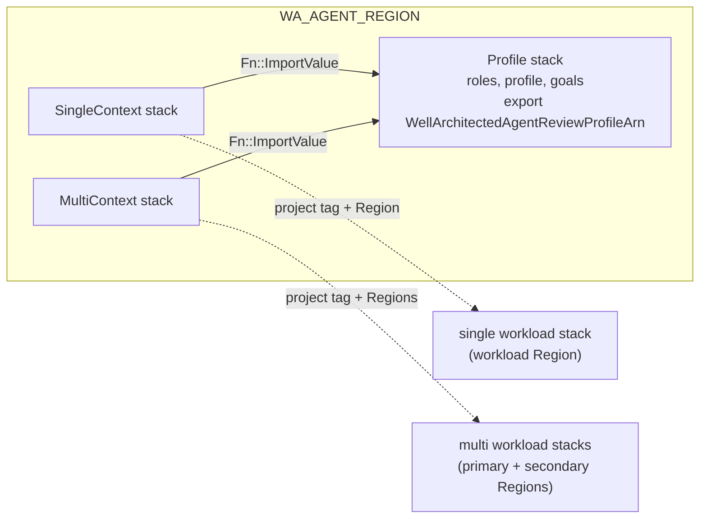
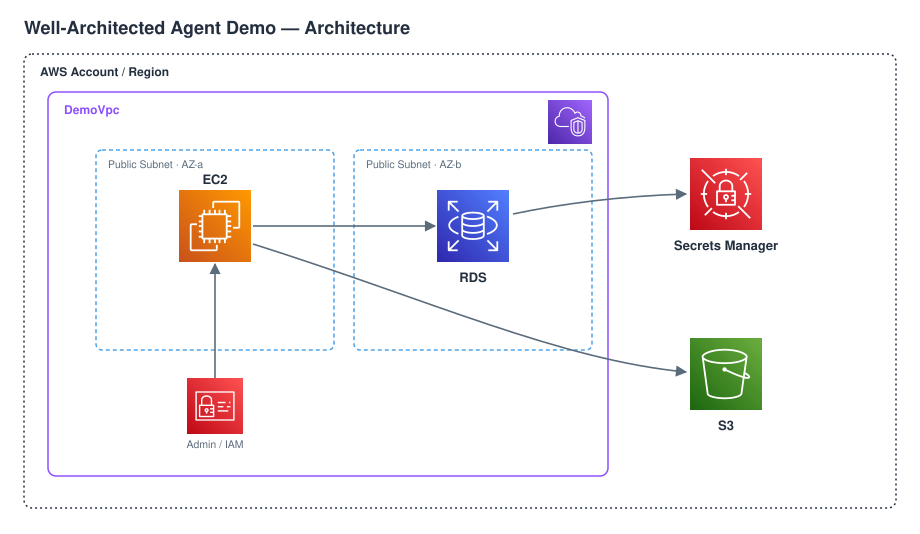
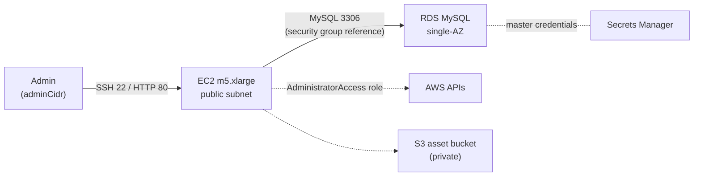
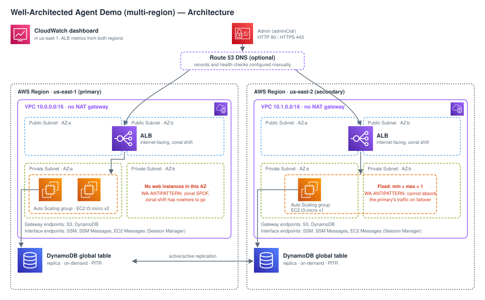
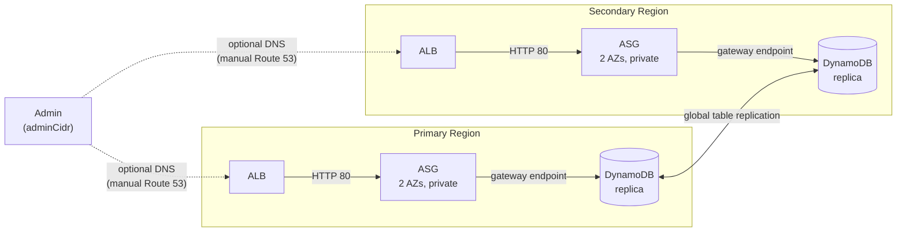
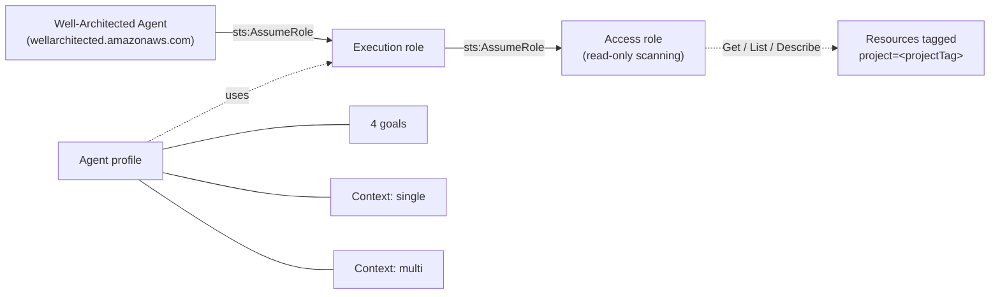

# Architecture: Well-Architected Agent Review

This demo deploys target applications for the Well-Architected Agent to review, plus a
correctly configured agent profile that reviews them. The applications are not a
recommended pattern: they exist so the agent has realistic findings to report. Each
anti-pattern is marked inline in the stacks with a `WA-ANTIPATTERN` comment.

The demo is made of three independent building blocks:

| Building block | Stacks | Region |
| --- | --- | --- |
| 1. Shared agent profile | `WellArchitectedAgentReviewProfile-<agent-region>`: execution and access roles, profile, goals. Main stack (adoption tracking) | `WA_AGENT_REGION` |
| 2. Application `single` (default) | `WellArchitectedAgentReviewStack-<region>`: deliberately non-optimized single-instance web app (EC2, RDS, S3) | workload Region |
| | `WellArchitectedAgentReviewSingleContext-<region>`: registers the application in the profile | `WA_AGENT_REGION` |
| 3. Application `multi` | `WellArchitectedAgentReviewMultiPrimary-<primary>`, `WellArchitectedAgentReviewMultiSecondary-<secondary>`, `WellArchitectedAgentReviewMultiDashboard-<primary>`: active/active web app in two Regions with a few documented gaps | primary and secondary Regions |
| | `WellArchitectedAgentReviewMultiContext-<primary>`: registers the application in the profile | `WA_AGENT_REGION` |

The workload stacks contain nothing of the agent. The profile is created once per account
and agent Region and reused by every application; an application joins it through its own
context stack, so adding an application changes nothing in the profile. Both applications
can run side by side under the same profile (distinct stack names and `project` tags).

The pieces all building blocks use (variant selection, agent profile, agent Region,
managed Lambda log groups) are described once in [Shared building blocks](#shared-building-blocks).

## Variant `single`

### Components

The workload lives in one CloudFormation stack, `WellArchitectedAgentReviewStack-<region>`,
defined in `infrastructure/cdk/lib/well-architected-agent-review-stack.ts`.

| Component | Configuration |
| --- | --- |
| VPC (`DemoVpc`) | 2 AZs, one public subnet per AZ, no NAT gateway, no private or isolated subnets |
| Security group (`OpenSecurityGroup`) | SSH (22) and HTTP (80) from the `adminCidr` context value only; shared by the instance and the database |
| EC2 (`AppInstance`) | One `m5.xlarge`, Amazon Linux 2, public subnet with a public IP, 50 GiB unencrypted root volume, no Auto Scaling group, no load balancer |
| IAM (`InstanceRole`) | Instance role with the `AdministratorAccess` managed policy |
| RDS (`Database`) | MySQL 8.0 on `db.t3.micro`, single-AZ, 20 GiB unencrypted storage, backups disabled, no deletion protection, `publiclyAccessible: false` |
| Secrets Manager | Generated master credentials for the database; no password in the template |
| S3 (`AssetBucket`) | Public access blocked, no versioning, TLS not enforced, no access logging, no lifecycle rules, objects auto-deleted with the stack |
| CloudWatch Logs (`AutoDeleteObjectsLogGroup`) | Log group of the CDK bucket-emptying Lambda, 30-day retention, deleted with the stack |

#### Application context

The application joins the shared profile through
`WellArchitectedAgentReviewSingleContext-<region>`, a `WaApplicationContextStack`
(`lib/wa-agent.ts`) deployed in `WA_AGENT_REGION`, with the content returned by
`singleRegionApplicationContext()` in `lib/well-architected-agent-review-stack.ts`:

| Field | Value |
| --- | --- |
| Profile | imported from `WellArchitectedAgentReviewProfileArn` (see [Well-Architected Agent (shared)](#well-architected-agent-shared)) |
| Type and criticality | `APPLICATION`, `BUSINESS_CRITICAL` |
| Scope | tag `project=well-architected-agent-review`, this account, the workload Region |
| Declared requirements | "Business critical, RPO 5 minutes, RTO 2 hours, HA and DR in place" |

The VPC spans two AZs only because an RDS subnet group must cover at least two. The
database itself stays single-AZ.

### Traffic and access

- Inbound traffic reaches the instance only from `adminCidr`. Without the context value
  the stack falls back to `10.0.0.0/32`, which allows no public access.
- The database port is opened to the shared security group only, and the database has
  no public endpoint.
- The instance role can call any AWS API, which is the most severe security finding.

### Intended findings by pillar

The agent analyzes four pillars. Operational Excellence and Sustainability are out of its
scope, so they are not listed.

| Pillar | Anti-pattern |
| --- | --- |
| Resilience | Single-AZ RDS, no backups, single instance, no Auto Scaling, no load balancer; declared RPO/RTO and HA/DR not achievable |
| Security | `AdministratorAccess` instance role, unencrypted EBS and RDS storage, TLS not enforced on S3, public subnets for every tier |
| Cost Optimization | Oversized `m5.xlarge` for a demo workload |
| Performance | Single manually sized instance with no scaling |

### Kept correct on purpose

- S3 public access is fully blocked.
- The database is not publicly accessible.
- Ingress is limited to one admin CIDR on two ports, never `0.0.0.0/0`.
- Database credentials are generated and stored in Secrets Manager.

### Deployment flow

`deploy-all.ps1` / `deploy-all.sh` (default variant) call the library's shared
`check-prerequisites` script (AWS CLI, credentials, region, Node.js 20+, CDK, and the
profile Region), list the account's enabled Regions for the profile, resolve the admin
CIDR, then call the shared `deploy-cdk` script once per stack:

1. Profile stack, in `WA_AGENT_REGION` (bootstraps it; created, or updated with the
   current enabled Regions).
2. Workload stack, in the workload Region (bootstraps it), with `adminCidr` as CDK context.
3. Context stack, in `WA_AGENT_REGION`.

### Teardown

`deploy-all.ps1 -Destroy` / `deploy-all.sh --destroy` destroy the context stack, then the
workload stack, and keep the shared profile (see
[Removing the profile](#well-architected-agent-shared)).

Every resource uses `RemovalPolicy.DESTROY` or the service default delete behavior. The
S3 bucket is emptied by the CDK auto-delete custom resource before deletion.

That custom resource runs a CDK-managed Lambda whose log group is managed by the stack
(see [CDK-managed Lambda log groups](#cdk-managed-lambda-log-groups-shared)).

## Variant `multi`

In the examples the primary Region is us-east-1 (N. Virginia) and the secondary is
us-east-2 (Ohio); both are configurable (see below).

### Stacks

| Stack (default Regions) | Region | Defined in | Contents |
| --- | --- | --- | --- |
| `WellArchitectedAgentReviewMultiPrimary-us-east-1` | primary | `lib/region-stack.ts` | Region resources, DynamoDB global table, `SecondaryRegion` output |
| `WellArchitectedAgentReviewMultiSecondary-us-east-2` | secondary | `lib/region-stack.ts` | Region resources |
| `WellArchitectedAgentReviewMultiDashboard-us-east-1` | primary | `lib/dashboard-stack.ts` | CloudWatch dashboard for both Regions |
| `WellArchitectedAgentReviewMultiContext-us-east-1` | `WA_AGENT_REGION` | `lib/wa-agent.ts`, `lib/multi-region-agent.ts` | Application context of this application in the shared profile |

The primary Region comes from `WA_DEMO_PRIMARY_REGION` when the deploy script sets it,
otherwise from the shared `getRegion()` resolution (`AWS_DEFAULT_REGION`, `AWS_REGION`,
CLI configuration). Any Region works: only the agent profile is limited to the hosting
Regions (see [Agent Region](#agent-region-shared)). The secondary Region comes from
`-c secondaryRegion=...` or `WA_DEMO_SECONDARY_REGION`; with neither the synth stops. The
CDK app keeps no Region list and chooses nothing. The deploy scripts set the variable:

1. `-SecondaryRegion` / `--secondary-region` when passed;
2. otherwise the `SecondaryRegion` output of the deployed primary stack, so a redeploy or
   a destroy never moves the secondary Region (passing a different one is an error);
3. otherwise, on a first deploy, a Region chosen from the account's enabled Regions
   (`aws ec2 describe-regions`) in the primary's geography: primary excluded,
   alphabetical order, Regions without opt-in first. us-east-1 gives us-east-2, eu-west-3
   gives eu-central-1.

On deploy, the scripts require the secondary Region to be in the primary's geography,
whatever its source: the geography is the Region code without its last two segments
(`us-east-1` is `us`, `ap-southeast-1` is `ap`, `us-gov-west-1` is `us-gov`). They stop
when it is not, and when the account has no other enabled Region in that geography. The
destroy skips this check, so it can always remove what is deployed. The scripts do not
check that the secondary Region offers every service the variant uses.

The secondary stack depends on the primary because the primary creates the DynamoDB
replica in the secondary Region and, with HTTPS, the shared ACM validation records. The
stacks share no CloudFormation cross-Region references: the dashboard receives the ALB and
target group identifiers of both Regions as `--context`, read by the deploy script from
the region stack outputs.

### Components (per Region)

| Component | Configuration |
| --- | --- |
| VPC (`Vpc`) | 2 AZs, 2 public `/24` subnets (ALB only), 2 private isolated `/24` subnets (web tier and interface endpoints), no NAT gateway. CIDR `10.0.0.0/16` (primary) / `10.1.0.0/16` (secondary) |
| Gateway endpoints | S3 (Amazon Linux 2023 package repositories) and DynamoDB, on the private route tables |
| Interface endpoints | `ssm`, `ssmmessages`, `ec2messages` with private DNS, in both private subnets; security group allows HTTPS from the VPC CIDR only |
| ALB (`Alb`) | Internet-facing, in both public subnets, ARC zonal shift enabled. HTTP 80 forwards to the target group, or redirects to 443 when HTTPS is enabled |
| ALB security group (`AlbSg`) | HTTP 80 (and HTTPS 443) from `adminCidr` and from the AWS-managed prefix list `com.amazonaws.<region>.route53-healthchecks` only |
| Target group (`TargetGroup`) | HTTP 80, health check `GET /` expecting `200`, 30 s interval, 2 healthy / 3 unhealthy |
| Auto Scaling group (`WebAsg`) | Launch template with Amazon Linux 2023 (latest AMI from the public SSM parameter), `t3.micro`, 8 GiB encrypted gp3 root volume, IMDSv2 only, no public IP. ELB health checks with a 300 s grace period, rolling replacement of one instance at a time. Shape per Region (deliberate gaps, `web` in `lib/config.ts`): **primary** min 2 / max 4 in **one** private subnet (one AZ); **secondary** min 1 / max 1 across both private subnets |
| Web tier security group (`Ec2Sg`) | HTTP 80 from the ALB security group only |
| IAM (`Ec2Role`) | `AmazonSSMManagedInstanceCore` plus `PutItem`, `UpdateItem`, `GetItem`, `Query`, `DescribeTable` on the table ARN in the same Region only |
| CloudWatch Logs (`RestrictDefaultSgLogGroup`) | Log group of the CDK Lambda that strips the rules of the VPC default security group (feature flag `@aws-cdk/aws-ec2:restrictDefaultSecurityGroup`, set on the region stacks only), 30-day retention, managed as in [CDK-managed Lambda log groups](#cdk-managed-lambda-log-groups-shared) |
| Optional single instance (`Web`) | `keepSingleInstance=true`: one instance in the first private subnet, registered to the same target group (single-instance baseline with `useAsg=false`) |
| Optional HTTPS | `appDomainName` + `route53ZoneName`: public ACM certificate per Region (DNS validation), HTTPS 443 listener with `ELBSecurityPolicy-TLS13-1-2-2021-06` |

### Shared components

| Component | Configuration |
| --- | --- |
| DynamoDB global table (`GlobalTable`) | Partition key `pk` (string), on-demand billing, encryption at rest with the AWS owned key (declared explicitly), point-in-time recovery on both replicas, replicas in both Regions. Both replicas accept writes |
| CloudWatch dashboard | Requests (stacked total and per Region), ELB 5xx, healthy hosts, target response time, requests per AZ (Metrics Insights). Optional Global Accelerator row |

#### Application context

The application joins the shared profile through
`WellArchitectedAgentReviewMultiContext-<primary>`, a `WaApplicationContextStack`
(`lib/wa-agent.ts`) deployed in `WA_AGENT_REGION`, with the content returned by
`multiRegionApplicationContext()` in `lib/multi-region-agent.ts`:

| Field | Value |
| --- | --- |
| Profile | imported from `WellArchitectedAgentReviewProfileArn` (see [Well-Architected Agent (shared)](#well-architected-agent-shared)) |
| Type and criticality | `APPLICATION`, `BUSINESS_CRITICAL` |
| Scope | tag `project=well-architected-agent-review-multiregion`, this account, both workload Regions |
| Declared requirements | "Business critical, RPO 1 minute, RTO 15 minutes, active/active in two Regions with automatic Regional failover, failures detected and alerted within 5 minutes" |

### Traffic and access

- Inbound traffic reaches an ALB only from `adminCidr`, plus the Route 53 health checkers
  so that endpoint health checks against the ALB work out of the box. Without the context
  value the stacks fall back to `10.0.0.0/32`, which allows no public access.
- The web tier accepts traffic only from its ALB. It has no public IP and no SSH; operators
  connect through Session Manager over the interface endpoints.
- Each Region writes to its local replica through the DynamoDB gateway endpoint;
  DynamoDB replicates the writes to the other Region.
- The application page (`/cgi-bin/app.sh`) shows the serving Region and instance and a
  visit counter shared by both Regions. `/` is a static page used as the health check
  target and does not touch DynamoDB.

### Routing one hostname to both Regions (manual)

The stacks do not create Route 53 records or health checks (this is one of the built-in
gaps). To put one hostname in front of both ALBs:

1. Create one Route 53 health check per Region: type endpoint, by domain name, protocol
   HTTP, port 80, path `/`, domain name = the Region's `AlbDnsName` output.
2. In your public hosted zone, create two alias `A` records with the same name (for
   example `app.example.com`), one per ALB, each with its health check. Pick a routing
   policy:
   - **Latency**: each client goes to the closest healthy Region (active/active).
   - **Weighted**: split traffic by weight, for example 50/50 or a gradual shift.
   - **Failover**: primary record for the primary Region, secondary for the other
     (active/passive).
3. Verify with `dig +short app.example.com` and `curl -s http://app.example.com/`.

With HTTPS enabled, port 80 answers with a 301 redirect, which Route 53 endpoint health
checks treat as healthy, so the same health checks keep working.

### Intended findings by pillar

The agent analyzes four pillars. Operational Excellence and Sustainability are out of its
scope, so they are not listed.

| Pillar | Gap | Where |
| --- | --- | --- |
| Resilience | Primary web tier confined to one Availability Zone: zonal single point of failure; ARC zonal shift on the ALB has no other AZ with targets to shift to | `region-stack.ts`, ASG (`primaryWebAzCount=1`) |
| Resilience / Performance | Secondary web tier fixed at one instance: cannot absorb the primary Region's traffic on failover (no static stability); a launch template change replaces it with an outage | `region-stack.ts`, ASG (`secondaryAsgMinSize=1`, `secondaryAsgMaxSize=1`) |
| Resilience | Cross-Region routing and failover not codified (no Route 53 records or health checks), contradicting the declared automatic Regional failover | `region-stack.ts`, outputs |
| Resilience | No CloudWatch alarms or notifications, contradicting the declared 5-minute detection | `region-stack.ts`, outputs |
| Resilience | Single point of failure when run as a single instance (`useAsg=false`) | `region-stack.ts`, single instance |
| Security | No AWS WAF web ACL on the internet-facing ALBs | `region-stack.ts`, ALB |
| Security | No ALB access logs | `region-stack.ts`, ALB |
| Security | Plain HTTP by default when no domain is configured | `region-stack.ts`, HTTP listener |
| Cost Optimization / Performance | Auto Scaling group without scaling policies: fixed capacity, no scale-out or scale-in | `region-stack.ts`, ASG |

### Kept correct on purpose

- Active/active data across two Regions with a DynamoDB global table; ALBs across two AZs in each Region.
- ARC zonal shift enabled on both ALBs.
- Compute in private subnets: no public IP, no SSH, IMDSv2 only, Session Manager access.
- No NAT gateway; AWS service traffic stays on VPC endpoints.
- Least-privilege instance role scoped to the local table replica.
- ALB ingress limited to one admin CIDR and the Route 53 health checkers, never `0.0.0.0/0`.
- Encryption at rest declared explicitly: encrypted gp3 root volumes, DynamoDB AWS owned key.
- Point-in-time recovery on both table replicas.
- With HTTPS: TLS 1.3 security policy and HTTP to HTTPS redirect.
- The shared agent profile and this application's context.

### Deployment flow

`deploy-all.ps1 -Variant multi` / `deploy-all.sh --variant multi` call the library's shared `check-prerequisites` script
(AWS CLI 2.31.13+, credentials, Region, Node.js 20+, CDK, and the profile Region, see
[Agent Region](#agent-region-shared)), resolve the secondary Region and the admin CIDR
(auto-detected `/32` or passed explicitly, fail closed on anything that is not an IPv4
CIDR). They then call the shared `deploy-cdk` script once per stack, with `AWS_REGION`
pinned to the stack's Region and `WA_DEMO_PRIMARY_REGION`, `WA_DEMO_SECONDARY_REGION` and
`WA_AGENT_REGION` pinned, so every call synthesizes the same stacks:

1. Profile stack, in `WA_AGENT_REGION` (bootstraps it; created, or updated with the
   current enabled Regions).
2. Primary stack, in the primary Region (bootstraps it).
3. Secondary stack, in the secondary Region (bootstraps it).
4. Context stack, in `WA_AGENT_REGION`.
5. Dashboard stack, in the primary Region, with the four ALB and target group identifiers
   read from the region stack outputs and passed as `--context`.

### Teardown

`deploy-all.sh --variant multi --destroy` / `deploy-all.ps1 -Variant multi -Destroy` destroy the dashboard, context,
secondary and primary stacks in that order through the shared `deploy-cdk` script, and keep the shared profile; run them
with the same `AWS_REGION` and `WA_AGENT_REGION` as the deploy (the secondary Region is read from the primary stack output).
The synth that `cdk destroy` runs needs no context: the Regions come from the environment variables above, the admin CIDR
falls back to a no-access value and the dashboard renders a placeholder widget.

Every resource uses `RemovalPolicy.DESTROY` or the service default delete behavior. The
DynamoDB table has deletion protection off, so the table and its replica are removed with
the primary stack.

Each region stack contains one CDK-managed Lambda, the custom resource that removes the
rules of the VPC default security group; its log group is managed by the stack (see
[CDK-managed Lambda log groups](#cdk-managed-lambda-log-groups-shared)). The stacks use
no CDK cross-Region references, so no other CDK-managed Lambdas exist. The CDK bootstrap
stacks (`CDKToolkit`) are left in place in both Regions.

## Shared building blocks

### Variant selection

`infrastructure/cdk/bin/app.ts` always instantiates the profile stack, plus the stacks
of the variant in `WA_DEMO_VARIANT` (set by the deploy scripts) or `-c variant=...`:
`profile` (nothing more), `single` (default) or `multi`. The environment variables are
what reach `cdk destroy`, because the deploy scripts pass no `--context` on destroy:

| Variable | Meaning | Default |
| --- | --- | --- |
| `WA_DEMO_VARIANT` | `profile`, `single` or `multi` | `single` |
| `WA_DEMO_PRIMARY_REGION` | workload Region (primary for `multi`), pinned by the scripts | the library's shared `getRegion()` (`shared/utils/aws-utils.ts`) |
| `WA_AGENT_REGION` | Region of the profile and of every context stack | the workload Region |
| `WA_AGENT_SCAN_REGIONS` | comma-separated Regions the profile scans | the profile Region alone (manual synth) |
| `WA_DEMO_SECONDARY_REGION` | secondary Region of `multi` | none: required for `multi` |

The applications use the same `adminCidr` context value with the `10.0.0.0/32` no-access
fallback. Solution adoption tracking is on the profile stack only, the one stack every
deployment has; the workload and context stacks carry none.

### Well-Architected Agent (shared)

`lib/wa-agent.ts` holds the agent side in two reusable stack classes. It is configured
correctly; none of it is an anti-pattern.

**`WaAgentProfileStack`**: `WellArchitectedAgentReviewProfile-<agent-region>`, one per
account and agent Region, created on the first application deploy and updated by every
later one. With fixed construct ids, so logical IDs stay stable and an update never
replaces the profile:

| Component | Configuration |
| --- | --- |
| Execution role (`WAAgentExecutionRole-<agent-region>`) | Trusted by `wellarchitected.amazonaws.com`; only permission is `sts:AssumeRole` on the access role |
| Access role (`WAAgentAccessRole-<agent-region>`) | Trusted by the execution role ARN; AWS managed policy `WellArchitectedAgentResourceScanning` (read-only) |
| Agent profile (`wa-agent-demo-profile`) | Display name `WA Agent Demo Profile`; pillars Resilience, Security, Cost Optimization, Performance; this account; scans every enabled Region of the account (`WA_AGENT_SCAN_REGIONS`, listed by the deploy scripts with `ec2 describe-regions` and sorted); termination protection off |
| Goals | One per pillar, `PROFILE_GOALS`. Goals belong to the profile, not to an application, so they are written for every application the demo deploys |
| Output | `AgentProfileArn`, exported as `WellArchitectedAgentReviewProfileArn` |

**`WaApplicationContextStack`**: one per application deployment, in the profile Region. It
creates one `APPLICATION` context (`AgentApplicationContext`) that imports the profile ARN
and scopes the application by its `project` tag, account and Regions. The profile scans
every enabled Region; each context narrows the review to its own application.

**Why a context stack sits in the profile Region.** A CloudFormation stack only creates
resources in its own Region, and a context belongs to its profile, so the context cannot
live in a workload stack deployed elsewhere. One context stack per application, always in
the profile Region, gives the same layout whatever the workload Region.

**Why an export.** The context stacks import `WellArchitectedAgentReviewProfileArn` with
`Fn::ImportValue`. Besides passing the ARN without a CDK dependency between stacks,
it makes CloudFormation refuse to delete the profile stack while an application is still
registered.

**Adding an application.** Write its workload stacks, a function that returns its
`WaApplicationContext` (title, overviews, declared requirements, `project` tag, Regions),
and one `WaApplicationContextStack` in `bin/app.ts` under a new variant. Nothing in the
profile changes. Limits: a Business+ plan allows 7 applications per profile, and the
profile has 4 of its 10 goals.

**Removing the profile.** The application destroy keeps the profile for the other
applications. `deploy-all.ps1 -Variant profile -Destroy` / `deploy-all.sh --variant profile
--destroy` removes it: the script first lists the stacks that still import the export
(`aws cloudformation list-imports`) and stops with their names if any are left, and
CloudFormation would refuse anyway. A profile without any context is valid to keep but
runs no scheduled recommendations.

### Agent Region (shared)

The workloads deploy in the user's Region. The profile can only be hosted in the Regions
on the [quotas page](https://docs.aws.amazon.com/wellarchitected/latest/userguide/agent-quotas.html),
and scans resources in every commercial Region wherever it is hosted. The profile stack
and every context stack live in `WA_AGENT_REGION`, default the workload Region (primary
Region for `multi`):

- The deploy scripts ask the library's shared prerequisites check for it
  (`wellarchitected-agent`). That check holds the only copy of the hosting-Region list,
  because hosting cannot be probed through the API, and stops with guidance to set
  `WA_AGENT_REGION` in a Region that cannot host a profile. The demo keeps no copy. See
  [AWS Well-Architected Agent Region](../../shared/README.md#aws-well-architected-agent-region).
- `bin/app.ts` reads the resolved value (`resolveAgentRegion()` in `lib/config.ts`). The
  stack layout is the same whether or not it equals the workload Region.
- Keep the same `WA_AGENT_REGION` for every application of an account: each value creates
  its own profile, and a Business+ plan allows 2. The IAM role names carry the profile
  Region, so there is one profile per agent Region.

The execution role trust policy names the exact service principal and carries the same
confused-deputy conditions as the role the console creates: `aws:SourceAccount` equal to
this account, and `aws:SourceArn` matching any agent profile of this account
(`arn:<partition>:wellarchitected:*:<account>:agent-profile/*`). The profile ARN itself
cannot be used, because the profile depends on the role. The access role trusts the
execution role ARN only.

### CDK-managed Lambda log groups (shared)

Both applications contain one CDK-managed custom resource Lambda: the S3 auto-delete-objects
Lambda in `single`, the VPC default security group Lambda in each `multi` region stack.
The profile and context stacks contain none.
Left alone, such a Lambda creates its own log group at runtime and leaves it behind after
`cdk destroy`. Because Lambda delivers logs a few seconds late, the run on destroy can
recreate the group even after CloudFormation deleted it (seen in a real teardown).
`lockProviderLogGroup()` in `lib/cdk-log-groups.ts` therefore:

- gives the function a fixed name and declares its log group explicitly (30-day
  retention, deleted with the stack, created before the function and deleted after it);
- removes the default `AWSLambdaBasicExecutionRole` and appends to the role's existing
  inline policies one that allows only `logs:CreateLogStream` and `logs:PutLogEvents` on
  that log group, with no `logs:CreateLogGroup`, so late log events are dropped instead of
  recreating the group. The provider's own inline permissions (for example the EC2
  actions of the default security group Lambda) are kept.

The synth fails if a future `aws-cdk-lib` renames the internal constructs, rather than
silently shipping an orphaning teardown.
