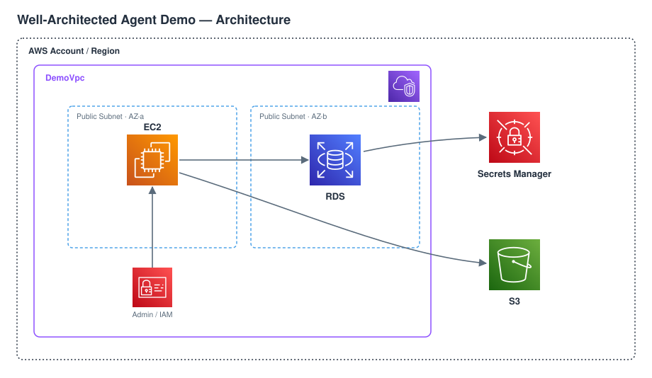
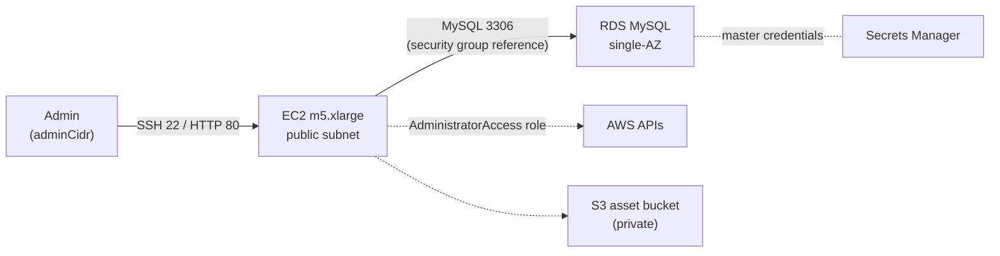
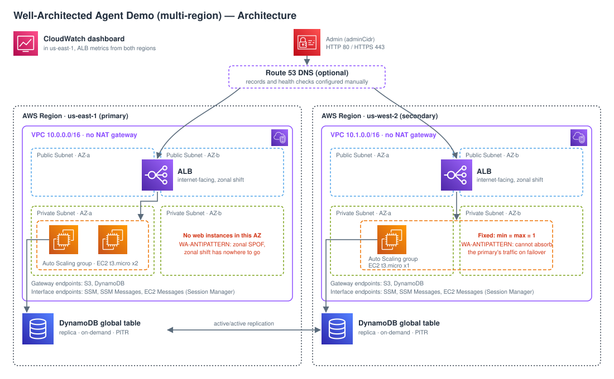
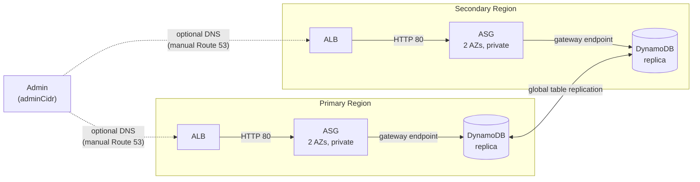
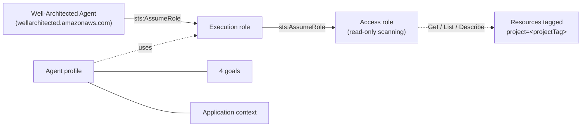

# Architecture: Well-Architected Agent Review

This demo deploys a target workload for the Well-Architected Agent to review, plus a
correctly configured agent profile that reviews it. The target workload is not a
recommended pattern: it exists so the agent has realistic findings to report. Each
anti-pattern is marked inline in the stacks with a `WA-ANTIPATTERN` comment.

There are two variants, selected at deploy time and deployable side by side in the same
account (distinct stack names, profile names, IAM role names and `project` tags):

| Variant | Workload | Stacks |
| --- | --- | --- |
| `single` (default) | Deliberately non-optimized single-instance web app (EC2, RDS, S3) | `WellArchitectedAgentReviewStack-<region>` |
| `multi` | Active/active web app in two Regions with a few documented gaps | `WellArchitectedAgentReviewMultiPrimary-<primary>`, `WellArchitectedAgentReviewMultiSecondary-<secondary>`, `WellArchitectedAgentReviewMultiDashboard-<primary>` |

The pieces both variants use (variant selection, agent profile, managed Lambda log
groups) are described once in [Shared building blocks](#shared-building-blocks).

## Variant `single`

### Components

All resources live in one CloudFormation stack, `WellArchitectedAgentReviewStack-<region>`,
defined in `infrastructure/cdk/lib/well-architected-agent-review-stack.ts`.

| Component | Configuration |
| --- | --- |
| VPC (`DemoVpc`) | 2 AZs, one public subnet per AZ, no NAT gateway, no private or isolated subnets |
| Security group (`OpenSecurityGroup`) | SSH (22) and HTTP (80) from the `adminCidr` context value only; shared by the instance and the database |
| EC2 (`AppInstance`) | One `m5.xlarge`, Amazon Linux 2, public subnet with a public IP, 50 GiB unencrypted root volume, no Auto Scaling group, no load balancer |
| IAM (`InstanceRole`) | Instance role with the `AdministratorAccess` managed policy |
| RDS (`Database`) | MySQL 8.0 on `db.t3.micro`, single-AZ, 20 GiB unencrypted storage, backups disabled, no deletion protection, `publiclyAccessible: false` |
| Secrets Manager | Generated master credentials for the database; no password in the template |
| S3 (`AssetBucket`) | Public access blocked, no versioning, TLS not enforced, no access logging, no lifecycle rules, objects auto-deleted with the stack |
| CloudWatch Logs (`AutoDeleteObjectsLogGroup`) | Log group of the CDK bucket-emptying Lambda, 30-day retention, deleted with the stack |

#### Well-Architected Agent

The agent side is configured correctly; none of it is an anti-pattern. It is built by the
shared `addWellArchitectedAgent()` (see [Well-Architected Agent (shared)](#well-architected-agent-shared)).

| Component | Configuration |
| --- | --- |
| Execution role (`WAAgentExecutionRole-<region>`) | Trusted by `wellarchitected.amazonaws.com`; only permission is `sts:AssumeRole` on the access role |
| Access role (`WAAgentAccessRole-<region>`) | Trusted by the execution role ARN; AWS managed policy `WellArchitectedAgentResourceScanning` (read-only) |
| Agent profile (`well-architected-agent-review`) | Pillars Resilience, Security, Cost Optimization, Performance; this account and Region; termination protection off |
| Goals | One per pillar, from `WA_AGENT_GOALS` in `lib/well-architected-agent-review-stack.ts` |
| Application context | `BUSINESS_CRITICAL`; "Business critical, RPO 5 minutes, RTO 2 hours, HA and DR in place"; scoped by tag `project=well-architected-agent-review` |

The VPC spans two AZs only because an RDS subnet group must cover at least two. The
database itself stays single-AZ.

### Traffic and access

- Inbound traffic reaches the instance only from `adminCidr`. Without the context value
  the stack falls back to `10.0.0.0/32`, which allows no public access.
- The database port is opened to the shared security group only, and the database has
  no public endpoint.
- The instance role can call any AWS API, which is the most severe security finding.

### Intended findings by pillar

The agent analyzes four pillars. Operational Excellence and Sustainability are out of its
scope, so they are not listed.

| Pillar | Anti-pattern |
| --- | --- |
| Resilience | Single-AZ RDS, no backups, single instance, no Auto Scaling, no load balancer; declared RPO/RTO and HA/DR not achievable |
| Security | `AdministratorAccess` instance role, unencrypted EBS and RDS storage, TLS not enforced on S3, public subnets for every tier |
| Cost Optimization | Oversized `m5.xlarge` for a demo workload |
| Performance | Single manually sized instance with no scaling |

### Kept correct on purpose

- S3 public access is fully blocked.
- The database is not publicly accessible.
- Ingress is limited to one admin CIDR on two ports, never `0.0.0.0/0`.
- Database credentials are generated and stored in Secrets Manager.

### Deployment flow

`deploy-all.ps1` / `deploy-all.sh` (default variant) call the library's shared
`check-prerequisites` script (AWS CLI, credentials, region, Node.js 20+, CDK), then the
shared `deploy-cdk` script, which installs dependencies, bootstraps the account and
deploys the stack with `adminCidr` passed as CDK context. CloudFormation creates the
roles first, then the agent profile, then the goals and the application context. The region is resolved once
and used for both the stack name suffix and the deployment.

### Teardown

Every resource uses `RemovalPolicy.DESTROY` or the service default delete behavior. The
S3 bucket is emptied by the CDK auto-delete custom resource before deletion.

That custom resource runs a CDK-managed Lambda whose log group is managed by the stack
(see [CDK-managed Lambda log groups](#cdk-managed-lambda-log-groups-shared)).

## Variant `multi`

By default the primary Region is us-east-1 (N. Virginia) and the secondary is us-west-2
(Oregon).

### Stacks

| Stack (default Regions) | Region | Defined in | Contents |
| --- | --- | --- | --- |
| `WellArchitectedAgentReviewMultiPrimary-us-east-1` | primary | `lib/region-stack.ts`, `lib/wa-agent.ts` | Region resources, DynamoDB global table, Well-Architected Agent roles / profile / goals / context (+ optional Resilience Hub role) |
| `WellArchitectedAgentReviewMultiSecondary-us-west-2` | secondary | `lib/region-stack.ts` | Region resources |
| `WellArchitectedAgentReviewMultiDashboard-us-east-1` | primary | `lib/dashboard-stack.ts` | CloudWatch dashboard for both Regions |

The primary Region comes from `WA_DEMO_PRIMARY_REGION` when the deploy script sets it,
otherwise from the shared `getRegion()` resolution (`AWS_DEFAULT_REGION`, `AWS_REGION`,
CLI configuration). It must be `us-east-1`, `us-east-2` or `us-west-2`, the Regions that
can host an agent profile; the synth fails early in any other Region. The secondary
Region is derived from the primary (`us-east-1` and `us-east-2` pair with `us-west-2`,
`us-west-2` pairs with `us-east-1`) unless `-c secondaryRegion=...` is passed.

The secondary stack depends on the primary because the primary creates the DynamoDB
replica in the secondary Region and, with HTTPS, the shared ACM validation records. The
stacks share no CloudFormation cross-Region references: the dashboard receives the ALB and
target group identifiers of both Regions as `--context`, read by the deploy script from
the region stack outputs.

### Components (per Region)

| Component | Configuration |
| --- | --- |
| VPC (`Vpc`) | 2 AZs, 2 public `/24` subnets (ALB only), 2 private isolated `/24` subnets (web tier and interface endpoints), no NAT gateway. CIDR `10.0.0.0/16` (primary) / `10.1.0.0/16` (secondary) |
| Gateway endpoints | S3 (Amazon Linux 2023 package repositories) and DynamoDB, on the private route tables |
| Interface endpoints | `ssm`, `ssmmessages`, `ec2messages` with private DNS, in both private subnets; security group allows HTTPS from the VPC CIDR only |
| ALB (`Alb`) | Internet-facing, in both public subnets, ARC zonal shift enabled. HTTP 80 forwards to the target group, or redirects to 443 when HTTPS is enabled |
| ALB security group (`AlbSg`) | HTTP 80 (and HTTPS 443) from `adminCidr` and from the AWS-managed prefix list `com.amazonaws.<region>.route53-healthchecks` only |
| Target group (`TargetGroup`) | HTTP 80, health check `GET /` expecting `200`, 30 s interval, 2 healthy / 3 unhealthy |
| Auto Scaling group (`WebAsg`) | Launch template with Amazon Linux 2023 (latest AMI from the public SSM parameter), `t3.micro`, 8 GiB encrypted gp3 root volume, IMDSv2 only, no public IP. ELB health checks with a 300 s grace period, rolling replacement of one instance at a time. Shape per Region (deliberate gaps, `web` in `lib/config.ts`): **primary** min 2 / max 4 in **one** private subnet (one AZ); **secondary** min 1 / max 1 across both private subnets |
| Web tier security group (`Ec2Sg`) | HTTP 80 from the ALB security group only |
| IAM (`Ec2Role`) | `AmazonSSMManagedInstanceCore` plus `PutItem`, `UpdateItem`, `GetItem`, `Query`, `DescribeTable` on the table ARN in the same Region only |
| CloudWatch Logs (`RestrictDefaultSgLogGroup`) | Log group of the CDK Lambda that strips the rules of the VPC default security group (feature flag `@aws-cdk/aws-ec2:restrictDefaultSecurityGroup`, set on the region stacks only), 30-day retention, managed as in [CDK-managed Lambda log groups](#cdk-managed-lambda-log-groups-shared) |
| Optional single instance (`Web`) | `keepSingleInstance=true`: one instance in the first private subnet, registered to the same target group (single-instance baseline with `useAsg=false`) |
| Optional HTTPS | `appDomainName` + `route53ZoneName`: public ACM certificate per Region (DNS validation), HTTPS 443 listener with `ELBSecurityPolicy-TLS13-1-2-2021-06` |

### Shared components

| Component | Configuration |
| --- | --- |
| DynamoDB global table (`GlobalTable`) | Partition key `pk` (string), on-demand billing, encryption at rest with the AWS owned key (declared explicitly), point-in-time recovery on both replicas, replicas in both Regions. Both replicas accept writes |
| CloudWatch dashboard | Requests (stacked total and per Region), ELB 5xx, healthy hosts, target response time, requests per AZ (Metrics Insights). Optional Global Accelerator row |
| Resilience Hub (optional) | One IAM role (IAM is global) trusted by `resiliencehub.amazonaws.com` with `aws:SourceAccount` and `aws:SourceArn` conditions for both Regions, with `AWSResilienceHubV2AssessmentExecutionPolicy` and `AWSResilienceHubResilienceTestingPolicy`. One tag-based resource group per Region (`project=<projectTag>`) as discovery source |

#### Well-Architected Agent

Built by the shared `addWellArchitectedAgent()` in the primary stack (see
[Well-Architected Agent (shared)](#well-architected-agent-shared)).

| Component | Configuration |
| --- | --- |
| Execution role (`WAAgentMultiRegionExecutionRole-<region>`) | Trusted by `wellarchitected.amazonaws.com`; only permission is `sts:AssumeRole` on the access role |
| Access role (`WAAgentMultiRegionAccessRole-<region>`) | Trusted by the execution role ARN; AWS managed policy `WellArchitectedAgentResourceScanning` (read-only) |
| Agent profile (`well-architected-agent-review-multiregion`) | Pillars Resilience, Security, Cost Optimization, Performance; this account, both Regions; termination protection off |
| Goals | One per pillar, from `MULTI_REGION_AGENT_GOALS` in `lib/multi-region-agent.ts` |
| Application context | `BUSINESS_CRITICAL`; "Business critical, RPO 1 minute, RTO 15 minutes, active/active in two Regions with automatic Regional failover, failures detected and alerted within 5 minutes"; scoped by tag `project=well-architected-agent-review-multiregion`, both Regions |

The role names carry a `MultiRegion` infix so they never collide with the `single`
variant's roles in the same account.

### Traffic and access

- Inbound traffic reaches an ALB only from `adminCidr`, plus the Route 53 health checkers
  so that endpoint health checks against the ALB work out of the box. Without the context
  value the stacks fall back to `10.0.0.0/32`, which allows no public access.
- The web tier accepts traffic only from its ALB. It has no public IP and no SSH; operators
  connect through Session Manager over the interface endpoints.
- Each Region writes to its local replica through the DynamoDB gateway endpoint;
  DynamoDB replicates the writes to the other Region.
- The application page (`/cgi-bin/app.sh`) shows the serving Region and instance and a
  visit counter shared by both Regions. `/` is a static page used as the health check
  target and does not touch DynamoDB.

### Routing one hostname to both Regions (manual)

The stacks do not create Route 53 records or health checks (this is one of the built-in
gaps). To put one hostname in front of both ALBs:

1. Create one Route 53 health check per Region: type endpoint, by domain name, protocol
   HTTP, port 80, path `/`, domain name = the Region's `AlbDnsName` output.
2. In your public hosted zone, create two alias `A` records with the same name (for
   example `app.example.com`), one per ALB, each with its health check. Pick a routing
   policy:
   - **Latency**: each client goes to the closest healthy Region (active/active).
   - **Weighted**: split traffic by weight, for example 50/50 or a gradual shift.
   - **Failover**: primary record for the primary Region, secondary for the other
     (active/passive).
3. Verify with `dig +short app.example.com` and `curl -s http://app.example.com/`.

With HTTPS enabled, port 80 answers with a 301 redirect, which Route 53 endpoint health
checks treat as healthy, so the same health checks keep working.

### Intended findings by pillar

The agent analyzes four pillars. Operational Excellence and Sustainability are out of its
scope, so they are not listed.

| Pillar | Gap | Where |
| --- | --- | --- |
| Resilience | Primary web tier confined to one Availability Zone: zonal single point of failure; ARC zonal shift on the ALB has no other AZ with targets to shift to | `region-stack.ts`, ASG (`primaryWebAzCount=1`) |
| Resilience / Performance | Secondary web tier fixed at one instance: cannot absorb the primary Region's traffic on failover (no static stability); a launch template change replaces it with an outage | `region-stack.ts`, ASG (`secondaryAsgMinSize=1`, `secondaryAsgMaxSize=1`) |
| Resilience | Cross-Region routing and failover not codified (no Route 53 records or health checks), contradicting the declared automatic Regional failover | `region-stack.ts`, outputs |
| Resilience | No CloudWatch alarms or notifications, contradicting the declared 5-minute detection | `region-stack.ts`, outputs |
| Resilience | Single point of failure when run as a single instance (`useAsg=false`) | `region-stack.ts`, single instance |
| Security | No AWS WAF web ACL on the internet-facing ALBs | `region-stack.ts`, ALB |
| Security | No ALB access logs | `region-stack.ts`, ALB |
| Security | Plain HTTP by default when no domain is configured | `region-stack.ts`, HTTP listener |
| Cost Optimization / Performance | Auto Scaling group without scaling policies: fixed capacity, no scale-out or scale-in | `region-stack.ts`, ASG |

### Kept correct on purpose

- Active/active data across two Regions with a DynamoDB global table; ALBs across two AZs in each Region.
- ARC zonal shift enabled on both ALBs.
- Compute in private subnets: no public IP, no SSH, IMDSv2 only, Session Manager access.
- No NAT gateway; AWS service traffic stays on VPC endpoints.
- Least-privilege instance role scoped to the local table replica.
- ALB ingress limited to one admin CIDR and the Route 53 health checkers, never `0.0.0.0/0`.
- Encryption at rest declared explicitly: encrypted gp3 root volumes, DynamoDB AWS owned key.
- Point-in-time recovery on both table replicas.
- With HTTPS: TLS 1.3 security policy and HTTP to HTTPS redirect.
- The agent roles, profile, goals and application context.

### Deployment flow

`deploy-all.ps1 -Variant multi` / `deploy-all.sh --variant multi` call the library's shared `check-prerequisites` script
(AWS CLI 2.31.13+, credentials, Region, Node.js 20+, CDK), check that the primary Region
can host the agent profile, derive the secondary Region and resolve the admin CIDR
(auto-detected `/32` or passed explicitly, fail closed on anything that is not an IPv4
CIDR). They then call the shared `deploy-cdk` script once per stack, with `AWS_REGION`
pinned to the stack's Region and `WA_DEMO_PRIMARY_REGION` pinned to the primary, so every
call synthesizes the same stacks:

1. Primary stack, in the primary Region (bootstraps it). CloudFormation creates the roles
   first, then the agent profile, then the goals and the application context.
2. Secondary stack, in the secondary Region (bootstraps it).
3. Dashboard stack, in the primary Region, with the four ALB and target group identifiers
   read from the region stack outputs and passed as `--context`.

### Teardown

`deploy-all.sh --variant multi --destroy` / `deploy-all.ps1 -Variant multi -Destroy` destroy the dashboard, secondary and
primary stacks in that order through the shared `deploy-cdk` script. The synth that `cdk destroy` runs needs no context: the admin CIDR
falls back to a no-access value and the dashboard renders a placeholder widget.

Every resource uses `RemovalPolicy.DESTROY` or the service default delete behavior. The
DynamoDB table has deletion protection off, so the table and its replica are removed with
the primary stack. The agent profile has termination protection off.

Each region stack contains one CDK-managed Lambda, the custom resource that removes the
rules of the VPC default security group; its log group is managed by the stack (see
[CDK-managed Lambda log groups](#cdk-managed-lambda-log-groups-shared)). The stacks use
no CDK cross-Region references, so no other CDK-managed Lambdas exist. The CDK bootstrap
stacks (`CDKToolkit`) are left in place in both Regions.

## Shared building blocks

### Variant selection

`infrastructure/cdk/bin/app.ts` instantiates either variant from `WA_DEMO_VARIANT` (set
by the deploy scripts) or `-c variant=...`, default `single`. The environment variable is
what reaches `cdk destroy`, because the shared `deploy-cdk` script passes no `--context` on
destroy. Both variants resolve the Region with the library's shared `getRegion()`
(`shared/utils/aws-utils.ts`), use the same `adminCidr` context value with the `10.0.0.0/32`
no-access fallback, and put solution adoption tracking on their main stack only.

### Well-Architected Agent (shared)

`lib/wa-agent.ts` exports `addWellArchitectedAgent()`, used by both variants with their
own name, role prefix, Regions, goals and application context. It creates, directly on
the stack and with fixed construct ids (`AgentExecutionRole`, `AgentAccessRole`,
`AgentProfile`, `AgentGoal<Pillar>`, `AgentApplicationContext`) so logical IDs stay
stable:

- an execution role trusted by `wellarchitected.amazonaws.com`, whose only permission is
  `sts:AssumeRole` on the access role;
- an access role trusted by the execution role ARN, with the AWS managed policy
  `WellArchitectedAgentResourceScanning` (read-only);
- the agent profile (termination protection off), one goal per pillar and one
  application context scoped by the `project` tag;
- the `AgentProfileArn` output.

The profile can only be hosted in `us-east-1`, `us-east-2` or `us-west-2`, so the synth
fails early in any other Region (`assertAgentProfileRegion()`).

The execution role trust policy names the exact service principal but has no
`aws:SourceAccount` / `aws:SourceArn` condition. The service documentation does not say
the service sends those keys, and states that it uses the profile ARN as an external ID in
the role chain to prevent confused-deputy use. This is a documented exception to the
library's SEC 03 rule, to revisit once the trust policy the console creates is confirmed.

### CDK-managed Lambda log groups (shared)

Both variants contain one CDK-managed custom resource Lambda: the S3 auto-delete-objects
Lambda in `single`, the VPC default security group Lambda in each `multi` region stack.
Left alone, such a Lambda creates its own log group at runtime and leaves it behind after
`cdk destroy`. Because Lambda delivers logs a few seconds late, the run on destroy can
recreate the group even after CloudFormation deleted it (seen in a real teardown).
`lockProviderLogGroup()` in `lib/cdk-log-groups.ts` therefore:

- gives the function a fixed name and declares its log group explicitly (30-day
  retention, deleted with the stack, created before the function and deleted after it);
- removes the default `AWSLambdaBasicExecutionRole` and appends to the role's existing
  inline policies one that allows only `logs:CreateLogStream` and `logs:PutLogEvents` on
  that log group, with no `logs:CreateLogGroup`, so late log events are dropped instead of
  recreating the group. The provider's own inline permissions (for example the EC2
  actions of the default security group Lambda) are kept.

The synth fails if a future `aws-cdk-lib` renames the internal constructs, rather than
silently shipping an orphaning teardown.
