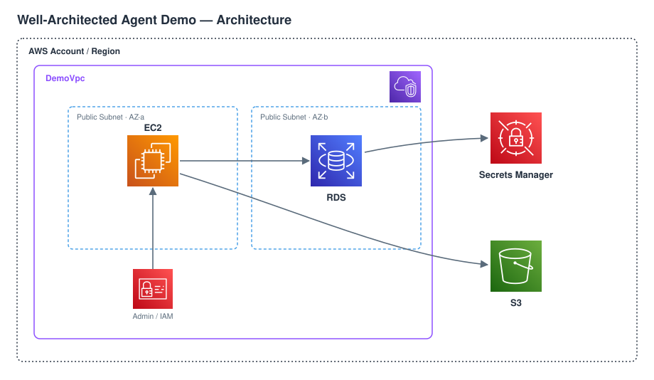
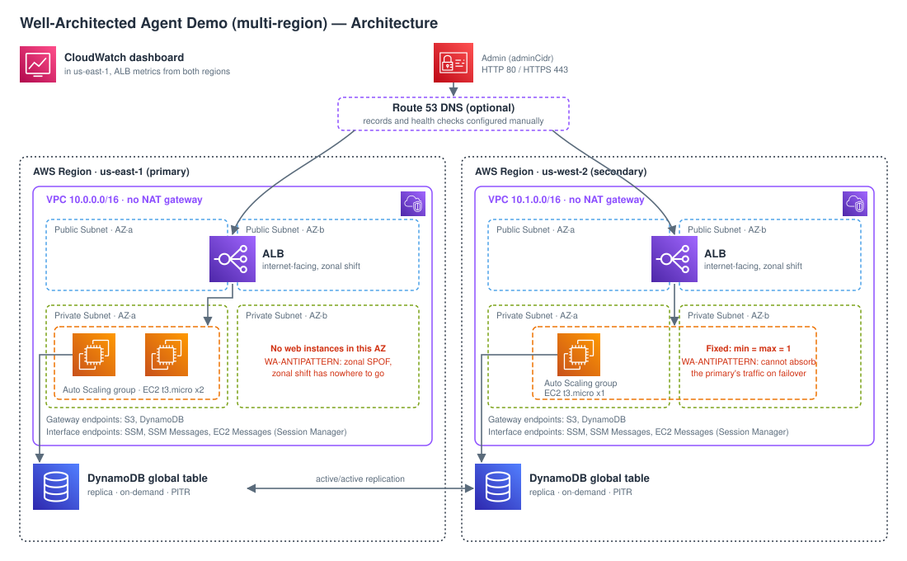

# Well-Architected Agent Review
*Give the Well-Architected Agent a realistic, flawed AWS workload so it has something worth reviewing*

## Overview

This demo deploys an AWS CDK (TypeScript) workload for the Well-Architected Agent to
review, together with a correctly configured agent profile that reviews it. It comes in
two variants, chosen at deploy time:

| Variant | Workload | Stacks | What it shows |
| --- | --- | --- | --- |
| `single` (default) | Intentionally non-optimized single-instance web app: EC2, MySQL RDS, S3, in one Region | 1 | Obvious anti-patterns across all four pillars the agent analyzes |
| `multi` | Active/active web app in two Regions: ALB, Auto Scaling group, DynamoDB global table | 3 | A design that looks resilient, with documented gaps that break its stated recovery objectives |

In both variants the anti-patterns span the four pillars the Well-Architected Agent
analyzes (resilience, security, cost optimization and performance), so the agent can
produce recommendations you can check against a known list. Each variant also creates
the agent side: an agent profile scoped to its workload, one goal per pillar, and an
application context that declares requirements the deployed architecture deliberately
cannot meet.

The two variants use distinct stack names, profile names, IAM role names and `project`
tags, so they can be deployed side by side in the same account.

> Do not use this as a production template. The anti-patterns are deliberate.

## At a Glance

- **Duration**: 20 minutes (`single`) or 30 minutes (`multi`) to deploy, plus 24 to 48 hours before the first scheduled recommendations
- **Difficulty**: Beginner (`single`), Intermediate (`multi`)
- **Target Audience**: Solutions architects, cloud engineers, platform and resilience teams
- **Key Technologies**: AWS Well-Architected Agent (preview), AWS CDK, Amazon EC2, Amazon RDS, Amazon S3, AWS Secrets Manager, IAM; for `multi` also Amazon EC2 Auto Scaling, Elastic Load Balancing (ALB), Amazon DynamoDB global tables, Amazon VPC endpoints, AWS Systems Manager Session Manager, Amazon CloudWatch
- **Estimated Cost**: about $0.22 to $0.23/hour (about $158 to $165/month if left running) depending on the variant, see breakdown below

## Business Value

Reviewing an architecture against the Well-Architected Framework is slow when it is
done by hand. The `single` variant shows the agent finding resilience, security, cost and
performance issues on its own, on a workload where the expected findings are documented
in advance. The `multi` variant raises the bar: a workload that already uses multiple
AZs and multiple Regions, where the remaining issues are subtle, so you can see whether
the agent recognizes what is done well and still finds the gaps that matter. Both make
the quality of the recommendations easy to judge.

## What You'll See

1. Deploy one variant (workload and agent profile) with one script.
2. Wait for the first scheduled recommendations (24 to 48 hours, see below).
3. Review them in the AWS WA Agent console.
4. Compare them with the built-in anti-patterns of that variant below. Search the stacks
   for `WA-ANTIPATTERN` to see each one called out inline.

## Variant `single`: non-optimized single-region workload



### Built-in anti-patterns

| Pillar | Anti-pattern |
| --- | --- |
| Resilience | Single-AZ RDS, no backups, no Auto Scaling, no load balancer |
| Security | Admin IAM role, no encryption (EBS and RDS storage), TLS not enforced on S3 |
| Cost Optimization | Oversized EC2 instance for the workload |
| Performance | Single manually sized instance, no load balancer |

### Agent configuration

| Item | Value |
| --- | --- |
| Profile | `well-architected-agent-review`, this account and Region only, termination protection off |
| Pillars | Resilience, Security, Cost Optimization, Performance (Operational Excellence and Sustainability are not in scope for the agent) |
| Goals | One per pillar, defined in `WA_AGENT_GOALS` at the top of `lib/well-architected-agent-review-stack.ts` |
| Application context | Business critical, RPO 5 minutes, RTO 2 hours, HA and DR in place; scoped by the `project=well-architected-agent-review` tag |

The declared RPO, RTO and HA/DR contradict the single-AZ, backup-less architecture on
purpose: the agent should flag the gap between stated requirements and reality.

### Kept intentionally correct

- The S3 bucket is private (public access fully blocked).
- The database is not publicly accessible.
- Ingress is restricted to one trusted admin CIDR on SSH and HTTP, never `0.0.0.0/0`.
- The database port is reachable only through the app security group.

## Variant `multi`: active/active multi-region workload



By default the primary Region is **us-east-1 (N. Virginia)** and the secondary is
**us-west-2 (Oregon)**. Per Region:

- **VPC**: 2 AZs, 2 public subnets (ALB only) and 2 private subnets (web tier), no NAT
  gateway. Egress to AWS services goes only through VPC endpoints.
- **VPC endpoints**: gateway endpoints for S3 (package repositories) and DynamoDB;
  interface endpoints for SSM, SSM Messages and EC2 Messages (Session Manager).
- **ALB**: internet-facing, ARC zonal shift enabled. Ingress only from the admin CIDR
  and the AWS-managed Route 53 health checker prefix list. Optional HTTPS with an ACM
  certificate (TLS 1.3 policy) and an HTTP to HTTPS redirect.
- **Auto Scaling group**: `t3.micro`, Amazon Linux 2023, encrypted gp3 root volume,
  IMDSv2 only, no public IP, no SSH. Reachable only from the ALB security group. Its shape
  differs per Region on purpose (see the two deliberate inefficiencies below).
- **IAM**: instance role with `AmazonSSMManagedInstanceCore` plus read/write access to
  the local DynamoDB replica only.

Shared: a DynamoDB global table (on-demand, encrypted at rest, point-in-time recovery on
both replicas), the agent profile and a CloudWatch dashboard in the primary Region, and an
optional AWS Resilience Hub discovery role with a tag-based resource group per Region.

### Deliberate inefficiencies in the web tier

The two Regions are deployed with different, deliberately weak web tiers, so the agent has
one distinct resilience story per Region:

| Region | Default shape | Why it is a problem |
| --- | --- | --- |
| Primary (`us-east-1`) | Auto Scaling group of 2 to 4 instances, **all in one Availability Zone** | Zonal single point of failure: an AZ impairment takes down the primary web tier. The ALB still spans two AZs with ARC zonal shift enabled, but shifting away from the only AZ that has instances leaves no healthy target, so the control is present but cannot help. |
| Secondary (`us-west-2`) | **One instance, fixed** (min = max = 1), across two AZs | No static stability: on a Regional failover a single instance that cannot scale must absorb all the traffic of the primary Region, so the declared active/active failover within an RTO of 15 minutes is not achievable. A launch template change also replaces the only instance with an outage. |

Both are marked `WA-ANTIPATTERN` in `lib/region-stack.ts` and set by defaults in
`lib/config.ts`. `deploy-all` always deploys these defaults. The resilient shape (2 to 4
instances across two AZs in both Regions) is available through CDK context, from
`infrastructure/cdk`, for example to compare the two templates:

Windows (PowerShell):

```powershell
cd infrastructure\cdk
npx cdk synth -c variant=multi -c "adminCidr=<YOUR_IP>/32" `
  -c primaryWebAzCount=2 -c secondaryAsgMinSize=2 -c secondaryAsgMaxSize=4
```

Linux / macOS (Bash):

```bash
cd infrastructure/cdk
npx cdk synth -c variant=multi -c "adminCidr=<YOUR_IP>/32" \
  -c primaryWebAzCount=2 -c secondaryAsgMinSize=2 -c secondaryAsgMaxSize=4
```

### Built-in gaps

| Pillar | Gap |
| --- | --- |
| Resilience | Primary web tier in a single Availability Zone; secondary web tier fixed at one instance (see above). Both contradict the declared active/active failover with an RTO of 15 minutes. |
| Resilience | Cross-Region routing not codified (no Route 53 records or health checks), so Regional failover depends on manual DNS. No CloudWatch alarms or notifications. Both contradict the declared automatic failover and 5-minute alerting. |
| Security | No AWS WAF on the internet-facing ALBs. No ALB access logs. Plain HTTP by default (HTTPS only when a domain is provided). |
| Cost Optimization | Fixed-size Auto Scaling group, no scale-in when idle. |
| Performance | No scaling policy: capacity never grows with load, including when one Region absorbs the traffic of the other. |

### Agent configuration

| Item | Value |
| --- | --- |
| Profile | `well-architected-agent-review-multiregion`, hosted in the primary Region, analyzing both Regions, termination protection off |
| Pillars | Resilience, Security, Cost Optimization, Performance |
| Goals | One per pillar, defined in `MULTI_REGION_AGENT_GOALS` in `lib/multi-region-agent.ts` |
| Application context | Business critical, RPO 1 minute, RTO 15 minutes, active/active with automatic Regional failover, failures detected and alerted within 5 minutes; scoped by the `project=well-architected-agent-review-multiregion` tag |

### Kept intentionally correct

- Active/active data across two Regions (DynamoDB global table), ALBs across two AZs with ARC zonal shift.
- Compute in private subnets with no public IP, no SSH, IMDSv2 only, Session Manager access.
- No NAT gateway: AWS service traffic stays on VPC endpoints.
- Least-privilege instance role (local DynamoDB replica only, no admin policies).
- ALB ingress limited to one admin CIDR and the Route 53 health checkers, never `0.0.0.0/0`.
- Encryption at rest declared explicitly (EBS root volumes, DynamoDB).
- DynamoDB point-in-time recovery enabled in both Regions.

See [ARCHITECTURE.md](ARCHITECTURE.md) for the full design of both variants.

## Prerequisites

- An AWS account and credentials configured for your shell, allowed to create IAM roles
  and pass them to the agent (`iam:PassRole`)
- An AWS Support plan at Business+ or higher (Business+, Enterprise On-Ramp, Enterprise,
  or Unified Operations). Accounts on Basic, Developer or Business do not get the agent.
- Deployment Region (primary Region for `multi`) `us-east-1`, `us-east-2` or `us-west-2`:
  the only Regions that can host an agent profile (preview). The synth stops with an
  error in any other Region. For `multi` the secondary Region is derived from the primary
  (`us-east-1` and `us-east-2` pair with `us-west-2`, `us-west-2` pairs with `us-east-1`).
- AWS CLI v2 (2.31.13 or later)
- Node.js 20+
- Outbound HTTPS to `checkip.amazonaws.com` (to detect your public IP), or your
  admin CIDR passed explicitly
- Optional, for HTTPS in `multi`: a public Route 53 hosted zone in the same account

## Deployment

Run the scripts from this demo folder, `resilience/well-architected-agent-review/`. They
call the library's shared scripts at `../../shared/scripts`.

The script runs the library's shared prerequisites check, then the shared `deploy-cdk`
script once per stack:

| Variant | Stacks (default Region us-east-1) | Prints |
| --- | --- | --- |
| `single` | `WellArchitectedAgentReviewStack-us-east-1` | Instance IP, database endpoint, bucket name, agent profile ARN |
| `multi` | `WellArchitectedAgentReviewMultiPrimary-us-east-1`, then `WellArchitectedAgentReviewMultiSecondary-us-west-2`, then `WellArchitectedAgentReviewMultiDashboard-us-east-1`; CDK is bootstrapped in both Regions | ALB DNS names, table name, agent profile ARN, dashboard URL |

For `multi`, the dashboard stack receives the ALB and target group identifiers of both
Regions as `--context`, read from the region stack outputs.

Options, the same in both scripts:

| Option | Default | Meaning |
| --- | --- | --- |
| Variant | `single` | Which workload to deploy or destroy: `single` or `multi` |
| Admin CIDR | your public IPv4 `/32` (detected via `checkip.amazonaws.com`) | CIDR allowed to reach the workload. If detection fails, the script stops and asks for it |
| Domain and zone | none | HTTPS for `multi` only (ACM certificate per Region, DNS-validated in your hosted zone); both must be passed together |
| Destroy | off | Tear the selected variant down instead of deploying it |

The Region is not an option: set `AWS_REGION` and `AWS_DEFAULT_REGION` before running the
script. Invalid values (an unknown variant, a domain without a zone, a domain with the
`single` variant, a Region that cannot host the agent profile, or a run outside the library
checkout) stop the script with an error before anything is deployed.

### Windows (PowerShell)

If the execution policy blocks the script, allow it for the current session only:

```powershell
Set-ExecutionPolicy -Scope Process -ExecutionPolicy Bypass
```

Deploy:

```powershell
$env:AWS_REGION = "us-east-1"; $env:AWS_DEFAULT_REGION = "us-east-1"

.\deploy-all.ps1                                                             # variant single
.\deploy-all.ps1 -Variant multi                                              # variant multi (us-east-1 + us-west-2)
.\deploy-all.ps1 -Variant multi -AdminCidr "<YOUR_IP>/32"                    # explicit admin CIDR
.\deploy-all.ps1 -Variant multi -Domain app.example.com -Zone example.com    # multi with HTTPS
```

Check that the agent profile is eligible for scheduled recommendations:

```powershell
aws wellarchitected get-agent-profile --profile-arn "<AGENT_PROFILE_ARN>" `
  --query "{eligible: eligibleForScheduledGeneration, errors: fieldErrors}"
```

Clean up:

```powershell
.\deploy-all.ps1 -Destroy                  # variant single
.\deploy-all.ps1 -Variant multi -Destroy   # variant multi
```

### Linux / macOS (Bash)

Deploy:

```bash
export AWS_REGION=us-east-1 AWS_DEFAULT_REGION=us-east-1

./deploy-all.sh                                                               # variant single
./deploy-all.sh --variant multi                                               # variant multi (us-east-1 + us-west-2)
./deploy-all.sh --variant multi --admin-cidr "<YOUR_IP>/32"                   # explicit admin CIDR
./deploy-all.sh --variant multi --domain app.example.com --zone example.com   # multi with HTTPS
```

Check that the agent profile is eligible for scheduled recommendations:

```bash
aws wellarchitected get-agent-profile --profile-arn "<AGENT_PROFILE_ARN>" \
  --query '{eligible: eligibleForScheduledGeneration, errors: fieldErrors}'
```

Clean up:

```bash
./deploy-all.sh --destroy                  # variant single
./deploy-all.sh --variant multi --destroy  # variant multi
```

### When recommendations appear

Scheduled recommendations start within 24 hours of profile setup according to the
console guide, and within 48 hours according to the API quickstart. Run the eligibility
check above for your shell: if `eligible` is `false`, `errors` names the field to fix.

### Manual synth

Windows (PowerShell):

```powershell
cd infrastructure\cdk
npm install
npx cdk synth -c "adminCidr=<YOUR_IP>/32"                    # variant single
npx cdk synth -c variant=multi -c "adminCidr=<YOUR_IP>/32"   # variant multi (three stacks)
```

Linux / macOS (Bash):

```bash
cd infrastructure/cdk
npm install
npx cdk synth -c "adminCidr=<YOUR_IP>/32"                    # variant single
npx cdk synth -c variant=multi -c "adminCidr=<YOUR_IP>/32"   # variant multi (three stacks)
```

### Configuration of the `multi` variant

Settings are CDK context values, overridable with `-c key=value`; defaults live in
`infrastructure/cdk/lib/config.ts`. Nothing account or deployment specific is committed.

| Key | Default | Description |
| --- | --- | --- |
| `adminCidr` | `10.0.0.0/32` (no access) | CIDR allowed to reach the ALBs; the deploy scripts always set it |
| `secondaryRegion` | derived from the primary | Region of the secondary stack |
| `primaryVpcCidr` / `secondaryVpcCidr` | `10.0.0.0/16` / `10.1.0.0/16` | VPC CIDRs |
| `instanceType` | `t3.micro` | Web tier instance type |
| `useAsg` / `keepSingleInstance` | `true` / `false` | Auto Scaling group and/or a single instance |
| `primaryWebAzCount` | `1` (deliberate gap) | Availability Zones the primary Auto Scaling group may use (1 or 2) |
| `primaryAsgMinSize` / `primaryAsgMaxSize` | `2` / `4` | Primary Auto Scaling group bounds |
| `secondaryWebAzCount` | `2` | Availability Zones the secondary Auto Scaling group may use (1 or 2) |
| `secondaryAsgMinSize` / `secondaryAsgMaxSize` | `1` / `1` (deliberate gap) | Secondary Auto Scaling group bounds |
| `appDomainName` / `route53ZoneName` | empty | Enable HTTPS for this FQDN, validated in this hosted zone |
| `appDomainAltNames` | `[]` | Extra certificate SANs |
| `createCertValidationRecords` | `true` | Set `false` if the ACM validation records already exist in the zone |
| `enableResilienceHub` | `false` | Create the Resilience Hub role and resource groups |
| `globalAcceleratorId` | empty | Add a Global Accelerator row to the dashboard |
| `projectTag` | `well-architected-agent-review-multiregion` | Value of the `project` tag, profile name and context scope |

To test the `multi` application, open `http://<AlbDnsName>/cgi-bin/app.sh` in each
Region: the page shows the serving Region and instance and a visit counter shared by
both Regions through the global table.

## Cleanup

Run the clean-up command for your shell from the deployment section above
([Windows (PowerShell)](#windows-powershell) or [Linux / macOS (Bash)](#linux--macos-bash)).
The script destroys the stacks through the shared `deploy-cdk` script (for `multi`:
dashboard, secondary, primary, in that order). Every resource is removed with its stack,
including the agent profile and the log groups of the CDK-managed Lambdas; the CDK
bootstrap stacks (`CDKToolkit`) stay in place.

## Estimated Cost Breakdown

Approximate us-east-1 on-demand prices. Check the
[AWS Pricing Calculator](https://calculator.aws/) for your region.

### Variant `single`

| Resource | Hourly | Monthly (730 h) |
| --- | --- | --- |
| EC2 `m5.xlarge` | $0.192 | ~$140 |
| RDS `db.t3.micro` MySQL, single-AZ | $0.017 | ~$12 |
| RDS storage, 20 GiB | | ~$2.30 |
| EBS root volume, 50 GiB | | ~$4-5 |
| Public IPv4 address | $0.005 | ~$3.65 |
| Well-Architected Agent (preview) | | Not estimated here; check the preview terms. Needs a Business+ Support plan |
| Secrets Manager secret | | $0.40 |
| S3 bucket (empty) | | < $0.01 |
| **Total** | **~$0.23** | **~$165** |

### Variant `multi`

On-demand prices for us-east-1 and us-west-2 (identical for these items), taken from the
AWS Price List bulk files.

| Resource | Primary (hourly) | Secondary (hourly) | Both Regions (hourly) | Both Regions (monthly, 730 h) |
| --- | --- | --- | --- | --- |
| EC2 `t3.micro`, Linux ($0.0104/h each): 2 primary + 1 secondary | $0.0208 | $0.0104 | $0.0312 | ~$22.78 |
| Application Load Balancer ($0.0225/h) | $0.0225 | $0.0225 | $0.0450 | ~$32.85 |
| Interface VPC endpoints, 3 x 2 AZs ($0.01/h per endpoint per AZ) | $0.0600 | $0.0600 | $0.1200 | ~$87.60 |
| Public IPv4 on the ALB, 2 addresses minimum, one per AZ ($0.005/h each) | $0.0100 | $0.0100 | $0.0200 | ~$14.60 |
| Well-Architected Agent (preview) | | | | Not estimated here; check the preview terms. Needs a Business+ Support plan |
| **Total (fixed hourly items)** | **~$0.113** | **~$0.103** | **~$0.22** | **~$158** |

With the resilient shape (2 instances in each Region) add one `t3.micro`: about $0.23/hour,
about $165/month.

Not included for `multi` (usage-based, small for a demo): ALB LCUs, DynamoDB on-demand
requests and replicated writes, EBS root volumes, interface endpoint data processing,
cross-Region data transfer, the CloudWatch dashboard. Gateway endpoints (S3, DynamoDB)
have no additional charge.

- **Demo cost**: a few dollars for a day-long session, plus the time you leave it running
  while waiting for recommendations. There are no Bedrock inference costs in this stack.
- **Production cost**: not applicable. This workload is never meant to run long-term.
- **Tip**: destroy the stacks as soon as you have the recommendations. In `single` the
  EC2 instance is most of the bill, and is itself one of the findings; in `multi` the
  interface endpoints are about half of it.

## Code Repository

This folder contains:

- `infrastructure/cdk/`: CDK app (`bin/app.ts`, selects the variant) and stacks (`lib/`):
  - `well-architected-agent-review-stack.ts`: variant `single`
  - `region-stack.ts`, `dashboard-stack.ts`, `config.ts`, `userdata.ts`,
    `multi-region-agent.ts`: variant `multi`
  - `wa-agent.ts` (agent roles, profile, goals and context), `cdk-log-groups.ts`
    (managed log groups for CDK Lambdas): shared by both variants. The Region is resolved
    with the library's `shared/utils/aws-utils.ts`
- `deploy-all.ps1` / `deploy-all.sh`: deployment and cleanup scripts for both variants
- `validation.yaml`: deploy / verify / destroy contract (variant `single`)
- `ARCHITECTURE.md`, `assets/architecture.svg` and `assets/architecture-multiregion.svg`:
  design and diagrams

Solution adoption tracking: `(uksb-do9bhieqqh)(tag:well-architected-agent-review,resilience)`, set on
the main stack of each variant in `infrastructure/cdk/bin/app.ts`.

## Available Extensions

- Fix one anti-pattern at a time and wait for the next generation to watch the
  recommendation clear.
- Change the goals (`WA_AGENT_GOALS`, `MULTI_REGION_AGENT_GOALS`) to see how they
  reprioritize recommendations.
- Deploy both variants side by side and compare how the agent scores an obviously flawed
  workload against a nearly resilient one.
- In `multi`, enable `enableResilienceHub=true` and run a Resilience Hub assessment on the
  same workload.
- Add more anti-patterns for pillars you want to emphasize.

## Contributing

We welcome community contributions! Please see [CONTRIBUTING.md](../../CONTRIBUTING.md) for guidelines.

## Security

See [CONTRIBUTING](../../CONTRIBUTING.md#security-issue-notifications) for more information.

## License

This library is licensed under the MIT-0 License. See the [LICENSE](../../LICENSE) file.
