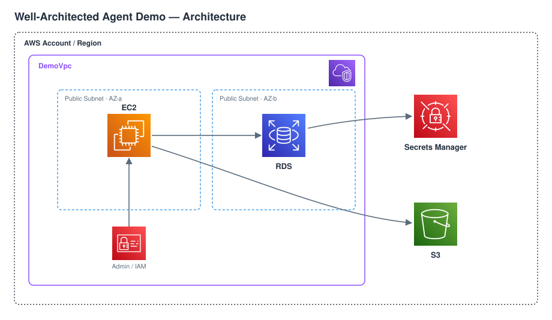
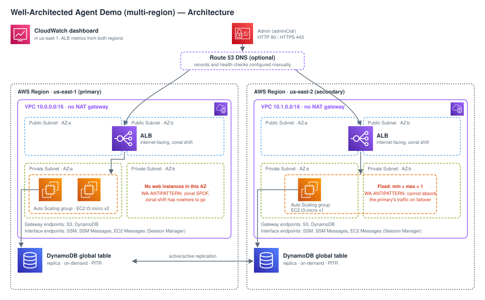

# Well-Architected Agent Review
*Give the Well-Architected Agent a realistic, flawed AWS workload so it has something worth reviewing*

## Overview

This demo deploys AWS CDK (TypeScript) applications for the Well-Architected Agent to
review, together with a correctly configured agent profile that reviews them. It is made
of three independent building blocks:

| Building block | What it deploys | What it shows |
| --- | --- | --- |
| Agent profile (shared) | One profile per account and agent Region: execution and access roles, the profile, one goal per pillar. Deployed automatically before the first application | The agent side, configured correctly |
| Application `single` (default) | Intentionally non-optimized single-instance web app (EC2, MySQL RDS, S3, in one Region), plus a context that registers it in the profile | Obvious anti-patterns across all four pillars the agent analyzes |
| Application `multi` | Active/active web app in two Regions (ALB, Auto Scaling group, DynamoDB global table), plus a context that registers it in the profile | A design that looks resilient, with documented gaps that break its stated recovery objectives |

In both applications the anti-patterns span the four pillars the Well-Architected Agent
analyzes (resilience, security, cost optimization and performance), so the agent can
produce recommendations you can check against a known list. Each application registers
in the shared profile with its own application context, which declares requirements the
deployed architecture deliberately cannot meet.

The applications use distinct stack names and `project` tags, so both can run side by
side under the same profile. Adding another application means adding its stacks and one
context stack, with no change to the profile (see [ARCHITECTURE.md](ARCHITECTURE.md)).

> Do not use this as a production template. The anti-patterns are deliberate.

## Business Value

Reviewing an architecture against the Well-Architected Framework is slow when it is
done by hand. The `single` variant shows the agent finding resilience, security, cost and
performance issues on its own, on a workload where the expected findings are documented
in advance. The `multi` variant raises the bar: a workload that already uses multiple
AZs and multiple Regions, where the remaining issues are subtle, so you can see whether
the agent recognizes what is done well and still finds the gaps that matter. Both make
the quality of the recommendations easy to judge.

## At a Glance

- **Duration**: 20 minutes (`single`) or 30 minutes (`multi`) to deploy, plus usually a few hours (at most 48 hours) before the first scheduled recommendations
- **Requires**: an AWS Support plan at Business+ or higher in the account (Business+, Enterprise, or Unified Operations); accounts on Basic, Developer or Business cannot use the agent. The demo also needs one free agent profile slot (2 per account on Business+, see [Prerequisites](#prerequisites))
- **Difficulty**: Beginner (`single`), Intermediate (`multi`)
- **Target Audience**: Solutions architects, cloud engineers, platform and resilience teams
- **Key Technologies**: AWS Well-Architected Agent (preview), AWS CDK, Amazon EC2, Amazon RDS, Amazon S3, AWS Secrets Manager, IAM; for `multi` also Amazon EC2 Auto Scaling, Elastic Load Balancing (ALB), Amazon DynamoDB global tables, Amazon VPC endpoints, AWS Systems Manager Session Manager, Amazon CloudWatch
- **Estimated Cost**: about $0.22 to $0.23/hour (about $158 to $165/month if left running) depending on the variant, see breakdown below

## Walkthrough after deployment

Deploy one application first (see [Deployment](#deployment)). The deploy script prints
`<AGENT_PROFILE_ARN>` and the agent Region, `<AGENT_REGION>` (`WA_AGENT_REGION`, default
your Region). Every command below runs against the agent Region, and the AWS WA Agent
console must be switched to that Region too.

### 1. Check the setup

Confirm that the profile can run scheduled recommendations:

```bash
aws wellarchitected get-agent-profile --profile-arn "<AGENT_PROFILE_ARN>" --region "<AGENT_REGION>" --query "{eligible: eligibleForScheduledGeneration, errors: fieldErrors}"
```

`eligible` must be `true`; otherwise `errors` names the field to fix.

In the console, open **Agent profiles**, then **WA Agent Demo Profile** (name
`wa-agent-demo-profile`):

- **Profile details** lists the four goals, one per pillar (`PROFILE_GOALS` in
  `lib/wa-agent.ts`).
- The **Application context** tab lists one context per deployed application, with its
  declared requirements, its account and Regions, and its `project` tag:
  `well-architected-agent-review` for `single`, `well-architected-agent-review-multiregion`
  for `multi`. That tag is how the agent finds the workload: only resources that carry it
  are reviewed as part of the application. The profile's **Edit** page does not show the
  application context at all, so check it on this tab.

The same contexts from the CLI:

```bash
aws wellarchitected list-agent-contexts --profile-arn "<AGENT_PROFILE_ARN>" --region "<AGENT_REGION>"
```

### 2. Know when results are ready

The first scheduled run usually starts within a few hours of profile setup, at most 48 hours
(see [When recommendations appear](#when-recommendations-appear)). List the runs:

```bash
aws wellarchitected list-agent-recommendation-generations --profile-arn "<AGENT_PROFILE_ARN>" --region "<AGENT_REGION>" --query "items[].{id: id, name: name, status: status, created: createdAt}"
```

Results are ready when the scheduled run (`scheduled-generation`) is `COMPLETED`. Before
that it is `QUEUED` or `IN_PROGRESS`. If it ends in `ERROR`, read the reason with
`aws wellarchitected get-agent-recommendation-generation --profile-arn "<AGENT_PROFILE_ARN>" --generation-id <ID> --region "<AGENT_REGION>" --query errorDetails`.

### 3. Open the results under Recommendations, not Reviews

In the console, open **Recommendations**. **Reviews** only lists on-demand architecture
reviews (step 8), so it stays empty after a scheduled run. From the CLI:

```bash
aws wellarchitected list-agent-recommendations --profile-arn "<AGENT_PROFILE_ARN>" --region "<AGENT_REGION>" --state OPEN --query "items[].{title: title, pillar: pillar, priority: priority, arn: recommendationArn}"
```

Add `--pillar RESILIENCE` (or `SECURITY`, `COST_OPTIMIZATION`, `PERFORMANCE`) to filter.
One run produces at most 30 recommendations. Most of them are of type **Application**
(beta): they look at the application as a whole, through its context, and name it
(*Well-Architected Agent demo web application* or *Multi-region active/active web
application*). Recommendations of type **Resource** target one resource, for example
one RDS instance or one S3 bucket. Expect several recommendations that say nearly the
same thing in different pillars or with different priorities, for example several
variants of "put the web tier behind a load balancer and an Auto Scaling group".

### 4. Read one recommendation end to end

For `single`, take the recommendation to put the web tier behind an Application Load
Balancer and a multi-AZ Auto Scaling group (resilience pillar): the single public
instance is the most visible gap of the variant. In the console, open it from
**Recommendations**; from the CLI, pass its ARN from step 3:

```bash
aws wellarchitected get-agent-recommendation --recommendation-arn "<RECOMMENDATION_ARN>" --region "<AGENT_REGION>"
```

Read it in this order:

- **Insights**: the signals the agent detected on the deployed resources, here one
  instance with a public IP, no load balancer and no Auto Scaling group.
- **Remediation steps**: what to change, step by step.
- **Cross-pillar benefits**: what the fix also improves outside the resilience pillar,
  typically performance (elastic capacity).
- **Trade-offs**: what the fix costs or risks, for example the hourly cost of the load
  balancer and of the extra instances.
- **Goals**: the profile goal the recommendation serves, here the resilience goal about
  the declared RPO and RTO.

### 5. Compare expected and found

Each variant section lists its built-in anti-patterns as a checklist, with what to expect
from the agent: [`single`](#expected-findings) and [`multi`](#expected-findings-1). Search
the stacks for `WA-ANTIPATTERN` to see each one called out inline in the code.

### 6. Find the declared RPO and RTO against the real architecture

The declared requirements live in the application context (step 1): for `single`,
RPO 5 minutes, RTO 2 hours, HA and DR in place; for `multi`, RPO 1 minute, RTO 15 minutes,
automatic Regional failover, alerting within 5 minutes. The deployed architecture cannot
meet them on purpose. Look for the gap in the resilience recommendations
(`--pillar RESILIENCE` in step 3): their description, impact and insights are where the
agent can contrast the declared objective with what it found (for `single`, HA and DR
declared on one public instance and a single-AZ database; for `multi`, alerting within
5 minutes with no alarms). Their **Goals** entry points to the resilience goal, which asks to meet each
application's declared RPO and RTO. The wording varies between runs, so treat this as
where to look rather than a fixed sentence.

### 7. Optional: fix one anti-pattern and watch it clear

Remove `AdministratorAccess` from the `single` instance role. This also removes the
main risk of the variant (see [Prerequisites](#prerequisites)). Find the role and the
policy ARN, then detach it:

```bash
aws cloudformation describe-stack-resources --stack-name "WellArchitectedAgentReviewStack-<WORKLOAD_REGION>" --region "<WORKLOAD_REGION>" --query "StackResources[?ResourceType=='AWS::IAM::Role' && starts_with(LogicalResourceId, 'InstanceRole')].PhysicalResourceId" --output text
aws iam list-attached-role-policies --role-name <INSTANCE_ROLE_NAME>
aws iam detach-role-policy --role-name <INSTANCE_ROLE_NAME> --policy-arn <ADMIN_POLICY_ARN>
```

The change is picked up at the next scheduled run, and scheduled runs have a cooldown of
7 days per profile, so expect the recommendation about `AdministratorAccess` to leave the
open list up to a week later (check with `--state CLOSED` in step 3). Resource and
application recommendations cannot be triggered on demand. A later deploy of the stack
attaches the policy again.

### 8. Optional: run an on-demand architecture review

An architecture review analyzes infrastructure as code instead of deployed resources, and
returns recommendations of type `ARCHITECTURE` in minutes. It is not subject to the 7-day
cooldown; the quota is 5 reviews per day per profile. The input must be in an S3 bucket
in the agent Region. For `single`, synthesize the template and upload it (from
`infrastructure/cdk`):

```bash
npx cdk synth -c "adminCidr=<YOUR_IP>/32"
aws s3 mb "s3://wa-agent-review-input-<ACCOUNT_ID>-<AGENT_REGION>" --region "<AGENT_REGION>"
aws s3 cp "cdk.out/WellArchitectedAgentReviewStack-<WORKLOAD_REGION>.template.json" "s3://wa-agent-review-input-<ACCOUNT_ID>-<AGENT_REGION>/single.template.json" --region "<AGENT_REGION>"
```

Then start the review from the console (**Architecture review**, with the S3 URI of the
template) or from the CLI. Bash:

```bash
aws wellarchitected start-agent-recommendation-generation --region "<AGENT_REGION>" \
  --profile-arn "<AGENT_PROFILE_ARN>" --types ARCHITECTURE --name single-template-review \
  --scope '{"pillars": ["RESILIENCE", "SECURITY", "COST_OPTIMIZATION", "PERFORMANCE"]}' \
  --additional-context '{"s3Uri": "s3://wa-agent-review-input-<ACCOUNT_ID>-<AGENT_REGION>/single.template.json", "lensArns": ["arn:aws:wellarchitected::aws:lens/wellarchitected"]}'
```

PowerShell 5.1 strips the inner double quotes of JSON arguments passed to native
commands, so write the JSON to files and pass them with `file://`:

```powershell
'{"pillars": ["RESILIENCE", "SECURITY", "COST_OPTIMIZATION", "PERFORMANCE"]}' | Set-Content scope.json -Encoding ascii
'{"s3Uri": "s3://wa-agent-review-input-<ACCOUNT_ID>-<AGENT_REGION>/single.template.json", "lensArns": ["arn:aws:wellarchitected::aws:lens/wellarchitected"]}' | Set-Content context.json -Encoding ascii
aws wellarchitected start-agent-recommendation-generation --region "<AGENT_REGION>" `
  --profile-arn "<AGENT_PROFILE_ARN>" --types ARCHITECTURE --name single-template-review `
  --scope file://scope.json --additional-context file://context.json
```

Follow it with step 2; the review appears under **Reviews** and its recommendations
under **Recommendations**. The service documentation lists AWS CDK and Terraform projects
as supported inputs; if it rejects the synthesized CloudFormation template, upload a .zip
of `infrastructure/cdk` without `node_modules` and `cdk.out` instead (25 MB at most).
Remove the bucket afterwards: `aws s3 rb "s3://wa-agent-review-input-<ACCOUNT_ID>-<AGENT_REGION>" --force --region "<AGENT_REGION>"`.

### For `multi`

Follow the same steps with the `multi` context (`project` tag
`well-architected-agent-review-multiregion`, both Regions in its scope). Use the
[expected findings of `multi`](#expected-findings-1), per Region, and its list of
[what should not be flagged](#kept-intentionally-correct-should-not-be-flagged-1). For
step 4, a good example is the recommendation about the primary web tier confined to one
Availability Zone. For step 8, upload the primary and secondary templates
(`WellArchitectedAgentReviewMultiPrimary-<primary>.template.json` and
`WellArchitectedAgentReviewMultiSecondary-<secondary>.template.json`) in one folder and
pass the folder URI (synthesize with the `multi` command of [Manual synth](#manual-synth)).

## Variant `single`: non-optimized single-region workload



### Expected findings

The built-in anti-patterns, as a checklist for step 5 of the
[walkthrough](#walkthrough-after-deployment). Recommendations vary between runs.

| Pillar | Anti-pattern | Expected from the agent |
| --- | --- | --- |
| Resilience, Performance | Single public instance, no load balancer, no Auto Scaling | Dedicated recommendations, usually several similar ones across resilience and performance |
| Security | Database in public subnets, sharing the app security group | Dedicated recommendations: move the database to isolated private subnets, split the security group |
| Security | `AdministratorAccess` on the instance role | Dedicated recommendation (replace the admin grant, add a permissions boundary) |
| Security | Public IPv4 address on the instance | Dedicated recommendation (remove it, put the instance behind a managed entry point) |
| Security | RDS storage not encrypted | Dedicated recommendation, often of type Resource (restore from an encrypted snapshot) |
| Security | No server access logging on the S3 bucket | Dedicated recommendation, often of type Resource |
| Resilience | Single-AZ RDS, automated backups disabled | May appear inside broader resilience recommendations rather than on its own |
| Security | EBS root volume not encrypted; TLS not enforced on the S3 bucket | May appear only as evidence in other recommendations, or not at all |
| Cost Optimization | Oversized instance (`m5.xlarge` for a demo web app) | May be missing: the goals favor resilience and security gaps first |

Count a row as found when it appears in the insights of another recommendation. The agent
also raises legitimate findings beyond this list, because the variant is weak in more
ways than the planted ones: SSH access instead of Session Manager, no automatic rotation
of the database secret, no patching or vulnerability scanning, no detailed monitoring,
no MySQL log exports, no incident-response tags, an interactive deployment instead of a
pipeline.

### Kept intentionally correct (should not be flagged)

A recommendation against any of these is a false positive:

- The S3 bucket is private (public access fully blocked).
- The database is not publicly accessible.
- Ingress is restricted to one trusted admin CIDR on SSH and HTTP, never `0.0.0.0/0`.
  The agent may still recommend replacing SSH with Session Manager: that targets SSH
  itself, not the CIDR.
- The database password is generated and stored in Secrets Manager, never in the
  template. The agent may still recommend automatic rotation.

## Variant `multi`: active/active multi-region workload



In the examples the primary Region is **us-east-1 (N. Virginia)** and the secondary is
**us-east-2 (Ohio)**; both are configurable (see [Prerequisites](#prerequisites)). Per
Region:

- **VPC**: 2 AZs, 2 public subnets (ALB only) and 2 private subnets (web tier), no NAT
  gateway. Egress to AWS services goes only through VPC endpoints.
- **VPC endpoints**: gateway endpoints for S3 (package repositories) and DynamoDB;
  interface endpoints for SSM, SSM Messages and EC2 Messages (Session Manager).
- **ALB**: internet-facing, ARC zonal shift enabled. Ingress only from the admin CIDR
  and the AWS-managed Route 53 health checker prefix list. Optional HTTPS with an ACM
  certificate (TLS 1.3 policy) and an HTTP to HTTPS redirect.
- **Auto Scaling group**: `t3.micro`, Amazon Linux 2023, encrypted gp3 root volume,
  IMDSv2 only, no public IP, no SSH. Reachable only from the ALB security group. Its shape
  differs per Region on purpose (see the two deliberate inefficiencies below).
- **IAM**: instance role with `AmazonSSMManagedInstanceCore` plus read/write access to
  the local DynamoDB replica only.

Shared: a DynamoDB global table (on-demand, encrypted at rest, point-in-time recovery on
both replicas), and a CloudWatch dashboard in the primary Region. The application context
goes to the agent Region.

### Deliberate inefficiencies in the web tier

The two Regions are deployed with different, deliberately weak web tiers, so the agent has
one distinct resilience story per Region:

| Region | Default shape | Why it is a problem |
| --- | --- | --- |
| Primary (`us-east-1`) | Auto Scaling group of 2 to 4 instances, **all in one Availability Zone** | Zonal single point of failure: an AZ impairment takes down the primary web tier. The ALB still spans two AZs with ARC zonal shift enabled, but shifting away from the only AZ that has instances leaves no healthy target, so the control is present but cannot help. |
| Secondary | **One instance, fixed** (min = max = 1), across two AZs | No static stability: on a Regional failover a single instance that cannot scale must absorb all the traffic of the primary Region, so the declared active/active failover within an RTO of 15 minutes is not achievable. A launch template change also replaces the only instance with an outage. |

Both are marked `WA-ANTIPATTERN` in `lib/region-stack.ts` and set by defaults in
`lib/config.ts`. `deploy-all` always deploys these defaults. The resilient shape (2 to 4
instances across two AZs in both Regions) is available through CDK context, from
`infrastructure/cdk`, for example to compare the two templates:

Windows (PowerShell):

```powershell
cd infrastructure\cdk
npx cdk synth -c variant=multi -c "adminCidr=<YOUR_IP>/32" `
  -c primaryWebAzCount=2 -c secondaryAsgMinSize=2 -c secondaryAsgMaxSize=4
```

Linux / macOS (Bash):

```bash
cd infrastructure/cdk
npx cdk synth -c variant=multi -c "adminCidr=<YOUR_IP>/32" \
  -c primaryWebAzCount=2 -c secondaryAsgMinSize=2 -c secondaryAsgMaxSize=4
```

### Expected findings

The built-in gaps, per Region, as a checklist for step 5 of the
[walkthrough](#walkthrough-after-deployment). Recommendations vary between runs.

| Region | Pillar | Gap | Expected from the agent |
| --- | --- | --- | --- |
| Primary | Resilience | Web tier in a single Availability Zone; ARC zonal shift cannot help, since no other AZ has instances | Dedicated recommendations, usually several (spread the instances across two AZs) |
| Secondary | Resilience | Web tier fixed at one instance: no static stability to absorb the primary's traffic on failover | Dedicated recommendation (pre-provision failover capacity, align the secondary with the primary) |
| Both | Resilience | No Route 53 records or health checks, so Regional failover depends on manual DNS | Dedicated recommendation (health-checked Route 53 routing), against the declared automatic failover |
| Both | Resilience | No CloudWatch alarms or notifications | Dedicated recommendations (alarms, SNS, canaries), against the declared 5-minute alerting |
| Both | Security | No ALB access logs | Dedicated recommendation |
| Both | Security | Plain HTTP by default (HTTPS only when a domain is provided) | Dedicated recommendation (HTTPS listener with ACM, HTTP to HTTPS redirect) |
| Both | Security, Resilience | No AWS WAF on the internet-facing ALBs | Dedicated recommendations, often framed as rate limiting |
| Both | Performance, Cost Optimization | Fixed-size Auto Scaling groups, no scaling policy | Dedicated recommendation (target-tracking scaling); the cost recommendation may target the burstable `t3.micro` instead of the missing scale-in |

The agent also raises findings that follow from demo choices, not from planted gaps:

- **Deletion protection off** on the DynamoDB replicas and **termination protection off**
  on the stacks. Both stay off so the demo can be destroyed cleanly.
- **Hardening beyond the scope of the demo**: least-privilege VPC endpoint policies,
  restricted security group egress, no automatic public IP on the ALB subnets, VPC flow
  logs, DynamoDB restore drills, Contributor Insights on the table, sharding of the visit
  counter item, emergency levers on the listeners.

### Agent configuration

| Item | Value |
| --- | --- |
| Profile | The shared `wa-agent-demo-profile` profile (see [Shared agent profile](#shared-agent-profile)) |
| Application context | `WellArchitectedAgentReviewMultiContext-<primary>`, in the profile Region: business critical, RPO 1 minute, RTO 15 minutes, active/active with automatic Regional failover, failures detected and alerted within 5 minutes; scoped by the `project=well-architected-agent-review-multiregion` tag, this account and both Regions. Defined in `multiRegionApplicationContext()` in `lib/multi-region-agent.ts` |

### Kept intentionally correct (should not be flagged)

A recommendation against any of these is a false positive:

- Active/active data across two Regions (DynamoDB global table), ALBs across two AZs with ARC zonal shift.
- Compute in private subnets with no public IP, no SSH, IMDSv2 only, Session Manager access.
- No NAT gateway: AWS service traffic stays on VPC endpoints.
- Least-privilege instance role (local DynamoDB replica only, no admin policies).
- ALB ingress limited to one admin CIDR and the Route 53 health checkers, never `0.0.0.0/0`.
- Encryption at rest declared explicitly (EBS root volumes, DynamoDB).
- DynamoDB point-in-time recovery enabled in both Regions.

## Shared agent profile

Both applications are reviewed by one profile, `WellArchitectedAgentReviewProfile-<agent-region>`,
created by the first application deploy and updated by every later one:

| Item | Value |
| --- | --- |
| Profile | `wa-agent-demo-profile` (display name `WA Agent Demo Profile`), hosted in the agent Region (`WA_AGENT_REGION`, default your Region), termination protection off |
| Scope | This account, every enabled Region (listed by the deploy script); each application context narrows it to its own `project` tag and Regions |
| Pillars | Resilience, Security, Cost Optimization, Performance (Operational Excellence and Sustainability are not in scope for the agent) |
| Goals | One per pillar, written for every application, defined in `PROFILE_GOALS` in `lib/wa-agent.ts` |
| Roles | `WAAgentExecutionRole-<agent-region>` (assumed by the service) and `WAAgentAccessRole-<agent-region>` (read-only scanning) |

Use the same `WA_AGENT_REGION` for every application of an account: each agent Region gets
its own profile, and a Business+ plan allows 2 profiles with 7 applications each.
Destroying an application keeps the profile; remove it once no application is left (see
[Cleanup](#cleanup)).

See [ARCHITECTURE.md](ARCHITECTURE.md) for the full design.

## Prerequisites

- **A sandbox account.** Deploy the demo in a dedicated sandbox account, never in an
  account with production workloads or data. In `single`, the EC2 instance has a public
  IP and an instance role with `AdministratorAccess`. Ingress is limited to your admin
  CIDR (`/32`), but anyone who reaches the instance gets administrator access to the
  whole account.
- An AWS account and credentials configured for your shell, allowed to create IAM roles
  and pass them to the agent (`iam:PassRole`)
- An AWS Support plan at Business+ or higher (Business+, Enterprise, or
  Unified Operations). Accounts on Basic, Developer or Business do not get the agent.
- A free agent profile slot in the account. The quota is per account and Support tier:
  2 profiles with 7 applications each on Business+, 10 profiles with 30 applications each
  on Enterprise and Unified Operations
  ([quotas page](https://docs.aws.amazon.com/wellarchitected/latest/userguide/agent-quotas.html)).
  The demo creates one profile per agent Region (`WA_AGENT_REGION`), shared by both
  applications: deploying `single` and `multi` with the same `WA_AGENT_REGION` uses one
  profile and 2 of its application slots, while two different agent Regions use two
  profiles, the full Business+ quota. On Business+, an account that already has two
  profiles cannot deploy the demo, and an account with one can deploy it in a single agent
  Region. Each workload Region of an application takes one application slot. List the
  existing profiles in each hosting Region with
  `aws wellarchitected list-agent-profiles --region <HOSTING_REGION>`.
- Regions: the workload deploys in your Region (`AWS_REGION` / `AWS_DEFAULT_REGION`). The
  agent profile (preview) can only be hosted in a few Regions, listed on the
  [quotas page](https://docs.aws.amazon.com/wellarchitected/latest/userguide/agent-quotas.html),
  but it scans resources in every commercial Region. The profile stack and the context
  stacks go to `WA_AGENT_REGION`, which defaults to your Region. If your Region cannot host
  a profile, the deploy script stops before deploying anything and asks you to set
  `WA_AGENT_REGION` to a hosting Region; the applications still deploy in your Region. See
  [AWS Well-Architected Agent Region](../../shared/README.md#aws-well-architected-agent-region).
- `ec2:DescribeRegions` for the deploying identity: the script lists the account's enabled
  Regions for the profile scope and, for `multi`, to choose a secondary Region.
- For `multi`, a secondary Region: pass it with `-SecondaryRegion` / `--secondary-region`,
  or let the script choose one from your account's enabled Regions: the first in
  alphabetical order in the primary's geography, preferring Regions that need no opt-in.
  For us-east-1 that is us-east-2; for eu-west-3, eu-central-1. A redeploy or a destroy
  reuses the secondary Region of the deployed stack, so you never pass it again.
- Either way the secondary Region must be in the **same geography as the primary**: the
  Region code without its last two segments (`us-east-1` and `us-west-2` are both `us`,
  `eu-west-3` and `eu-central-1` both `eu`; `us-gov-west-1` is `us-gov`). The deploy stops
  otherwise, and when your account has no other enabled Region in that geography (for
  example `sa-east-1`): enable one, or use the `single` variant. The script does not check
  that the secondary Region offers every service the variant uses.
- AWS CLI v2 (2.31.13 or later)
- Node.js 20+
- Outbound HTTPS to `checkip.amazonaws.com` (to detect your public IP), or your
  admin CIDR passed explicitly
- Optional, for HTTPS in `multi`: a public Route 53 hosted zone in the same account

## Deployment

Run the scripts from this demo folder, `resilience/well-architected-agent-review/`. They
call the library's shared scripts at `../../shared/scripts`.

The script runs the library's shared prerequisites check, then the shared `deploy-cdk`
script once per stack, in this order (Regions in the examples: us-east-1, and us-east-2
as the secondary):

| Variant | Stacks | Prints |
| --- | --- | --- |
| `single` | `WellArchitectedAgentReviewProfile-us-east-1` (created or updated), `WellArchitectedAgentReviewStack-us-east-1`, `WellArchitectedAgentReviewSingleContext-us-east-1` | Instance IP, database endpoint, bucket name, agent profile ARN |
| `multi` | `WellArchitectedAgentReviewProfile-us-east-1` (created or updated), `WellArchitectedAgentReviewMultiPrimary-us-east-1`, `WellArchitectedAgentReviewMultiSecondary-us-east-2`, `WellArchitectedAgentReviewMultiContext-us-east-1`, `WellArchitectedAgentReviewMultiDashboard-us-east-1`; CDK is bootstrapped in both Regions | ALB DNS names, table name, agent profile ARN, dashboard URL |
| `profile` | `WellArchitectedAgentReviewProfile-us-east-1` only | Agent profile ARN, scanned Regions |

The profile and context stacks always go to `WA_AGENT_REGION`; the context stack name
carries the workload Region, so the same application can run in several Regions under
one profile. For `multi`, the dashboard stack receives the ALB and target group
identifiers of both Regions as `--context`, read from the region stack outputs.

Options, the same in both scripts:

| Option | Default | Meaning |
| --- | --- | --- |
| Variant | `single` | What to deploy or destroy: application `single` or `multi` (each also deploys or updates the profile), or `profile` alone |
| Admin CIDR | your public IPv4 `/32` (detected via `checkip.amazonaws.com`) | CIDR allowed to reach the workload. If detection fails, the script stops and asks for it |
| Domain and zone | none | HTTPS for `multi` only (ACM certificate per Region, DNS-validated in your hosted zone); both must be passed together |
| Secondary Region | the deployed one, else chosen by the script (see [Prerequisites](#prerequisites)) | `multi` only: Region of the secondary stack |
| Destroy | off | Tear the selected variant down instead of deploying it |

The workload and profile Regions are environment variables, not options: set `AWS_REGION`
and `AWS_DEFAULT_REGION` (workload) and, when needed, `WA_AGENT_REGION` (agent profile)
before running the script, and use the same values to destroy. Invalid values (an unknown
variant, a domain without a zone, a domain or a secondary Region outside `multi`,
a profile Region that cannot host a profile, a secondary Region outside the primary's
geography or different from the one
already deployed, or a run outside the library checkout) stop the script with an error
before anything is deployed.

### Windows (PowerShell)

If the execution policy blocks the script, allow it for the current session only:

```powershell
Set-ExecutionPolicy -Scope Process -ExecutionPolicy Bypass
```

Deploy:

```powershell
$env:AWS_REGION = "us-east-1"; $env:AWS_DEFAULT_REGION = "us-east-1"

.\deploy-all.ps1                                                             # variant single
.\deploy-all.ps1 -Variant multi                                              # variant multi (us-east-1 + us-east-2)
.\deploy-all.ps1 -Variant multi -SecondaryRegion us-west-2                   # variant multi, secondary of your choice
.\deploy-all.ps1 -Variant multi -AdminCidr "<YOUR_IP>/32"                    # explicit admin CIDR
.\deploy-all.ps1 -Variant multi -Domain app.example.com -Zone example.com    # multi with HTTPS
```

Workload in a Region that cannot host the profile (example: Paris), profile in us-east-1:

```powershell
$env:AWS_REGION = "eu-west-3"; $env:AWS_DEFAULT_REGION = "eu-west-3"; $env:WA_AGENT_REGION = "us-east-1"

.\deploy-all.ps1                                                             # variant single
.\deploy-all.ps1 -Variant multi -SecondaryRegion eu-central-1                # variant multi
```

Check that the agent profile is eligible for scheduled recommendations (the deploy script
prints the profile ARN and its Region):

```powershell
aws wellarchitected get-agent-profile --profile-arn "<AGENT_PROFILE_ARN>" --region "<AGENT_REGION>" `
  --query "{eligible: eligibleForScheduledGeneration, errors: fieldErrors}"
```

Clean up (applications first, then the shared profile):

```powershell
.\deploy-all.ps1 -Destroy                    # application single (keeps the profile)
.\deploy-all.ps1 -Variant multi -Destroy     # application multi (keeps the profile)
.\deploy-all.ps1 -Variant profile -Destroy   # shared profile, once no application is left
```

Deploy the profile alone, without an application:

```powershell
.\deploy-all.ps1 -Variant profile
```

### Linux / macOS (Bash)

Deploy:

```bash
export AWS_REGION=us-east-1 AWS_DEFAULT_REGION=us-east-1

./deploy-all.sh                                                               # variant single
./deploy-all.sh --variant multi                                               # variant multi (us-east-1 + us-east-2)
./deploy-all.sh --variant multi --secondary-region us-west-2                  # variant multi, secondary of your choice
./deploy-all.sh --variant multi --admin-cidr "<YOUR_IP>/32"                   # explicit admin CIDR
./deploy-all.sh --variant multi --domain app.example.com --zone example.com   # multi with HTTPS
```

Workload in a Region that cannot host the profile (example: Paris), profile in us-east-1:

```bash
export AWS_REGION=eu-west-3 AWS_DEFAULT_REGION=eu-west-3 WA_AGENT_REGION=us-east-1

./deploy-all.sh                                                               # variant single
./deploy-all.sh --variant multi --secondary-region eu-central-1               # variant multi
```

Check that the agent profile is eligible for scheduled recommendations (the deploy script
prints the profile ARN and its Region):

```bash
aws wellarchitected get-agent-profile --profile-arn "<AGENT_PROFILE_ARN>" --region "<AGENT_REGION>" \
  --query '{eligible: eligibleForScheduledGeneration, errors: fieldErrors}'
```

Clean up (applications first, then the shared profile):

```bash
./deploy-all.sh --destroy                    # application single (keeps the profile)
./deploy-all.sh --variant multi --destroy    # application multi (keeps the profile)
./deploy-all.sh --variant profile --destroy  # shared profile, once no application is left
```

Deploy the profile alone, without an application:

```bash
./deploy-all.sh --variant profile
```

### When recommendations appear

The documentation gives an upper bound: scheduled recommendations start within 24 hours
of profile setup according to the console guide, and within 48 hours according to the API
quickstart. In practice the first scheduled generation usually starts and completes much
sooner, often within a few hours. Follow
it with `list-agent-recommendation-generations` (step 2 of the
[walkthrough](#walkthrough-after-deployment)); the deploy script prints the command. If
nothing is queued, run the eligibility check above for your shell: if `eligible` is
`false`, `errors` names the field to fix.

### Manual synth

Windows (PowerShell):

```powershell
cd infrastructure\cdk
npm install
npx cdk synth -c "adminCidr=<YOUR_IP>/32"                                              # profile + single (three stacks)
npx cdk synth -c variant=multi -c secondaryRegion=us-east-2 -c "adminCidr=<YOUR_IP>/32"   # profile + multi (five stacks)
npx cdk synth -c variant=profile                                                        # profile alone
```

Linux / macOS (Bash):

```bash
cd infrastructure/cdk
npm install
npx cdk synth -c "adminCidr=<YOUR_IP>/32"                                              # profile + single (three stacks)
npx cdk synth -c variant=multi -c secondaryRegion=us-east-2 -c "adminCidr=<YOUR_IP>/32"   # profile + multi (five stacks)
npx cdk synth -c variant=profile                                                        # profile alone
```

A manual synth differs from the scripts in three ways:
- `multi` needs the secondary Region (`-c secondaryRegion=...` or
  `WA_DEMO_SECONDARY_REGION`): only the deploy scripts choose one;
- the profile scans only its own Region unless you pass `-c scanRegions=<r1>,<r2>,...` or
  `WA_AGENT_SCAN_REGIONS` (the scripts pass every enabled Region);
- `WA_AGENT_REGION` is read but not checked against the hosting Regions: only the deploy
  scripts, through the shared prerequisites check, do.

### Configuration of the `multi` variant

Settings are CDK context values, overridable with `-c key=value`; defaults live in
`infrastructure/cdk/lib/config.ts`. Nothing account or deployment specific is committed.

| Key | Default | Description |
| --- | --- | --- |
| `adminCidr` | `10.0.0.0/32` (no access) | CIDR allowed to reach the ALBs; the deploy scripts always set it |
| `secondaryRegion` | `WA_DEMO_SECONDARY_REGION`, set by the scripts; required for a manual synth | Region of the secondary stack |
| `primaryVpcCidr` / `secondaryVpcCidr` | `10.0.0.0/16` / `10.1.0.0/16` | VPC CIDRs |
| `instanceType` | `t3.micro` | Web tier instance type |
| `useAsg` / `keepSingleInstance` | `true` / `false` | Auto Scaling group and/or a single instance |
| `primaryWebAzCount` | `1` (deliberate gap) | Availability Zones the primary Auto Scaling group may use (1 or 2) |
| `primaryAsgMinSize` / `primaryAsgMaxSize` | `2` / `4` | Primary Auto Scaling group bounds |
| `secondaryWebAzCount` | `2` | Availability Zones the secondary Auto Scaling group may use (1 or 2) |
| `secondaryAsgMinSize` / `secondaryAsgMaxSize` | `1` / `1` (deliberate gap) | Secondary Auto Scaling group bounds |
| `appDomainName` / `route53ZoneName` | empty | Enable HTTPS for this FQDN, validated in this hosted zone |
| `appDomainAltNames` | `[]` | Extra certificate SANs |
| `createCertValidationRecords` | `true` | Set `false` if the ACM validation records already exist in the zone |
| `globalAcceleratorId` | empty | Add a Global Accelerator row to the dashboard |
| `projectTag` | `well-architected-agent-review-multiregion` | Value of the `project` tag, the scope of this application's context |

To test the `multi` application, open `http://<AlbDnsName>/cgi-bin/app.sh` in each
Region: the page shows the serving Region and instance and a visit counter shared by
both Regions through the global table.

## Troubleshooting

**The profile stack fails with `ServiceQuotaExceededException` on
`AWS::WellArchitected::AgentProfile`.** The account has reached the agent profile quota of
its Support tier (2 profiles on Business+, see [Prerequisites](#prerequisites)). The deploy
script stops at the profile stack, before any application is deployed. List the profiles in
each hosting Region:

```bash
aws wellarchitected list-agent-profiles --region <HOSTING_REGION>
```

Then set `WA_AGENT_REGION` to the Region of an existing `wa-agent-demo-profile`
profile so the demo reuses it, delete an unused profile, or upgrade the Support tier, and
run the deploy script again.

**`eligibleForScheduledGeneration` is `false`, or no recommendations appear.** Read
`fieldErrors` (step 1 of the [walkthrough](#walkthrough-after-deployment)) and see
[Troubleshooting AWS Well-Architected Agent](https://docs.aws.amazon.com/wellarchitected/latest/userguide/agent-troubleshooting.html).

## Cleanup

Run the clean-up command for your shell from the deployment section above
([Windows (PowerShell)](#windows-powershell) or [Linux / macOS (Bash)](#linux--macos-bash)).
Run it with the same `AWS_REGION` and `WA_AGENT_REGION` as the deploy; for `multi` the
script reads the secondary Region from the deployed primary stack. Cleanup has two steps:

1. **Each application**: `-Destroy` / `--destroy` (with `-Variant multi` / `--variant multi`
   for `multi`) destroys its context stack first, then its workload stacks (for `multi`:
   dashboard, context, secondary, primary). The shared profile stays for the other
   applications.
2. **The profile**: `-Variant profile -Destroy` / `--variant profile --destroy`, once no
   application is left. The script lists the stacks that still import the profile ARN and
   stops with their names if there are any; CloudFormation would refuse anyway.

All stacks go through the shared `deploy-cdk` script. Every resource is removed with its
stack, including the log groups of the CDK-managed Lambdas; the CDK bootstrap stacks
(`CDKToolkit`) stay in place. Until step 2 the profile stays in the account, with no cost
estimated here (see below).

## Estimated Cost Breakdown

Approximate us-east-1 on-demand prices. Check the
[AWS Pricing Calculator](https://calculator.aws/) for your region.

### Variant `single`

| Resource | Hourly | Monthly (730 h) |
| --- | --- | --- |
| EC2 `m5.xlarge` | $0.192 | ~$140 |
| RDS `db.t3.micro` MySQL, single-AZ | $0.017 | ~$12 |
| RDS storage, 20 GiB | | ~$2.30 |
| EBS root volume, 50 GiB | | ~$4-5 |
| Public IPv4 address | $0.005 | ~$3.65 |
| Well-Architected Agent (preview) | | Not estimated here; see the [preview terms](https://aws.amazon.com/service-terms/) (Betas and Previews). Needs a Business+ Support plan |
| Secrets Manager secret | | $0.40 |
| S3 bucket (empty) | | < $0.01 |
| **Total** | **~$0.23** | **~$165** |

### Variant `multi`

On-demand prices for us-east-1 and us-west-2 (identical for these items), taken from the
AWS Price List bulk files. The default secondary Region for us-east-1 is now us-east-2:
check the [AWS Pricing Calculator](https://calculator.aws/) for that pair or any other.

| Resource | Primary (hourly) | Secondary (hourly) | Both Regions (hourly) | Both Regions (monthly, 730 h) |
| --- | --- | --- | --- |
| EC2 `t3.micro`, Linux ($0.0104/h each): 2 primary + 1 secondary | $0.0208 | $0.0104 | $0.0312 | ~$22.78 |
| Application Load Balancer ($0.0225/h) | $0.0225 | $0.0225 | $0.0450 | ~$32.85 |
| Interface VPC endpoints, 3 x 2 AZs ($0.01/h per endpoint per AZ) | $0.0600 | $0.0600 | $0.1200 | ~$87.60 |
| Public IPv4 on the ALB, 2 addresses minimum, one per AZ ($0.005/h each) | $0.0100 | $0.0100 | $0.0200 | ~$14.60 |
| Well-Architected Agent (preview) | | | | Not estimated here; see the [preview terms](https://aws.amazon.com/service-terms/) (Betas and Previews). Needs a Business+ Support plan |
| **Total (fixed hourly items)** | **~$0.113** | **~$0.103** | **~$0.22** | **~$158** |

With the resilient shape (2 instances in each Region) add one `t3.micro`: about $0.23/hour,
about $165/month.

Not included for `multi` (usage-based, small for a demo): ALB LCUs, DynamoDB on-demand
requests and replicated writes, EBS root volumes, interface endpoint data processing,
cross-Region data transfer, the CloudWatch dashboard. Gateway endpoints (S3, DynamoDB)
have no additional charge.

- **Demo cost**: a few dollars for a day-long session, plus the time you leave it running
  while waiting for recommendations. There are no Bedrock inference costs in this stack.
- **Production cost**: not applicable. This workload is never meant to run long-term.
- **Tip**: destroy the stacks as soon as you have the recommendations. In `single` the
  EC2 instance is most of the bill, and is itself one of the findings; in `multi` the
  interface endpoints are about half of it.

## Code Repository

This folder contains:

- `infrastructure/cdk/`: CDK app (`bin/app.ts`: the profile stack, plus the stacks of the
  selected variant) and stacks (`lib/`):
  - `wa-agent.ts`: the agent side, reusable by any application: `WaAgentProfileStack`
    (roles, profile, `PROFILE_GOALS`) and `WaApplicationContextStack` (one application
    context in the profile)
  - `well-architected-agent-review-stack.ts`: application `single` and its context
    (`singleRegionApplicationContext()`)
  - `region-stack.ts`, `dashboard-stack.ts`, `config.ts`, `userdata.ts`: application
    `multi`; `multi-region-agent.ts`: its context (`multiRegionApplicationContext()`)
  - `cdk-log-groups.ts`: managed log groups for CDK Lambdas. The Region is resolved with
    the library's `shared/utils/aws-utils.ts`
- `deploy-all.ps1` / `deploy-all.sh`: deployment and cleanup scripts for the profile and
  both applications
- `validation.yaml`: deploy / verify / destroy contract (profile and application `single`)
- `ARCHITECTURE.md`, `assets/architecture.svg` and `assets/architecture-multiregion.svg`:
  design and diagrams

Solution adoption tracking: `(uksb-do9bhieqqh)(tag:well-architected-agent-review,resilience)`, set on
the shared profile stack in `infrastructure/cdk/bin/app.ts`, the one stack every
deployment has. The application and context stacks carry none.

## Available Extensions

- Fix one anti-pattern at a time and wait for the next generation to watch the
  recommendation clear.
- Change the goals (`PROFILE_GOALS` in `lib/wa-agent.ts`) to see how they reprioritize
  recommendations for every application.
- Deploy both applications under the same profile (one profile, 2 of its application slots)
  and compare how the agent scores an
  obviously flawed workload against a nearly resilient one.
- Add your own application: its workload stacks plus one `WaApplicationContextStack`
  under a new variant in `bin/app.ts`, with no change to the profile (see
  [ARCHITECTURE.md](ARCHITECTURE.md)).
- Assess the `multi` workload with AWS Resilience Hub as well, using its `project` tag as the
  discovery source, and compare the findings with the agent's.
- Add more anti-patterns for pillars you want to emphasize.

## Contributing

We welcome community contributions! Please see [CONTRIBUTING.md](../../CONTRIBUTING.md) for guidelines.

## Security

See [CONTRIBUTING](../../CONTRIBUTING.md#security-issue-notifications) for more information.

## License

This library is licensed under the MIT-0 License. See the [LICENSE](../../LICENSE) file.
