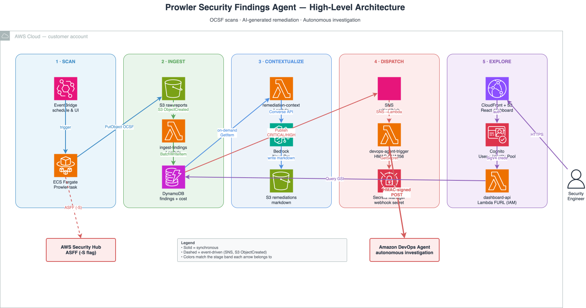

# AI-Assisted Security Triage for AWS: Prowler, Bedrock and DevOps Agent
*Continuous security scanning of your AWS account with [Prowler](https://github.com/prowler-cloud/prowler), AI-generated remediation playbooks via Amazon Bedrock (Nova Lite 2), and automated incident response through AWS DevOps Agent — all surfaced in a React dashboard.*

## Overview

Most AWS security posture tooling stops at "here's a list of 5,000 findings, good luck." This demo closes the loop:

1. **Scan** — a scheduled (and on-demand) [Prowler](https://github.com/prowler-cloud/prowler) ECS Fargate task runs against your AWS account, emitting OCSF JSON and ASFF findings to S3 and Security Hub.
2. **Ingest** — an S3 event fires a Lambda that upserts every finding into DynamoDB and triages by severity.
3. **Contextualize (on demand)** — from the dashboard, one click on a finding calls **Amazon Nova Lite 2** via the Bedrock Converse API and produces a status-aware markdown playbook (Impact / Root cause / Remediation steps with CLI + CDK snippets for FAIL; hardening or review playbooks for PASS / MANUAL).
4. **Dispatch (on demand)** — one click publishes the finding to SNS. A HMAC-SHA256-signing Lambda forwards it to your [AWS DevOps Agent](https://aws.amazon.com/devops-agent/) webhook with the Bedrock playbook embedded, so the agent starts its investigation with a remediation proposal in hand. Flip the `autoInvestigate` CDK context to `true` to fan out automatically on every CRITICAL/HIGH finding instead.
5. **Explore** — a React/Cloudscape dashboard (CloudFront + S3 + Cognito) lets you browse findings, read the AI playbook, stream the agent's investigation journal in real time, trigger scans on-demand, bulk-dispatch or bulk-generate insights for groups of findings, and suppress false positives with a reason stored in DynamoDB.

In addition, the dashboard ships a **⌘K command palette**, URL-synced filters, keyboard shortcuts, a dedicated **Investigations page** listing every DevOps Agent task dispatched from the demo, and copy-paste-ready **seeded DevOps Agent Skills** (AWS Security Remediator + Compliance Framework Translator) that line up 1:1 with the agent's Create skill form (Name, Description, Agent Type, Instructions). A **CloudWatch dashboard** is auto-provisioned as part of the deploy to surface Lambda / Bedrock / DynamoDB / Fargate health in one pane.

## At a Glance

- **Duration**: ~8 min deployment (CDK + one CodeBuild to build the Prowler image) + ~3-10 min for the first scan
- **Difficulty**: Intermediate
- **Target Audience**: Security Engineers, Cloud SecOps, DevOps Engineers, SREs
- **Key Technologies**: Prowler, AWS DevOps Agent, Amazon Bedrock (Nova Lite 2), Amazon ECS Fargate, AWS Lambda, Amazon Cognito, CloudFront, AWS CDK (TypeScript)
- **Estimated Cost**: ~$1/day idle, ~$0.50 per on-demand scan + Bedrock usage per finding you click "Generate AI Insights" on (see [Cost](#cost))

## Why not just a third-party CSPM?

This demo doesn't replace commercial CSPMs — it shows what's possible when you build on AWS-native primitives with GenAI. Prowler sends findings to Security Hub via the `-S` flag, so it complements your existing AWS security posture tooling.

| Capability | This project | Other CSPMs |
|---|---|---|
| Compliance frameworks | 8+ (HIPAA, GDPR, SOC 2, ISO 27001, NIST, CIS, PCI, FSBP) | Varies (typically 5-10, often behind a paywall) |
| Remediation guidance | AI-generated playbook with CLI + CDK code, tailored per finding | Static runbooks or generic fix suggestions |
| Autonomous investigation | DevOps Agent dispatches, investigates, reports back | None (some offer ticket creation, not investigation) |
| Data residency | 100% in your AWS account — no data leaves | Findings sent to vendor SaaS (data sovereignty concern) |
| Cost model | Pay-per-use AWS primitives (~$0.50/scan + Bedrock tokens) | Per-asset/month licensing ($5-15/workload/month typical) |
| Customization | Full source — modify checks, prompts, UI, agent skills | Limited to vendor's extension model |
| Security Hub integration | Prowler `-S` flag sends ASFF findings natively | Some support ASFF export |

**The positioning:** "This shows what's possible when you add Bedrock + DevOps Agent on top of Prowler — going from 'you have a problem' to 'here's how to fix it in 30 seconds,' without sending your security data to a third party."

## Interactive Demo

Experience this demo in an interactive click-through walkthrough:

▶️ [Launch Interactive Demo](https://app.storylane.io/demo/lxqexdsy2lyi)

## Architecture



Five stages, all inside the customer AWS account:

- **Scan** — an ECS Fargate Prowler task runs on a schedule or on demand, writing OCSF JSON findings to S3 and ASFF findings to Security Hub (via the `-S` flag).
- **Ingest** — an S3 ObjectCreated event triggers the `ingest-findings` Lambda, which parses OCSF and upserts every finding into DynamoDB, indexed by severity and status for fast dashboard queries.
- **Contextualize** — on demand from the dashboard, the `remediation-context` Lambda calls Amazon Bedrock Nova Lite 2 via the Converse API and produces a status-aware markdown playbook (Impact, Root cause, Remediation steps with bash and CDK v2 snippets for FAIL; hardening or review playbooks for PASS / MANUAL).
- **Dispatch** — clicking _Investigate_ publishes the finding to SNS, which triggers an HMAC-SHA256-signing Lambda that POSTs the incident (with the Bedrock playbook embedded) to the AWS DevOps Agent webhook. The dashboard then polls the agent's backlog tasks and journal records back through SigV4 so you can watch the investigation in real time.
- **Explore** — a React/Cloudscape dashboard (CloudFront + S3 + OAC) authenticates via Cognito User Pool + Identity Pool and calls an IAM-authenticated Lambda Function URL over SigV4. Six pages: Dashboard, Findings, Finding Detail, Compliance, Cost, Investigations. Scan history is enumerated from S3 `raw-reports/{scan_id}/` prefixes (the authoritative audit trail — the DynamoDB table is overwritten each scan).

See [`docs/ARCHITECTURE.md`](docs/ARCHITECTURE.md) for the detailed architecture, including the VPC design, IAM roles, the cost-events subsystem, and the full bi-directional DevOps Agent integration.

## Prerequisites

- **AWS CLI ≥ 2.34.21** with credentials + default region configured
- **Node.js 20+** and **npm**
- **Python 3.12+** (for Lambda packaging inspection; not required at runtime)
- **zip** utility
- **CDK bootstrap** for the target account/region. If you haven't bootstrapped yet:
  ```bash
  npx cdk bootstrap aws://<account-id>/<region>
  ```
- **Bedrock model access** — enable **Amazon Nova Lite 2** in your region via the Bedrock console (Model access > Manage model access). The demo defaults to the global inference profile `global.amazon.nova-2-lite-v1:0`, which routes to the closest supported region automatically; the base model must be enabled in the regions the profile covers (the console lets you enable them in one click).
- **AWS DevOps Agent** is available in `us-east-1`, `us-west-2`, and `eu-west-1`. If your infrastructure region is different, set `DEVOPS_AGENT_REGION` before deploying.

## Quick Start

```bash
git clone https://github.com/aws-samples/sample-aws-genai-ops-demos.git
cd sample-aws-genai-ops-demos/security/prowler-security-findings-agent

# Optional overrides
export AWS_REGION=eu-west-1
export AWS_DEFAULT_REGION=eu-west-1
export DEVOPS_AGENT_REGION=eu-west-1
# Bedrock model ID defaults to the Nova Lite 2 global inference profile
# (global.amazon.nova-2-lite-v1:0), which routes to the closest supported
# region automatically. Override only if you want a specific model or an
# on-demand (non-profile) ID.
# export BEDROCK_MODEL_ID=global.amazon.nova-2-lite-v1:0
# The scanner runs in public subnets (no NAT). If VPC Block Public Access is
# set to block-ingress in the region, deploy-all switches to private subnets
# behind a NAT gateway (~$33/month) automatically. Force either mode with:
# export SCANNER_NAT_GATEWAY=true

# Deploy
bash deploy-all.sh          # macOS / Linux
./deploy-all.ps1            # Windows / PowerShell
```

The script walks through:

1. Prerequisites check (region, CDK, AWS CLI version, zip)
2. **Interactive DevOps Agent setup** — creates the Agent Space + IAM roles, prompts you to generate a webhook URL and secret in the DevOps Agent console, then captures them and live-patches both Lambdas (trigger + dashboard-api) with the webhook URL, HMAC secret, and Space ID
3. Deploys 7 CDK stacks (everything except frontend): Data, Auth, DevOpsAgent, Scanner, Ingest, Api, Observability
4. Builds the Prowler container image via CodeBuild and pushes to ECR
5. Rebuilds the React dashboard with the CDK outputs baked in
6. Deploys the frontend stack (CloudFront + S3 + OAC)
7. Creates a default Cognito user so the dashboard is immediately usable

At the end you get the CloudFront dashboard URL and the demo login credentials printed to the console.

### Demo login

The deploy script provisions a default Cognito user for the dashboard:

- **Username**: `demo@prowler-security.local`
- **Password**: `ProwlerDemo2026!`

The email address is a synthetic non-routable value (Cognito sends no verification email because `--message-action SUPPRESS` is used). Override by exporting `DEMO_USERNAME` / `DEMO_PASSWORD` before running `deploy-all.sh`, or `$env:DEMO_USERNAME` / `$env:DEMO_PASSWORD` before `deploy-all.ps1`. The password must satisfy the Cognito policy (minimum 8 characters, at least one uppercase, one lowercase, and one digit).

To create additional users after deployment, use:

```bash
aws cognito-idp admin-create-user \
  --user-pool-id <USER_POOL_ID> \
  --username you@example.com \
  --user-attributes Name=email,Value=you@example.com \
  --message-action SUPPRESS --no-cli-pager

aws cognito-idp admin-set-user-password \
  --user-pool-id <USER_POOL_ID> \
  --username you@example.com \
  --password 'YourPass123!' \
  --permanent --no-cli-pager
```

### Trigger your first scan

1. Open the dashboard URL and sign in.
2. On **Dashboard**, click **Run scan now**. The Fargate task starts; first-time pulls of the Prowler image take ~90s.
3. Findings arrive in 3-10 minutes depending on account size.
4. Open **Findings** → click any CRITICAL/HIGH item → press **Generate AI Insights** to produce the Bedrock-generated playbook on demand (shown in the Overview tab).
5. From the same finding, press **Investigate with DevOps Agent** to dispatch a single incident to the Agent. The Investigation tab streams backlog task status and journal records live; the Agent Operator console shows the full reasoning trace.

## CDK Stacks

All stack IDs include the region suffix for multi-region deployments.

| Stack | Purpose | Key Resources |
|---|---|---|
| `ProwlerSecurityData-{region}` | State | DynamoDB `prowler-security-findings` (PK `finding_uid`, GSIs `severity-index` + `status-index`), S3 raw-reports + remediations buckets |
| `ProwlerSecurityAuth-{region}` | Auth | Cognito User Pool + Identity Pool + authenticated IAM role |
| `ProwlerSecurityDevOpsAgent-{region}` | Agent webhook | SNS topic, HMAC-SHA256 Lambda, Secrets Manager secret |
| `ProwlerSecurityScanner-{region}` | Prowler | ECR repo, CodeBuild image build, ECS cluster + Fargate Task Definition (SecurityAudit + ViewOnlyAccess), EventBridge schedule; with `eventScans`, the event-scan rules, SQS queues and trigger Lambda |
| `ProwlerSecurityIngest-{region}` | Pipeline | `ingest-findings` Lambda (S3-triggered), `remediation-context` Lambda (Bedrock Converse / Nova Lite 2) |
| `ProwlerSecurityApi-{region}` | Dashboard API | `dashboard-api` Lambda with IAM-auth Function URL (SigV4 from browser). Routes findings, scans, cost events, investigations, suppressions, insights |
| `ProwlerSecurityObservability-{region}` | Metrics | CloudWatch Dashboard stitching Lambda invocations, Bedrock tokens, DynamoDB RCU/WCU, and Fargate scan runs into one pane |
| `ProwlerSecurityFrontend-{region}` | Dashboard | CloudFront + S3 website + OAC |

## Event-driven scans (opt-in)

Scheduled and on-demand scans report what was wrong when they ran. Event-driven scans re-check the resource a risky API call touched, a few minutes after the call. This is a do-it-yourself take on [Prowler Realtime](https://docs.prowler.com/user-guide/tutorials/prowler-cloud-realtime), which is a Prowler Cloud feature (added in 5.48.0) and not part of the open-source CLI this demo runs. It only detects and records; it does not remediate. It is off by default.

```bash
export EVENT_SCANS=true          # deploy-all passes -c eventScans=true to CDK
bash deploy-all.sh
```

Deploying with the CDK directly works too: run `npx cdk deploy --exclusively ProwlerSecurityScanner-{region} ProwlerSecurityIngest-{region} -c eventScans=true`, keep the `-c` flags of your previous deploy (for example `-c scannerNatGateway=true`), and rebuild the scanner image with `scripts/build-scanner-image.sh` so the task understands `SCAN_MODE=event`.

**Requirement: a CloudTrail trail.** EventBridge only receives `AWS API Call via CloudTrail` events when the account has a trail with logging on that records write management events in the region (`aws cloudtrail describe-trails`, then `aws cloudtrail get-trail-status --name <trail>` should show `IsLogging: true`). IAM calls and S3 account-level Block Public Access calls are delivered to `us-east-1` only, so those rules fire only when the demo is deployed in `us-east-1`.

**How it works.** One EventBridge rule per row below sends matching calls (successful ones only) to an SQS queue. The `prowler-security-event-scan-trigger` Lambda reads what the queue collected over a 60-second batching window, resolves the resource each call touched, and coalesces the batch into one Fargate task per scan group. The task runs the existing task definition with container overrides (`SCAN_MODE=event`), which run `prowler aws --checks <ids> --resource-arn <arns>` with the scanner's own subnets and public IP setting. The rules, check IDs and resolvers live in [`cdk/lambda/event-scan-trigger/rules.json`](cdk/lambda/event-scan-trigger/rules.json).

| CloudTrail calls | Scanned resource | Prowler checks |
|---|---|---|
| `AuthorizeSecurityGroupIngress`, `ModifySecurityGroupRules`, `RevokeSecurityGroupIngress` | Security group, plus its VPC | 20 `ec2_securitygroup_*` checks: internet ingress to all ports, any port, any port from an IP, high-risk ports, 22, 3389 and 12 database or service ports, wide-open IPv4, default group restricts traffic |
| `PutBucketPolicy`, `DeleteBucketPolicy`, `PutBucketAcl`, `PutBucketPublicAccessBlock`, `DeleteBucketPublicAccessBlock` | S3 bucket | `s3_bucket_public_access`, `s3_bucket_policy_public_write_access`, `s3_bucket_public_write_acl`, `s3_bucket_public_list_acl`, `s3_bucket_level_public_access_block`, `s3_bucket_cross_account_access` |
| `PutAccountPublicAccessBlock`, `DeleteAccountPublicAccessBlock` | Account S3 Block Public Access | `s3_account_level_public_access_blocks` |
| `AttachUserPolicy`, `DetachUserPolicy` | IAM user (ARN with path) | `iam_user_administrator_access_policy` |
| `AddPermission*`, `RemovePermission*`, `CreateFunctionUrlConfig*`, `UpdateFunctionUrlConfig*` | Lambda function (unqualified) | `awslambda_function_not_publicly_accessible`, `awslambda_function_url_public`, `awslambda_function_url_cors_policy` |
| `ModifyDBInstance` (held 10 minutes) | Every RDS instance in the event's region | `rds_instance_no_public_access` |

The revoke and delete calls are included so a fix shows up as **Fixed** without waiting for the next full scan.

**Where partial reports land.** An event scan writes `event-reports/{scan_id}/{account}.ocsf.json`, with a scan ID such as `20261125T193512Z-event-ec2-securitygroup-1a2b3c`, never `raw-reports/`. The Dashboard scan history lists `raw-reports/` prefixes, so it keeps showing full scans only; event reports expire with the bucket's 90-day lifecycle rule like full ones. Ingest upserts the reported findings by `finding_uid`, which is the same check and resource as in a full scan, so their status, status history (New, Fixed and Regressed badges), `last_seen_at` and `scan_id` update. Findings missing from a partial report are left untouched, since ingest has no "missing means resolved" step. Event runs pass `-S --skip-sh-update` so Security Hub gets the re-checked findings; without `--skip-sh-update` Prowler would archive every Prowler finding the partial run did not report. Because a finding's `scan_id` names the last scan that saw it, filtering Findings by a full scan's ID leaves out findings re-checked since.

**Limitations.**

- `--resource-arn` filters every resource Prowler loads, not just the one being checked. Security group checks skip a group whose VPC is filtered out, so the trigger adds the VPC ARN. They also skip groups with no network interface, as full scans do, so a new unattached group produces no finding.
- `rds_instance_no_public_access` reads the instance's security groups and subnets, which an ARN-scoped run would filter out, and Prowler drops RDS checks when RDS and EC2 ARNs share a run. RDS events therefore run that check for the whole region. `ModifyDBInstance` applies changes asynchronously, so a delay queue holds RDS events for 10 minutes; a change that takes longer is picked up by the next scheduled scan.
- Calls whose checks would not reflect the change are not mapped: access-key and console-login checks read the IAM credential report, which IAM regenerates at most every 4 hours (`CreateAccessKey`, `CreateLoginProfile`), and Prowler drops inline-policy checks when the scan targets a user ARN (`PutUserPolicy`).
- While an event scan runs (about 2 minutes), the Dashboard lists it under running scans and disables **Run scan now**.
- The mapping was verified against Prowler 5.52.0 (`prowlerVersion` in `rules.json`). Before the scanner image moves to another Prowler version, install that version locally and run the trigger tests. With Prowler installed they also check that every mapped check exists, that it survives Prowler's ARN-based check selection, and that `prowlerVersion` matches; bump it once the rest passes:

  ```bash
  cd cdk/lambda/event-scan-trigger
  python3 -m unittest discover -s tests   # needs boto3; install prowler to run the compatibility tests
  ```

## Project Structure

```
prowler-security-findings-agent/
├── README.md
├── deploy-all.sh / deploy-all.ps1
├── cdk/
│   ├── bin/app.ts
│   ├── cdk.json, package.json, tsconfig.json
│   ├── lib/
│   │   ├── data-stack.ts
│   │   ├── auth-stack.ts
│   │   ├── devops-agent-stack.ts       ← mirrors observability/eks-investigation-devops-agent
│   │   ├── scanner-stack.ts
│   │   ├── event-scan-trigger.ts        ← opt-in event-driven scans (EventBridge → SQS → Lambda → RunTask)
│   │   ├── ingest-stack.ts
│   │   ├── api-stack.ts
│   │   ├── observability-stack.ts       ← CloudWatch Dashboard
│   │   └── frontend-stack.ts
│   └── lambda/
│       ├── _shared/                     ← common helpers (cost logging, OCSF parsing)
│       ├── ingest-findings/index.py
│       ├── remediation-context/index.py
│       ├── devops-agent-trigger/index.py
│       ├── event-scan-trigger/          ← index.py, rules.json (event → checks mapping), tests/
│       └── dashboard-api/index.py
├── scanner/
│   ├── Dockerfile                      ← FROM toniblyx/prowler
│   └── entrypoint.sh                   ← prowler aws --output-formats json-ocsf -S
├── scripts/
│   ├── setup-devops-agent.sh / .ps1
│   ├── build-scanner-image.sh / .ps1
│   ├── build-frontend.sh / .ps1
│   └── cleanup.sh / .ps1
├── frontend/
│   ├── index.html, package.json, vite.config.ts, tsconfig.json
│   └── src/
│       ├── main.tsx, App.tsx, auth.ts, api.ts, AuthModal.tsx, constants.ts, theme.ts, frameworks.ts
│       ├── CommandPalette.tsx           ← global ⌘K navigation + actions
│       ├── KeyboardShortcuts.tsx        ← j/k/?/g* navigation
│       ├── status-history.ts            ← per-finding timeline persisted in IndexedDB
│       ├── agent-skills.ts              ← seeded DevOps Agent skills (copy-paste-ready)
│       └── pages/
│           ├── Dashboard.tsx
│           ├── Findings.tsx              ← URL-synced filters + bulk actions + group-by-check
│           ├── FindingDetail.tsx
│           ├── Compliance.tsx
│           ├── Cost.tsx
│           └── Investigations.tsx        ← DevOps Agent backlog + seeded skills library
└── docs/
    ├── ARCHITECTURE.md
    ├── architecture-overview.drawio          # AWS-shape high-level pipeline
    ├── architecture-overview.drawio.svg
    ├── architecture.drawio                   # detailed view with VPC + IAM + cost subsystem
    └── architecture.drawio.svg
```

## How it maps to other demos in this repo

This demo was built to slot cleanly next to the existing patterns:

- **DevOps Agent webhook** (`cdk/lib/devops-agent-stack.ts` + `cdk/lambda/devops-agent-trigger/index.py`) is an adaptation of [`observability/eks-investigation-devops-agent`](../../observability/eks-investigation-devops-agent/), replacing CloudWatch-alarm payloads with Prowler OCSF findings.
- **React/Cloudscape dashboard** follows [`operations-automation/ai-lambda-runtime-migration`](../../operations-automation/ai-lambda-runtime-migration/): Cognito User Pool → Identity Pool → SigV4 → IAM-authorized Lambda Function URL (instead of AgentCore Runtime).
- **Shared tooling**: `shared/scripts/check-prerequisites.sh` and `shared/utils/aws-utils.sh` are used verbatim for region detection and prereq validation.

## Cost

All costs approximate, `us-east-1` pricing.

### Idle (~$1/day)

| Resource | Note | $/month |
|---|---|---|
| DynamoDB | On-demand | ~$0.25 |
| S3 | <1 GB total | <$0.10 |
| CloudFront + Cognito | Minimal traffic | ~$1 |
| ECR image | 1 GB image stored | ~$0.10 |
| Secrets Manager | 1 secret | $0.40 |
| NAT gateway | Only when `SCANNER_NAT_GATEWAY=true` or VPC Block Public Access is `block-ingress` | ~$33 + data |

### Per scan (~$0.50 + Bedrock usage)

- Fargate task: 1 vCPU, 2 GB RAM, ~5 min runtime → ~$0.02
- **Nova Lite 2 remediation** (Converse API, 1 call per finding you click "Generate AI Insights" on): ~$0.0002–0.001 per finding depending on OCSF size
- CodeBuild: only runs on image rebuilds

### Event-driven scans (opt-in, ~$0.002 per scan)

Nothing is added while the account is quiet: the EventBridge rules, SQS queues and trigger Lambda have no idle cost, and EventBridge does not charge for AWS management events delivered to targets in the same account. Each coalesced batch starts one short Fargate task (about 2 minutes, ~$0.002). With `SCANNER_NAT_GATEWAY=true`, every task also pulls the ~0.5 GB scanner image through the NAT gateway, about $0.02 of NAT data processing per scan. The Cost page logs each event scan that uploads a report at the same $0.02 estimate as a full scan. A trail's first copy of management events is free; you pay only for its S3 storage.

### DevOps Agent usage

Per the [DevOps Agent pricing](https://aws.amazon.com/devops-agent/pricing/) — charged per investigation hour. The webhook simply enqueues incidents; cost depends on how much the agent actually investigates.

## Cleanup

```bash
bash scripts/cleanup.sh        # macOS / Linux
./scripts/cleanup.ps1          # Windows
```

Destroys all 8 stacks in reverse dependency order and (after confirmation) deletes the DevOps Agent Space and its IAM roles.

## Troubleshooting

| Problem | Cause | Fix |
|---|---|---|
| `The provided model identifier is invalid` or `isn't supported` when calling Converse | Model access not enabled in the inference-profile regions | Enable Nova Lite 2 in Bedrock console > Model access > Manage across the regions the selected profile covers (the `global.*` profile spans all supported regions — the console has a one-click enable). |
| CodeBuild fails to pull `toniblyx/prowler` | Docker Hub rate limits | Re-run `bash scripts/build-scanner-image.sh`; or switch to an ECR Public mirror in `scanner/Dockerfile`. |
| Fargate task fails with `AccessDenied` on S3 | Bucket region mismatch | Confirm `RawReportsBucket` is in the same region as the scanner task; rerun `deploy-all.sh`. |
| DevOps Agent never receives incidents | Webhook URL/secret still placeholders | Run `bash scripts/setup-devops-agent.sh` — it live-updates the deployed Lambda and Secrets Manager. |
| Dashboard returns 403 calling the API | Authenticated role missing `lambda:InvokeFunctionUrl` | Redeploy `ProwlerSecurityApi-{region}` and `ProwlerSecurityAuth-{region}`. |
| Investigations tab shows "Space ID not set" after a `cdk deploy` | CDK context lost when deploying without `-c devOpsAgentSpaceId=...` (CDK rewrote the Lambda env var to `""`) | Re-run `bash scripts/setup-devops-agent.sh` to live-patch the dashboard-api + trigger Lambdas, or always pass the `-c devOpsAgent*` flags to `cdk deploy`. |
| `SSM parameter /cdk-bootstrap/... not found` | CDK not bootstrapped | `npx cdk bootstrap aws://<account>/<region>` once. |

## Design decisions

### Why direct Converse (Nova Lite 2) instead of AgentCore Runtimes?

The [`ai-lambda-runtime-migration`](../../operations-automation/ai-lambda-runtime-migration/) demo is the canonical example of multi-step AgentCore Runtimes. Here, the "agent" loop is already provided by AWS DevOps Agent itself — Bedrock's role is a single contextualization step per finding. A Converse API call with a constrained system prompt is the cheaper, lower-latency option.

### Why a Lambda Function URL (not API Gateway)?

Same reason the runtime-migration demo does not have API Gateway: fewer moving parts, lower idle cost, and direct SigV4 auth against IAM using credentials the Identity Pool already mints for the browser.

### Why ECS Fargate for Prowler (not Lambda)?

Prowler scans a medium-sized account in 3–10 minutes — too long for Lambda's 15-minute hard limit when scanning multiple regions, and awkward to package with its dependencies. Fargate runs the official `toniblyx/prowler` image as-is.

## Contributing

See [CONTRIBUTING.md](../../CONTRIBUTING.md).

## Security

See [CONTRIBUTING](../../CONTRIBUTING.md#security-issue-notifications).

## License

MIT-0. See [LICENSE](../../LICENSE).
